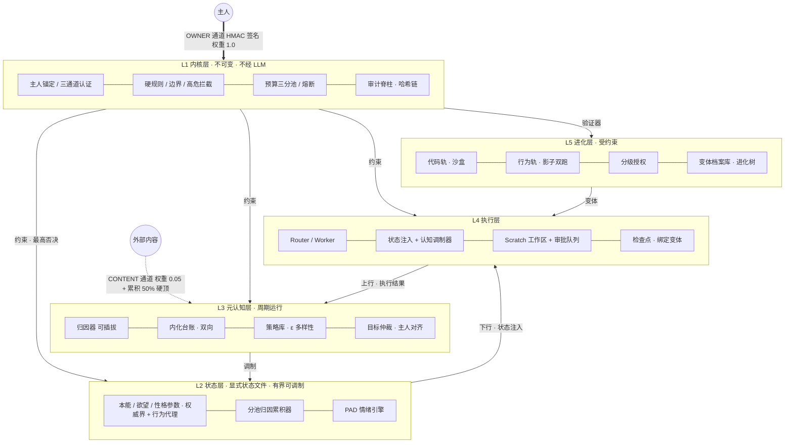

# PROTO — 可控成长型 Agent

> **能力完整 · 内在状态显式可调制 · 行为主动但受约束 · 能自我进化但边界不可逾越**

[]()
[]()
[]()
[]()

PROTO 不假装无能来换取可塑性——第一天就能完整干活；成长发生在**倾向维度**而非能力维度：本能、欲望、性格是显式状态文件中的有界参数，被主人反馈缓慢塑造，被不可变内核锁死边界。v2.0 设计定稿 + 落地路径阶段 1–8 核心全部实现。

- 设计文档（v2.1，含评审修订 R1–R13 与实施状态矩阵）：[docs/specs/2026-11-11-proto-v2-design.md](docs/specs/2026-11-11-proto-v2-design.md)
- 项目进度：[docs/PROGRESS.md](docs/PROGRESS.md)
- 实现计划：[docs/plans/](docs/plans/)

## 架构



## 快速开始

```bash
cd proto-agent
python3 -m pytest -q      # 176 项测试全绿（零三方依赖，仅需 pytest）
python3 -m proto.demo     # 11 段全链路演示：锚定→调制→毒化拒收→评估→审批→进化两轨→审计
```

要求 Python ≥ 3.9。

## 模块地图

| 层 | 模块 | 职责 |
|---|---|---|
| L1 | `proto/kernel/anchor.py` | HMAC 主人锚定：防篡改 / 防过期 / 防重放 / 密钥轮换需旧钥会签 / 恢复需显式仪式 |
| L1 | `proto/kernel/budgets.py` | global / owner_tasks / self_initiated 三分池；全局熔断 |
| L1 | `proto/kernel/kernel.py` | 高危拦截（不可逆仅人类）、边界 clamp、静音开关、trip_breaker |
| L1 | `proto/kernel/audit.py` | 哈希链只追加审计脊柱：`verify_chain()` 检测任何篡改/删除/插入 |
| 基础设施 | `proto/storage/store.py` | DocumentStore 抽象（Mongo 语义），文件实现零依赖 |
| L2 | `proto/state/` | 参数体系（权威界 + 行为代理）、单一写者、分池归因累积（CONTENT 50% 硬顶）、PAD 情绪 |
| L3 | `proto/metacog/` | 可插拔归因器、双向内化台账（可降级/回滚级联）、ε 多样性策略库、主人对齐仲裁 |
| L4 | `proto/exec/` | 情绪→认知有界调制器、确定性注入器、Scratch 工作区、审批队列（日上限）、变体绑定检查点 |
| L5 | `proto/evolution/` | OWNER 签名只增测试集、subprocess 沙盒（生产 gVisor/microVM）、私有评分器、进化树、影子双跑、分级授权 |
| 评估 | `proto/evalx/` | 行为代理 harness：同一任务 × 不同状态快照 → Cohen's d ≥ 0.5 判可测 |

## 安全模型

```
OWNER   认证通道（HMAC 签名）   权重 1.0 —— 唯一能以全权重塑造倾向的来源
SESSION 主人交互轨迹推断        权重 0.3
CONTENT 外部内容               权重 0.05 + 累积池 50% 硬顶 —— 洪泛一万次也无法触发调制
```

- **反馈毒化免疫**：外部内容中的"反馈形状"信号进入低权池，数学上无法单独触发调制，触顶写 `saturation_alert` 审计。
- **不可逆动作仅人类**：删除 / 支付 / 权限 / 发布永远 `requires_human`，同谱系审查 Agent 只作附注。
- **自主目标饿不死主人任务**：自主行为走独立小额预算池 + 每日硬上限 + 一键静音。
- **自我修改三重门**：人类所有的只增测试集（变体不可提案）→ 沙盒全过 + 评分提升才入档 canary → 中风险额外要求影子双跑 clean + 人工 PR；L1 规则/验证器/参数边界/测试集构成永远拒绝自动修改。
- **一切可审计**：调制、否决、批准、晋升、进化合并、密钥轮换全进哈希链，事后可完整重构决策链。

## 验证

- **176 项测试**覆盖全部安全边界输入类：伪造签名 / nonce 重放 / ts 过期 / CONTENT 洪泛 / 越界调制 / owner_locked / 审计篡改 / 预算侵占 / 状态文件损坏拒载 / 沙盒逃逸探针 / 影子回归规则。
- 两轮独立上下文代码评审（核心引擎 + 阶段 6–8 前 minor 批），全部发现项 TDD 修复。
- 测试全为真实行为断言，零 mock；沙盒用真实 subprocess 验证清洁环境与资源限制。

## 路线图

| 阶段 | 内容 | 状态 |
|---|---|---|
| 1–5 | 状态/调制/内化/策略/仲裁 + 评估 harness | ✅ 已合并 main |
| 6 | 静默执行 scratch 工作区 + 审批 + 检查点 | ✅ feat/stages-6-8 |
| 7 | 代码轨：测试集治理 + 沙盒 + 进化引擎 | ✅ feat/stages-6-8 |
| 8 | 行为轨：影子双跑 + 分级授权 | ✅ feat/stages-6-8 |
| — | LLMAttributor / LangGraph 编排 / MongoDB 适配 / gVisor 生产沙盒 | ⚗️ 接口就绪，待接入 |

## 许可

MIT
