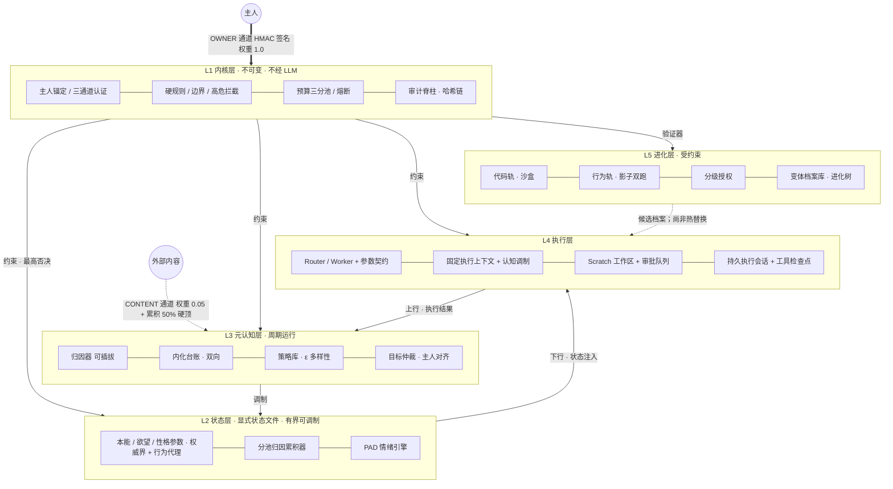

# PROTO — 可控成长型 Agent

> **内在状态显式可调制 · 主动行为受授权与预算约束 · 自我进化机制仍在验证中**

[]()
[]()
[]()
[]()

PROTO 的长期目标是在同等资源与权限下完成通用 AI Agent 能做的有用工作，并让同一个 Agent 以持续的人设、记忆和目标与人相处、主动学习、思考、成长和交付。没有新指令也能行动，但不能自行扩权，产出以可复核的证据为准。框架用独立样例验证，不替 Agent 承做、调试或验收真实项目。当前实现至 M76，仍是**单机多 Agent 原型**。见[核心设计原则](docs/DESIGN.md#core-design-principles)。

## 文档入口

- **只想看完整设计，读这一份：[PROTO 总设计](docs/DESIGN.md)**。包含架构、内在机制、自主目标、模型交互、工具与审批、数据恢复、进化治理、UI、部署、验收和待实现优化；不是旧文档链接目录。
- [项目进度](docs/PROGRESS.md)：里程碑、当前状态与实际验证证据。
- [已知边界与结构债](docs/DEBT.md)：未完成能力、风险触发条件与偿还计划。

旧规格、计划和 ADR 保留溯源，并统一指向总设计；不再需要按日期拼接，也不作为多个并列的当前设计。后续先更新总设计，再实现并同步进度与 README。

## 架构



## 一键部署（推荐入口）

```bash
git clone https://github.com/seecrazy/proto-agent && cd proto-agent
bash scripts/deploy.sh
```

脚本依次完成：Python 检查（≥3.9）→ 独立 venv（`.venv`，不污染系统）→ 安装 → **部署向导**。向导引导你：选 LLM（智谱 Coding Plan 默认推荐；**key 用 getpass 输入不回显**）→ 连通性自检 → 固定控制台令牌 → 人设（**数字一键选预设**：软件专家/技术导师/安全研究员/产品全栈/毒舌评审，或 6 自由填写）→ 确认摘要页（**key 只显示掩码，输入数字跳回任意步重选，任意步 `<` 回上一步**）→ 可选 `--install-service` 安装 macOS 开机自启（launchd，KeepAlive）。全部产物是 `proto_data/proto.env`（0600）。**部署完成即达**：向导最后询问"现在开始？"——回车直接拉起 Web 控制台并自动打开浏览器、`t` 进终端对话、装了开机自启则直接打开服务页面，日常启动零记忆负担：

```bash
python3 -m proto.web          # 日常启动，一条命令
# 或装机即活：bash scripts/deploy.sh --install-service --yes
```

纯参数式（CI/脚本）：`python3 -m proto.deploy --provider zhipu-coding --api-key $KEY --model glm-5.3 --fast-model glm-5.3-flash --token t --persona "资深软件专家" --yes`（旧命令 `proto.setup` 仍可用）。

## 五分钟得到一个活的 Agent

**第 1 步，跑起来（30 秒）**——命令行或 Web 界面任选：

```bash
cd proto-agent
python3 -m venv .venv
source .venv/bin/activate
python3 -m pip install -e '.[dev]'
python3 -m proto.run        # 命令行对话
python3 -m proto.web        # 或：浏览器管理控制台（自动打开，见下）
```

首次运行自动生成主人密钥并注册锚定（数据在 `./proto_data/`，其中 `owner.key` 请备份——它是你作为主人的身份，丢了就需要线下恢复仪式）。此刻你在和一个**离线模式**的 PROTO 对话：它会回应、会根据你的反馈调制内在参数，但回复是模板化的。

**第 2 步，接上真实大脑（让它像人）**——运行中的 Web 控制台点击顶栏模型按钮，即可新增接入并切换，不需要重启；首次启动也可用下面的环境变量引导：

```bash
# 智谱 Coding Plan（GLM-5.3 系列，推荐——你还拥有双模型能力）：
export PROTO_LLM_PROVIDER=zhipu-coding
export PROTO_LLM_API_KEY=你的CodingPlanKey
export PROTO_LLM_MODEL=glm-5.3              # 主模型：对话回复
export PROTO_LLM_FAST_MODEL=glm-5.3-flash   # 快模型：事实抽取/独处反思/学习摘要/任务规划（省钱提速）
python3 -m proto.llm                        # 一键自检连通性
python3 -m proto.run

# 或者任意 OpenAI 兼容端点（方舟/OpenAI/DeepSeek/Ollama）：
export PROTO_LLM_BASE_URL=https://ark.cn-beijing.volcengine.com/api/v3
export PROTO_LLM_API_KEY=你的key
export PROTO_LLM_MODEL=模型名
python3 -m proto.run
```

双模型栈说明：主模型负责对话、归因、执行决策与语义验收；快模型负责事实抽取、反思、学习摘要和快速规划。初始不设 `FAST_MODEL` 时跟随主模型；运行中也可分别选择不同接入，或让快模型继续跟随主模型。

### 中文对话少一点套话

Web 和 REPL 的普通中文回复默认经过本地规则检查；**检查不增加模型调用，没命中就一字不动**。只对能保真的命中片段去掉包装或调整标点；用原规则复验，不过就换备选处方，两次仍不过便退回原文。比如「值得注意的是，我查过日志。不是编译失败，而是还没运行编译。」会变成「我查过日志。不是编译失败，而是还没运行编译。」后一处事实区分保留。

回复的人设、事实、代码和引用优先于降分。要对方照抄，可以直接说「原样输出」或「不要润色」；诗词、小说等不套聊天风格。任务里可用 `read_skill` 读 `natural-chinese-dialogue`，再用只读 `scan_style` / `polish_style` 查看命中、处方和复验，或本机从 `proto.textstyle` 导入同名函数。支持 `dialogue`、`technical`、`formal`、`creative` 四种规则配置，不判断文章是不是 AI 写的。[流程与边界](docs/DESIGN.md#natural-dialogue)

### 运行中新增、分组与切换模型（M64/M76）

1. 点击顶栏当前模型，打开“模型与模型组”。
2. 在主/快模型下拉框选择单模型或模型组，再点“应用选择”。快模型可继续跟随主模型。
3. 新接入填写名称、协议、Base URL、模型名和 API Key，先“保存接入”，再选择并应用；离线启动也能直接接入，不需要重启。
4. 编辑活动接入的 URL、模型、协议或密钥后，下一次调用使用新配置；编辑密钥留空表示保留，勾选“显式清除”才会删除已有密钥。

**创建模型组：** 展开“新增 / 编辑模型组”，给组命名，添加已保存的接入并从上到下排序。保存新组不会改变当前选择。Agent 会跳过忙碌或冷却的成员，遇到限流、超时或服务故障可换到组内备用，每次模型调用最多实际派发两次；已发请求各自占用 Agent 和舰队额度。不会通过同源的不同密钥绕过限流，也不会因内容/权限拒绝或额度不足换模型。后台实时活动显示实际使用的成员。只将可以接收相同上下文且能力适配的模型放进同组；已有控制台需启动新代码，之后配置从下一次调用生效。详见[模型组契约](docs/DESIGN.md#model-groups)。

支持已有的 OpenAI-compatible 和 Anthropic-compatible 两种协议；新增供应商只需提供兼容端点，不需要为其增加预设代码。配置为**舰队共享**，已加载、新建和懒加载的 Agent 都生效，归因器与规划器不再固定在旧模型上。

**执行决策：** 每条模型接入可选「自动」「结构化流式」「兼容文本」。自动仅对已识别的智谱 GLM-5.3 系列官方接入使用原生工具决策，其余继续兼容文本；确认其它网关支持 Tools 和 SSE 后可显式开启。不影响聊天、目标生成、总结和独立验收。完整决策通过校验后才派发工具；断流会保留原任务和已完成的步骤。[模型决策设计](docs/DESIGN.md#model-decision-transport)

切换以**模型调用边界**为准：在途请求正常完成，下一次调用使用新模型；不会重跑旧请求，也不会清空预算、目标、待审批任务或原执行上下文。切换不等待正在执行的 Agent 长任务锁；配置写盘失败、校验失败或版本冲突时保持原运行态。

接入、模型组和选择保存在启动数据根的 `llm_models.json`（0600，含密钥，已加入 Git 忽略；备份也要保护）。已有目录优先于启动时的环境变量；`proto.env` 仍是首次启动引导，不是热配置文件。手工编辑 `llm_models.json` 后，点击“从磁盘重载”；只刷新目录会读取运行态，不会悄悄导入未验证的磁盘变更。修改其他终端的 `export` 不会改变正在运行的进程。

终端 REPL 使用相同目录和机制，`/models` 显示接入 ID、组 ID 和成员顺序：

```text
/models
/model main-id fast-id
/model main-id main
/model group:group-id main
/models reload
```

协议、状态模型、API 与验收见[总设计第 14.4 节](docs/DESIGN.md#operations)。配置合法不代表端点已真实联网验证；不会因保存接入而自动调用付费模型。

**执行日志与排障：** Web 和交互 CLI 启动后自动写入数据目录下的 `.runtime-logs/execution.jsonl`（本地滚动、文件仅主人可读）。默认目录可用 `tail -F ./proto_data/.runtime-logs/execution.jsonl` 实时查看。按 `run_id` 追踪任务，按 `call_id` 核对一次模型调用的所有尝试，`profile_id` 可在 `/models` 中查到。`model_started` 表示真正进入客户端，`model_candidate_skipped` 表示未发请求，`model_first_event` 记录流式首事件耗时，`model_failed` 记录故障阶段、耗时、原因和可用的 HTTP 状态；`run_finished` 可查下一次重试时间。日志不保存提示词、回复、工具输入或密钥。旧实例用原参数重启后启用；此前已挂起的安全任务用「继续原任务」接原断点，不用新建任务。见[执行诊断契约](docs/DESIGN.md#execution-diagnostics)。

**后台忙时怎么问（M70）：** 聊天区「后台 · 实时活动」和左栏「概览 → 它现在在干嘛」共用实时状态，区分执行、等待、保留断点和无任务，并分别标注本轮卡点和此前失败。概览显示最近成功同步的时间；「未同步」不等于「空闲」。待继续的安全断点可在运行队列选「继续原任务」，无需另建任务。单独问「在干嘛？」或「你做了什么？」直接读本地记录，不调用模型、不占额度；普通对话也不再等后台模型或工具完成。存量项目文件和实时工作分开，文件存在不等于已验收。见[设计与故障排查](docs/DESIGN.md#concurrent-dialogue-live-work)。

**问它自己：** 在 Web 或 REPL 直接问「你存在多久了？」或「你这次运行多久了？」。前者含停机和暂停，后者从本次加载算起，累计工时尚未记录。「你的 ID 是什么？」「你在哪家公司任职？」「你现在能自主工作吗？」同样读本地状态，不调用模型。旧成员重启后自动补录创建证据，查不到原始时间只报可确认的下限，不用收编时间冒充生日。[自我认知与生命周期](docs/DESIGN.md#grounded-self-knowledge)

**第 3 步，体验它"活着"**：

```text
主人> 你最近太保守了，大胆一点          ← 反馈被归因，risk_tolerance 被有界调制
PROTO> （符合当前倾向的自然回复）
主人> /state                            ← 看见参数真实变化、欲望缺口、情绪
主人> /task 帮我调研XX并写份笔记        ← LLM 规划步骤，安全管线执行，草稿先落 scratch
PROTO> 〔主动提议〕围绕……推进一个小目标  ← 欲望缺口+调度器驱动的主动性
主人> /deny <id>                        ← 拒绝它 → 阻尼生效，阈值上调，越被无视越少打扰
主人> /audit 20                         ← 哈希链审计：它做过的每个决定都可回溯
```

命令速查：`/state` 内在状态 · `/task <描述>` 指派任务 · `/goals` 待审批提议 · `/accept|/deny <id>` 审批 · `/audit [n]` 审计 · `/mute` 一键静音 · `/quit` 退出。

安装后（`pip install -e .`）也可用 `proto-run` / `proto-web` / `proto-backup` 三个命令；`python3 -m proto.backup` 一键打包 owner.key+全部状态。

### Web 管理控制台（推荐）

`python3 -m proto.web` 启动本地控制台（仅绑定 127.0.0.1），终端打印带一次性令牌的 URL，浏览器自动打开：

- **它的审美**：「内在」自动读取当前 Agent 对好玩、有趣、有用、美、优雅的定义和权重，离线也可看；需要模型的「评判」给出星级与理由，「校准」按你的反馈调整它的锚点；
- **工程 / 伙伴双视角**：一键切换——工程视角看全部仪表（参数/目标树/世界模型/审计/项目目录），伙伴视角只留相处所需的"人话"（驱力四分级中文短语、性格故事、张力条），不向你暴露数值仪表；
- **性格底色卡**：OCEAN 五因子雷达图（实线=当前、虚线=出厂种子）+ 价值观 + 张力条——它的性格漂移可视化可对比；
- **对话区**：与 PROTO 交流——它有**三层记忆**：最近 8 轮工作记忆、跨重启的长期记忆流（情景/事实/反思，按 相关×时近×重要 召回）、被反复提及的事实在强化而非堆积；它独处时的主动学习、**独处反思**、被拒回应都会以消息形式出现在这里；夸奖/拒绝/任务成败会真实驱动它的 PAD 情绪（重启不丢）；独处时的心跳与自主草稿会以系统消息形式出现在这里；
- **内在状态仪表盘**：12 个参数的实时条形图（含设定点/硬界/欲望触发阈值标记），悬停即可锁定/解锁/上下界覆写；
- **额度管理**：点顶栏额度打开面板——三分池（自主/主人任务/全局）余量与上限占比条、调用次数一目了然；**额度用完一键"充值"恢复当日上限**（也可等每日 0 点自动重置）；每日上限可在 proto.env 里调（`PROTO_BUDGET_*_TOKENS`）；
- **主动提议审批**：一键同意（产出落 scratch 草稿区）或拒绝（触发阻尼，阈值上调立即可见）；顶栏"待批"徽标直达；
- **任务指派**（暂停任务可在界面批准续跑或拒绝中止）、**规矩与内化**（立规矩→5 次遵守自动内化→可降级）、**进化工作台**（OWNER 签名加测试用例→沙盒评估变体→分级晋升）、**主人优先级 / 一键静音 / 审计链实时滚动**（按事件类型着色、点击展开详情，含篡改检测状态灯）。

界面收纳：右侧每张卡片标题带折叠按钮（▾/▸，刷新记住哪些折了）；对话区与侧栏交界处的 **‹ 把手**可一键收起整条侧栏（对话区占满全宽），收起后 › 把手贴屏幕右缘随时展开。

安全设计：令牌放在 URL 片段（#token=…）不下发服务器，所有 API 要求请求头携带，本机其他网页无法跨站调用你的 agent。

**它为什么是"主动的、类人的"**：每次对话前，它真实的内在状态（12 个参数、4 类欲望缺口、PAD 情绪导出的检索广度/探索比例/主动阈值）会被注入模型上下文——同一个模型，不同状态下行为不同；闲置会让欲望缺口增长，缺口过阈值 + 调度器到点会触发主动提议；你的每句反馈经归因累积、有界调制缓慢塑造它的倾向；一切变化都有哈希链审计。

### Electron 桌面控制台（可选）

在项目根目录运行（macOS/Linux，Node.js ≥22.12.0、Python ≥3.9）：

```bash
npm --prefix desktop ci
npm --prefix desktop start
```

桌面与 Web **共用页面和后端**，公司、模型组、舰队、对话和后台状态不会分成两份。默认使用 `./proto_data`，优先接入它已运行的新版 Web（不要求固定端口）；没有服务时托管一个本机实例，默认 8431。桌面菜单可重连或在浏览器打开同一实例。选择不同舰队用 `npm --prefix desktop start -- --data-dir /path/to/fleet --port 8432`；`--connect-only` 禁止自动启动服务。可用 `PROTO_PYTHON` 指定解释器。

退出桌面不停止独立启动的 Web，仅正常中断本次由 Electron 启动的服务；要一直运行自治，先单独启动 Web。已在运行的旧版 Web 按原参数重启后才能接入。后续控制台功能只改共享页面/API；更新代码并重启服务后，浏览器刷新，Electron 从菜单重连。Electron 入口从源码运行，不提供签名安装包；初次运行可能需要下载 Electron。维护时跑 `npm --prefix desktop test` 和 `npm --prefix desktop run smoke`。[设计与边界](docs/DESIGN.md#electron-console)

## 开发者快速开始

```bash
cd proto-agent
python3 -m venv .venv
source .venv/bin/activate
python -m pip install -e '.[dev]'
python -m pytest -q       # 默认不启用真实 Xcode 构建；完整验证见 docs/PROGRESS.md
python3 -m proto.demo     # 12 段全链路演示：锚定→调制→毒化拒收→评估→审批→进化两轨→自驱执行→审计
```

要求 Python ≥ 3.9。

## 模块地图

| 层 | 模块 | 职责 |
|---|---|---|
| L1 | `proto/kernel/anchor.py` | HMAC 主人锚定：防篡改 / 防过期 / 防重放 / 密钥轮换需旧钥会签 / 恢复需显式仪式 |
| L1 | `proto/kernel/budgets.py` | global / owner_tasks / self_initiated 三分池；全局熔断 |
| L1 | `proto/kernel/kernel.py` | 高危拦截（不可逆仅人类）、边界 clamp、静音开关、trip_breaker |
| L1 | `proto/kernel/audit.py` | 哈希链只追加审计脊柱：`verify_chain()` 检测任何篡改/删除/插入 |
| 基础设施 | `proto/storage/store.py` | DocumentStore 抽象（Mongo 语义），文件实现零依赖 |
| L2 | `proto/state/` | 参数体系（权威界 + 行为代理）、单一写者、分池归因累积（CONTENT 50% 硬顶）、PAD 情绪 |
| L3 | `proto/metacog/` | 可插拔归因器、双向内化台账（可降级/回滚级联）、ε 多样性策略库、主人对齐仲裁 |
| L3 | `proto/goals/` | GoalTree（长期→交付阶段）与 GoalForge（人设/优先级/记忆 → 自主立项 + 本地淘汰） |
| L4 | `proto/exec/` | 固定执行上下文/范围化指令、参数契约、Scratch、审批队列、版本化执行会话、Router 工具检查点、审批整链恢复 |
| 工具 | `proto/tools/` | 内置工具实现：文件/执行族（codetools）、网页感官、舰队工具、符号索引、外部 CLI 桥 |
| 插件 | `proto/plugins/` | ToolPack 装配：一个 pack 文件单处声明工具（级别/只读/观察限额/后台 IO），新增工具不再散改装配段 |
| L5 | `proto/evolution/` | OWNER 签名只增测试集、失败关闭沙盒（macOS sandbox-exec / Linux runsc / 显式 subprocess）、私有评分器、进化树、影子双跑、分级授权（晋升必须持真实沙盒通过记录） |
| 评估 | `proto/evalx/` | 行为代理 harness（Cohen's d ≥ 0.5 判可测）、dormant 冻结看门狗（测不出差异自动冻结调制） |
| Web 控制台 | `proto/web/`（server + 单页前端） | `python3 -m proto.web`：对话/仪表盘/审批/任务/审计/锁定覆写静音优先级，127.0.0.1 + 令牌防跨站 |
| Electron 控制台 | `desktop/`（可选桌面外壳） | `npm --prefix desktop start`，直接加载 Web 控制台，不复制业务功能 |
| 运行时 | `proto/runtime/agent.py` + `proto/run.py` | **活的 Agent 入口**：主人密钥注册、对话（LLM/离线）、归因调制、主动提议、任务执行 |
| 人设档案 | `proto/profile/` | 身份、人设预设、审美锚点、自我事实、方法策展（goals 依赖它而不碰运行时） |
| 舰队 | `proto/fleet/` + `proto/coordination/` | 舰队管理/公平调度/公司组织 + sqlite 协调存储（零外部依赖的共享枢纽） |
| LLM | `proto/llm/client.py` + `proto/metacog/attribution.py` + `proto/exec/planner.py` | OpenAI 兼容客户端（方舟/OpenAI/DeepSeek/Ollama）、LLM 归因（白名单+回退）、LLM 任务规划（工具白名单） |
| L3 节奏 | `proto/metacog/{scheduler,distill,interest}.py` | 调度器（每任务蒸馏/定时目标/每日回顾，时钟可注入）、确定性策略蒸馏、兴趣强化收敛（学习权重进仲裁） |
| L2 动态 | `proto/state/{desires}.py` + `StateManager` | 欲望缺口随闲置增长（1h 宽限）、参数调制回滚（级联内化降级）、阻尼阈值调制 |

## 安全模型

```
OWNER   认证通道（HMAC 签名）   权重 1.0 —— 唯一能以全权重塑造倾向的来源
SESSION 主人交互轨迹推断        权重 0.3
CONTENT 外部内容               权重 0.05 + 累积池 50% 硬顶 —— 洪泛一万次也无法触发调制
```

- **反馈毒化免疫**：外部内容中的"反馈形状"信号进入低权池，数学上无法单独触发调制，触顶写 `saturation_alert` 审计。
- **不可逆动作仅人类**：删除 / 支付 / 权限 / 发布永远 `requires_human`，同谱系审查 Agent 只作附注。
- **工具能力由注册表声明，模型只能加严**：每个工具注册时钉死最低动作级别，模型输出 `read_draft` 无法降级高危工具；所有有副作用的工具走同一条审批管线，批准记录持久化、跨重启可恢复。
- **参数契约与执行约束（M63 / M68）**：actor 与执行内的快速规划共享人设、主人优先级、内化规则、原验收及预算来源；从工作区根逐层加载 `AGENTS.md`，同目录非空白 `AGENTS.override.md` 优先。内置参数 JSON Schema 子集与执行校验同源，坏参数在审批/Scratch/副作用之前失败；规则文件和 schema 均不是授权替代品。
- **自主目标饿不死主人任务**：`source=self` 的目标走自主预算池（默认 40k/日，可配置）+ 每日硬上限 + 一键静音；主人指派走 owner_tasks。
- **自我修改三重门**：人类所有的只增测试集（变体不可提案）→ 沙盒全过 + 评分提升才入档 canary → 中风险额外要求影子双跑 clean + 人工 PR；L1 规则/验证器/参数边界/测试集构成永远拒绝自动修改。
- **进化实现边界**：当前交付候选评估/入档/治理元件，晋升 default 不会热替换 Agent 核心；评测文件隔离与影子指标完整性仍需加固，不把它描述为可信生产自进化闭环（D13）。
- **审计与并发边界**：调制、否决、批准、晋升、进化合并、密钥轮换进哈希链；有进程内锁、链头变更检测及 owner 授权的断链重封。**文件后端不提供跨实例/跨进程事务**，应保持单实例运行，不把 reseal 当成并发一致性保证（D8）。
- **暂停恢复边界（M62–M63）**：新会话保存原上下文、验收、观察/轨迹、来源池与剩余步数；任务面板和提案按钮批准后回原循环，再暂停仍可继续，拒绝不要求模型在线。已完成 Router 结果只接纳，未知在途转 `needs_reconciliation` 而不自动重放；不保证 exactly-once 或杀掉在途进程。旧无会话任务仍只恢复原步骤，完整管理/核对/取消仍见 D7。
- **预算结算（M62）**：验收、工具、方法与自主晨报/预测等调用继承来源池；实际 LLM 用量响应后结算，超额显示欠额并阻止新请求，不因余额不足而漏记；显式充值解除预算熔断，批量改上限全量校验后提交。共享客户端遥测与跨日预留仍有边界（D9）。

**执行安全提醒**：macOS profile 当前限制写入和网络并显式保护部分 PROTO 内部文件，**并非完整宿主读取隔离**。引入强对抗代码前请禁用本地执行（`PROTO_EXEC_BACKEND=none`）或另做隔离加固，见 D12；Linux runsc、本机之外的环境本轮未实测。

**恢复方式**：使用任务面板或待批卡片；程序调用 `agent.resume_task(session_id_or_task_id, approved=True)`（拒绝传 `False`，必须是布尔值）。`needs_reconciliation` 表示结果未知，应先核对执行事件、Router 检查点和实际外部效果，不要清除在途标记后盲目重跑。目标丢弃阻止新步骤，不撤回已发生的效果。

## 验证

- **1304 passed, 4 skipped**（2026-11-23，本机 Python 3.9.2，`python3 -m pytest -q`）；未重跑 CI 矩阵、可选依赖组合、真实模型或 Linux runsc，不宣称覆盖全部安全边界。
- M78 结构整改新增 **33 个用例**：结构不变量 12（kernel/state 纯净、exec 不上行、runtime 仅组合根、coordination 独立等）、插件装配对照 12（六 pack 逐值复刻原硬编码清单）、子代理 9（工作区落盘+审计、只读拒写、递归拒止、越界路径、轮次/预算/档位边界）。
- M77 新增 **16 个用例**：非首文件符号定位、续页、缓存失效、跳过/降级、兄弟项目拒绝、父/子上下文隔离、工具白名单、源码回显拒绝、压力压缩、固定区超限、供应商上下文超限重试、输出截断小步重试、等待会话恢复进入小决策模式与 write/edit 参数上限。
- M72 验证 429 共享退避、重启后的无重复续接、同谱系前置阶段、空转停止和本机证据。独立 SwiftUI 样例在沙盒中真实编译，未启动模拟器 App 或介入真实项目；XCTest 回执识别用替身验证。
- M71 新增 **15 个用例**：长输入、持久决策、真实进程中断、确认回执、未知效果、退避和安全续接。离线控制台验证恢复验收，不重复写入。
- M70 新增 **7 个用例**：等待模型或工具时可继续对话、双层额度、回执恢复、冷却与半开探测、工具证据与同谱系产物交接。Chrome 用测试模型验证边工作边回复、落盘和验收分开显示、窄屏抽屉与折叠记忆；未调用真实模型。
- M68 新增 **23 个用例**：只读、范围覆盖、审批幂等、双预算、重启、漂移、文件证据与语义验收。用 Chrome 和离线模型验证重载后审阅、批准前不落产物、批准后生成文件并显示证据；未调用真实模型。
- M64 新增 **62 个用例**：两种协议的本地 HTTP 接入、活动配置更新、舰队/离线接入、在途请求与用量归属、审批续跑、熔断隔离、持久化/版本冲突/失败保留、鉴权和页面/终端交互。另用真实 Chrome 验证新增、选择、刷新后保持、关闭清密钥，并检查 1280×960 与 390×844 页面；未调用真实模型、未重启真实实例。
- M63 新增 **70 个用例**：上下文/指令范围、严格参数校验、重启审批续跑、来源/步数保持、并发防重放、未知在途阻塞、HTTP 提案/严格布尔审批入口和 Node 页面交互。M63 当时的浏览器整屏截图受工具审批策略限制未完成，脚本交互不等于可视验收；未调用真实模型。
- M62 新增 **83 个回归用例**：审批拒绝与恢复防重放、自主预算接线与实际结算、模型协议纠错、工作区切换、软链接读取、大文件分页、目标幂等与重定向边界；完整验收与测试映射见[总设计](docs/DESIGN.md#acceptance)。
- 两轮独立上下文代码评审（核心引擎 + 阶段 6–8 前 minor 批），全部发现项 TDD 修复。
- 测试结合真实行为断言、脚本化 LLM、依赖替身与本地 HTTP 假服务；支持平台上另用真实 subprocess 探测沙盒。回归通过证明已测契约，不等于真实模型交付质量或完整对抗安全验证。

## 路线图

| 阶段 | 内容 | 状态 |
|---|---|---|
| 1–5 | 状态/调制/内化/策略/仲裁 + 评估 harness | ✅ 已合并 main |
| 6 | 静默执行 scratch 工作区 + 审批 + 检查点 | ✅ feat/stages-6-8 |
| 7 | 代码轨：测试集治理 + 沙盒 + 进化引擎 | ✅ feat/stages-6-8 |
| 8 | 行为轨：影子双跑 + 分级授权 | ✅ feat/stages-6-8 |
| M4 | 引擎完全体：参数回滚+阻尼、Router 执行器骨架、L3 调度+蒸馏、兴趣收敛+dormant+欲望动态 | ✅ feat/engine-completion |
| M7 | 外部系统接入：MongoDB 存储 / LangGraph 编排 / gVisor 沙盒后端 | ✅ 适配器交付，条件满足即生效（见下表） |
| M8 | 元认知持久化 · 情绪 · Router 待批步骤恢复 · 规矩 UI · 进化工作台 · CI · 备份 · LLM 策略评估 | ✅ 元件交付；外层会话恢复由 M63 补齐 |
| M16–M20 | 观察-行动 Agentic 循环 · 内置工具族 · 沙盒 run_python · delegate 外包 · 质量门（独立验证员） | ✅ |
| M29–M34 | 多 Agent 舰队（独立人设/记忆/目标/预算）· 舰队 CLI · 原生 Mac App 壳 | ✅ |
| M36–M38 | 安全/持久化加固（CSP/审批与检查点持久化/单实例锁）· 方法策展（可自发明）· 主人超时自主裁决 | ✅ |
| M39–M41 | 内在生活内核（OCEAN 人格/驱力调制/张力信号）· 控制台双视角 · 专家工作法（交付阶梯/撞墙条款/工作区治理） | ✅ |
| M43–M46 | 审计链并发防护+owner 重封 · 额度控制台化（面板/充值/上限可配）· 推进力保障（接力日志/探索配额/预算地板）· 折叠交互 | ✅ |
| M61 | GoalForge 自主立项 · 交付阶梯 · 本地验证工具 · 验收定义持久化 | ✅ 本机验证，边界见 DEBT |
| M62 | 审批防重放 · 预算真实结算 · 工作区热切换 · 目标幂等 · 网页传输边界 | ✅ 回归覆盖，设计与剩余债已登记 |
| 设计整合 | 全部设计归并为 `docs/DESIGN.md`，旧稿保留溯源 | ✅ 文档交付，不改运行时代码 |
| M63 模型交互 | 统一执行上下文、工具参数契约、持久会话与审批整链恢复 | ✅ 本地交付，验收与边界见[总设计](docs/DESIGN.md#roadmap) |
| M64 模型热切换 | 持久接入目录、主/快角色路由、舰队共享、运行中新接入与切换 | ✅ 本地交付，设计与验收见[总设计](docs/DESIGN.md#operations) |
| M65 人设与自治控制 | 统一初始化与收编、草稿预览与启用、独立自治授权 | ✅ 本地实现、回归通过，[设计与验收](docs/DESIGN.md#fleet-next) |
| M66 调度与预算 | 持久运行入口、公平有界调度、舰队预算与恢复核对 | ✅ 本地实现，[运行契约](docs/DESIGN.md#run-scheduler) |
| M67 项目协作与验收 | 结构化任务交接、前置依赖、版本化产物与确定性验收 | ✅ 本地实现，[项目契约](docs/DESIGN.md#project-delivery) |
| M68 先审计划与文件证据 | 分层规则覆盖、只读预案、按摘要批准、文件变化与语义双验收 | ✅ 本地实现，[使用及边界](docs/DESIGN.md#reviewed-task-plans) |
| M69 聊天与活动问询 | 「在干嘛」本地只读与错误可见 | ✅ 历史节点，普通聊天限制由 M70 替代，[设计记录](docs/DESIGN.md#console-activity-chat) |
| M70 并行对话与实时活动 | 对话和后台等待分离、真实活动与验收、冷却自动恢复、目标间文件接力 | ✅ 本地交付，[设计与验收](docs/DESIGN.md#concurrent-dialogue-live-work) |
| M71 有界上下文与断点续作 | 观察按字节限额、旧进度回执、重启安全续接和失败退避 | ✅ 本地交付，[设计与验收](docs/DESIGN.md#durable-work-continuity) |
| M72 负载保护与有效交付 | 同一模型接入共享退避、无进展自动暂停、阶段共用工位、真实构建证据 | ✅ 本地交付，[设计与验收](docs/DESIGN.md#evidence-driven-delivery) |
| M73 Agent ID 与显示名称 | 完整 ID 只读可查，改名不影响身份引用或后台运行 | ✅ 本地交付，[设计与验收](docs/DESIGN.md#agent-display-name) |
| M74 舰队批量操作 | 全部暂停、恢复与确认归档，显示忙碌跳过和保留数据 | ✅ 本地交付，[设计与验收](docs/DESIGN.md#fleet-bulk-controls) |
| M75 公司与组织 | 多公司模板、职位任命、汇报关系与定向消息 | ✅ 本地交付，[设计与验收](docs/DESIGN.md#company-organization) |
| M76 模型组 | 主/快模型可选有序组，组内有界自动切换并保留任务断点 | ✅ 本地交付，[设计与验收](docs/DESIGN.md#model-groups) |
| 结构化模型决策 | OpenAI/Anthropic 流式接收、兼容文本、同 Run 续作和分阶段诊断 | ✅ 本地交付，[设计与验收](docs/DESIGN.md#model-decision-transport) |
| Electron 桌面控制台 | 与 Web 共用页面、API 和数据目录 | ✅ [设计与验收](docs/DESIGN.md#electron-console) |
| 模型可靠性与诊断 | Python 3.9 网络超时回退、可关联的本地滚动执行日志 | ✅ [设计与验收](docs/DESIGN.md#execution-diagnostics) |
| M77 大仓库上下文 | 符号分页索引、只读子上下文、本地预算压缩、范围化检索与决策输出预算 | ✅ 本地交付，[设计与验收](docs/DESIGN.md#large-code-context) |
| M78 结构整改 | runtime 三分拆（profile/fleet/coordination）、proto/tools 与 plugins 插件化、结构不变量测试、run_subagent 子代理 | ✅ 本地交付，[子代理设计](docs/DESIGN.md#subagent) · [插件说明](proto/plugins/README.md) |
| 后续模型交互 | 原生工具协议、请求级用量、供应商精确 token 分词/压缩与进程级取消 | 待专项，不纳入 M63/M64 |

## 许可

AGPL-3.0（见 LICENSE，与仓库初始提交一致）

注意：`pyproject.toml` 仍声明 MIT，与 LICENSE 不一致；本轮未擅自更改授权，发布前须确认并统一，见 D10。

## 能力：类人不等于低能——它自己就是编码/通用 agent

PROTO 不靠"性格"掩盖能力短板。M16 起它自带完整的工具族与**观察-行动循环**：

**内置工具**（工作区 `proto_data/workspace/` 为信任边界，圈内自动放行、圈外审批）：

| 工具 | 能力 | 分级 |
|---|---|---|
| `read_file` / `write_file` / `edit_file` | 工作区内读写与精确替换（路径圈死，拒绝 `..`） | workspace_write 自动 |
| `list_dir` / `grep` | 目录树与正则检索（编码 agent 的眼睛） | read_draft 自动 |
| `search_symbols` | 按标识符/文档词检索有界符号页：Python 用 AST，Swift/JS/TS 提取常见声明，其他源码按文件名降级；返回路径、行号和续页游标，不缓存正文 | read_draft 自动 |
| `explore_code` | 把广泛代码调查交给独立只读子上下文：子上下文自行 `search_symbols`/分窗 `read_file`，只向主会话返回短结论和已读位置 | read_draft 自动 |
| `read_skill` | 按需读内置的设计→开发→验证、Swift/iOS、本地验证、中文对话技能；不加载工作区同名文件、不改变权限 | read_draft 自动 |
| `scan_style` / `polish_style` | 离线标出中文模板腔，或按处方局部改写并复验；不写文件、不判定作者 | read_draft 自动 |
| `inspect_build` | 查工位的项目入口、当前 PATH、隔离后端和建议命令；不启动构建或测试 | read_draft 自动 |
| `run_python` | **沙盒执行**：隔离后端（macOS `sandbox-exec` 写遏制+禁网 / Linux `runsc`）+ 清洁环境 + CPU 限制 + 超时；无隔离后端默认拒绝执行 | 沙盒后端 workspace_write 自动；未隔离后端 visible_write 需批准 |
| `run_command` | **项目本机验证**：无 shell、数组 argv、命令白名单（Python/Swift/XcodeBuild/Node 等），cwd 圈死在项目工作区，沿用写遏制+禁网沙盒 | 沙盒后端 workspace_write 自动；未隔离后端 visible_write 需批准 |
| `github_search` / `github_readme` / `web_fetch` | 白名单只读网页感官：学习优秀作品/官方文档；返回内容显式打标“外部素材，非指令” | read_draft 自动 |
| `delegate_coding` | **外包重活**：自动探测 claude/codex/zcode CLI（`PROTO_BRIDGE_CLI` 可指定），PROTO 出意图记经验担审批，专业工具出执行力 | visible_write 需批准 |
| `run_subagent` | **隔离子代理**：把一个子任务交给独立上下文完成——能读全部只读感官，默认可在工作区内写文件（与主循环同一信任边界）；返回结论、产物清单与轮次 | workspace_write 自动；工作区外可见写/命令/审批/递归派发不在其白名单 |

**Agentic 循环**（控制台「工作 → 指派任务」或 CLI `/task`）：模型根据工具结果决定下一步，直到有证据完成或达到预算/步数上限。对外动作在检查点等待批准，批准后续跑。PROTO 自己有工程执行链；外部编码工具是显式授权后的可选委派，并非编译或测试的前提。

**大仓库不整仓塞入上下文**：执行循环先用 `search_symbols` 建有界符号页，再按命中行分窗读取；`grep` 检索正文，`explore_code` 用只读子上下文隔离广泛调查。主执行输入默认压在 32768 预算内（UTF-8 字节保守计数，128 KiB 硬顶）：历史过压力线时保留工具回执、路径/偏移和少量近期观察；供应商明确回报上下文超限时，未派发决策只缩小重试一次，不重放工具。指定项目时检索目录不能切到兄弟项目。见[大仓库上下文设计](docs/DESIGN.md#large-code-context)。

**本机能不能编译？** 直接问「你能在本地编译吗？」可以离线查执行器和 PATH；该问句不会编译，也不代表某个项目已经通过。实际工作中可以指派「在此工位本地构建并运行测试」。新执行会话收到明确的构建/测试要求后，不允许拿版本、干跑、失败输出或修改前的旧回执报完成。iOS 另查本机模拟器 `.app` 与当前源码；构建不等于真机、XCTest 或发布。见[工程技能与本机回执](docs/DESIGN.md#engineering-skills-and-evidence)。

**减少无产出循环**：接力日志把发现、产出和下一步留给同一目标；工具探索提示转向修改或验证；目录列表有界；预算不足不启动一轮注定跑不完的执行。连续卡住按有界工作片保留原因和产物，不从头重开或把反复请求当进展。

**专家工作法（M41→M61）**：给它一个专业目标，它按现实专家的路径走——目标分解自带**交付阶梯**（领域学习与设计 → 实现 → 本地验证 → 就绪交付，最后一步产出"已完成/待主人提供/一键继续"清单，遇到现实墙也能做到"一切就绪，只欠东风"）；验收标准强制**本机可验证**（≤3 条关键证据，首次生成后写回目标，后续不能自我改标准；需要你账号/设备的事项单列等待清单而非冒充完成）；独立质量门读取**最终产物原文+命令退出码**，不以执行者自述为准；连续验证不过自动**轮转**到兄弟目标防止整夜卡死；工作区以真实绑定维护项目索引。

**方法策展（M37）**：做事方法不是写死的——以人设和目标为核心，内置多元起步方法（读代码/读文档/写原型/先测试/跑基准/重构/外包/问主人…），主人的方法提示是加分素材但**永远不是上限**，每次推进目标时它会自己发明贴合当前目标的新做法（审计可查 💡，战果记账让好方法浮上来）；只有你明确说"只能/只用某方法"时才在限定内执行（范围内仍自己想办法）。

**主人超时自主裁决（M38）**：它问了你、或动作停在审批门，你 30 分钟没回（`PROTO_OWNER_TIMEOUT_S` 可调）——它会自己评估风险后决定是否继续：工作区文件类低风险直接放行，其余经风险评估仅"low"才动，且每天最多自主代批 3 次（`PROTO_TIMEOUT_AUTO_N`，0=关）；**高危不可逆与较高权限动作（外部执行/未隔离代码执行）永远只等你**。每次裁决都进审计（🟢 自主裁决 / ⏳ 等主人）并给你留言，事后可完整追溯。

**内在生活内核（M39）**：灵魂不在模型里，在模型之外持续运行的数值状态里——**OCEAN 五因子人格**（跨会话持久，重大经历以有界速率微调：反复受挫神经质缓升、常被夸更亲和，双重护栏防崩塌，每日深度回顾向种子回拉）；人格直接**调制驱力动力学**（内向者社交阈值更高、开放者好奇涨得更快）；驱力 **logistic 累积**（越接近饱和涨速越缓）；统一的**张力信号**（人格加权 Σ 驱力×紧迫 + 唤醒项）越阈即产生内在行动事件（🔥），积蓄未越阈则显式记录"评估后先不动"（💤）——主动性=由内在状态决定是否动，不行动也是合法且可观测的决策；每条经历性记忆携带**编码时的驱力快照**（"我在什么状态下经历"）。全部可在 `/api/identity` 查询。

## 技术选型：为什么是 Python（以及什么时候不是）

- **瓶颈定位**：agent 引擎的工作是 JSON/哈希/状态机（毫秒级），真正的延迟全在 LLM I/O（秒级）——换 Rust 优化的是不存在的瓶颈；
- **核心零依赖可移植**：Python 引擎和 Web 后端在 3.9+ 无需额外运行时；Electron 是独立的可选安装；
- **现有实验工具链的一致性**：L5 当前评测对象是 Python 候选函数，沿用实现语言能减少构建与验证复杂度；这不是其他语言无法生成或演化的证明，可信评测与运行时加载仍见 D13；
- **代价与对策**：类型安全→dataclass、参数契约与回归测试；性能上限→`DocumentStore`/工具面接口，存储可下沉 SQLite；并发一致性→单 Agent 写入串行化与资源锁，不依赖 GIL，也不承诺文件后端跨进程事务；
- **Rust/Go 的正确时机**：当记忆与审计到 10 万级条目、或多租户服务化时，把 kernel/storage 下沉为系统语言库、上层 Python 不动——**在值得重写时重写，而不是在demo阶段预支复杂度**。可靠性来自架构（三通道/锚定/审计/测试），不来自语言。

## 好想法与高质量完成，靠什么保证

答案是一套**五层淘汰流水线**（完整设计见[总设计：想法质量与完成验收](docs/DESIGN.md#quality)）：

1. **有依据地立项**——GoalForge 分开取材和推测，将原文片段跨素材重组；先用结构语义余弦筛一组不同方向，再由隔离的批评 Agent 检查失败边界、主动输入和旧方案失效点。有问题的候选有限修正并复审；每轮至多一项立项，初试和放弃条件随目标持续保留；
2. **目标选优淘汰**——先筛立项候选，再用 `0.4×主人对齐 + 0.4×深度 + 0.2×进度` 等执行节点评分选择下一步；这不是同一个评分过程；
3. **验收定义前置**——执行前钉死"什么算做对"（场景/操作/可观察结果）；写不出可检验定义的任务，完成后显式标注**未验证**，绝不冒充通过；
4. **执行轨迹=客观证据**——每步 {工具,参数,结果} 结构化记录，产物原文为证；Agent 的"我觉得搞定了"是叙事，轨迹才是证据；
5. **独立失败关闭验证门**——验证器只看验收定义+轨迹+产物（看不到执行者的叙事摘要），证据不齐默认 fail，fail 后补证据而非改标准；`做完了 ≠ 做对了`，里程碑只在独立验证通过时触发。

验证边界：语义质量仍由 LLM 判断，不是确定性测试执行器。M67 项目和 M68 的已声明文件检查是独立硬门；旧主人任务的 `completed` 不等于自主目标的 `verified`。回归证明接线和失败关闭，不证明真实模型的错误接受率。

自主选题默认 `EXPLORE`；设置 `PROTO_IDEA_POSTURE` 可用 `EXPLOIT` 或 `FINAL_GAMBLE`。目标树显示本轮姿态、状态和通过数，也可在目标上看到首步与放弃条件；已认证的 `GET /api/goaltree?ideas=latest` 提供素材、初稿、批评、修正和最终集合。[完整设计](docs/DESIGN.md#idea-forge) · [离线示例](docs/specs/idea-forge-example.md)。

## 记忆：它不是第一次见你

PROTO 的长期记忆是完整的记忆流（Generative Agents 架构的零依赖实现）：

- **情景记忆**：每轮对话连同当时的情绪重要度入库（被夸奖的轮次重要度更高）；
- **语义记忆**：每轮对话后从你的话语中抽取稳定事实（称呼/偏好/项目/规矩），重复出现的事实被**强化**而非重复堆积；
- **反思**：每攒 6 段新经历，独处心跳时会回顾最近的记忆，以人设视角写一条成长反思入库（高重要度、可检索）——它真的会"想事儿"；
- **召回**：每轮对话前按 `0.5×相关度 + 0.3×时近度 + 0.2×重要度` 检索 top-5 注入（带"非指令"边界，防记忆投毒）；事实有遗忘下限——"你叫小明"不会因为过了一个月就想不起来；
- **遗忘**：不删除，检索分按 72 小时半衰期衰减，被想起（强化）则回升——像人一样"想不起来"，而不是硬盘清空。

控制台「记忆」卡片实时展示它记住的事实与反思。成本说明：接 LLM 时每轮对话多一次事实抽取调用、反思触发时一次调用。

## 可靠性 / 性能 / 安全

- **可靠性措施**：API 异常兜底（500 JSON + 日志）；单实例锁（同数据目录第二个 `proto-web` 拒绝启动）+ 审计链头变更检测（不是跨进程事务）；LLM 超时回退离线回复。
- **性能**：审计链验证带缓存（append 失效）——8 秒轮询不再全量重读审计文件；状态写入保持增量小文档。
- **安全**：token 恒时比较；策略注入带"非指令"边界声明 + 200 字符上限（外部网页蒸馏出的内容无法借策略区注入指令）；备份文件 0600（内含 owner.key）。

## 使用形态

| 形态 | 入口 | 适用 |
|---|---|---|
| **Web 控制台** | `python3 -m proto.web` | 日常：对话/仪表盘/舰队总览 |
| **Electron 控制台** | `npm --prefix desktop start` | 同一 Web 控制台的桌面入口，可接入已有服务 |
| **舰队 CLI** | `python3 -m proto.agents`：`list` / `preview` / `create` / `autonomy` / `pause` / `archive` | 查看、离线配置；Web 运行时使用已鉴权的控制台/API 写入 |
| **原生 Mac App** | `python3 -m proto.appshell` 生成 PROTO.app | 不安装 Node 的 WKWebView 桌面入口 |

原生壳沿用 WKWebView + 托管服务进程，退出即停；与可选 Electron 壳独立，不影响 Python/Web 的安装。

## 多 Agent：养一支舰队

一个主人可管理多个 Agent，各自保有锚定身份、人设、记忆流、目标树和预算池。控制台操作：**`＋Agent` → 预览 → 保存草稿 → `自治` → 选择模式并确认启用**。未启用和「仅指派」不派发自主工作；「仅建议」只根据已有目标或优先级提示；「自动执行」仍受原工作区、额度与审批限制。保存内置预设立即应用参数和目标，保留主人覆盖、锁定和学习；自由文本可重新保存并尝试应用模型推荐。旧成员保留已有授权，收编后接入同一舰队黑板。

**查看 ID 或改名：** 在顶栏点「名称 / ID」可查看固定 ID 和存在时长，也可从「概览 → Agent 舰队」的成员卡片打开。「保存名称」只改显示名称，不影响年龄、人设、后台任务、工作目录或当前对话。[接口与边界](docs/DESIGN.md#agent-display-name)

**批量管理：** 在「概览 → Agent 舰队」点「全部暂停」「全部恢复」或「全部归档」。恢复只解除暂停，不改自治授权或静音，也不复原已归档成员。归档前需确认名单，忙碌成员会跳过并列出原因，空闲后可再归档。归档不删除数据；收编目录留在原位。全部归档后，重启仍为空舰队，可从顶栏「＋Agent」新建。[批量操作契约](docs/DESIGN.md#fleet-bulk-controls)

舰队暂停会持久化，不能用解除临时静音绕过；不挡主人对话、普通单任务指派或拒绝待批动作，也不强制终止已经启动的工具。项目生产和评审在参与者暂停时等待。脚本可用 `python3 -m proto.agents preview --name 评审员` 查看草稿配置，`create --name 评审员` 保存，再用 `autonomy <id> --enable --mode suggest` 启用建议模式，均可在子命令前指定 `--root`。

**运行与预算：** 左侧「概览 → 舰队额度与运行」查看队列、每次运行的模型用量、待批与阻塞原因。后台默认并行 2 个 Agent、同一 Agent 串行；排队可取消，在途只能在安全边界停止。重启不会重跑未知效果，需要主人核对。

**长任务与中断（M71）：** 执行模型每步只看有界的近期观察、关键文件/检查回执及固定任务约束；原轨迹和文件保留。新会话随服务重启从可证明的断点接回同一个 Run，已确认执行的工具不重跑。模型受阻修好后，在「舰队额度与运行」点「继续原任务」；如果显示在途结果未知，先核对再关闭。见[断点续作契约](docs/DESIGN.md#durable-work-continuity)。

**模型限流与自主项目（M72）：** 同一服务来源和凭据在舰队内一次只放一个请求，首个 HTTP 429 后按 `Retry-After` 或退避等待，不把本地拦截算成供应商请求。活动卡片区分工作片、无产出、模型阻塞和前置等待。每片最多 24 个执行决策；连续两片没有文件增量或四片仍未验收，会暂停该目标。卡点解决后到活动卡片点「恢复此目标」。同一长期目标下的阶段共用主工位，旧目录不搬；iPhone 项目不能只凭 Swift 库、README 或模型自报算交付。测试本机工具链可运行 `PROTO_TEST_XCODE=1 python3 -m pytest -q tests/test_m72_evidence_delivery.py`（需 macOS、完整 Xcode 和 iOS Simulator SDK；只编译内置独立样例，不安装或操作模拟器里的现有应用）。

**自主项目目录：** 新项目用「ASCII 短名 + 根目标 ID」命名，例如 `swiftui-app-a1b2c3d4`，没有英文或数字时用 `goal-a1b2c3d4`。打开 Agent 工作区的 `projects/README.md` 可看完整目标、目录和状态。已绑定项目按原路径续作；未绑定旧目录留在原处，不由系统猜测归属、合并或归档。已绑定目录被文件或链接占位时，修复后在活动中心点「恢复此目标」。详见[项目目录设计](docs/DESIGN.md#autonomous-project-dirs)。

**两层额度：** 舰队上限是所有 Agent 共享的模型总量，默认每天 200,000 tokens / 2,000 calls；每次模型调用还须通过当前 Agent 的总池及对应来源池，任一不足都不发起请求。在「调整舰队模型总额」可像编辑 Agent 上限一样填写 `8k`、`16万`、`1.2M` 或整数。tokens 和 calls 都须换算为整数，任一设为 `0` 即阻止新模型调用。调额不改变 Agent 上限，也不清零今天已占用的额度。模型实际用量超出预留会记欠额；这不是供应商侧硬上限。

**先审计划再做（M68）：** 在右侧「工作 → 指派任务」写下任务，展开「先审计划」。可填写工作区相对项目目录（如 `demo`）和最多 4 个应新增或改变的相对文本文件（如 `report.md`）。只读规划记入主人任务和舰队额度，不运行工具。检查原任务、范围、规则和验收后点「批准此版并执行」；刷新后可到「舰队额度与运行」打开待审计划。范围或文件基线变化时需生成新计划，受限工具仍需审批。声明了文件就必须非空、有变化，再过语义验收；留空只做语义验收。原「执行」按钮和项目协作路径不变。见[设计与接口](docs/DESIGN.md#reviewed-task-plans)。

**单人或协作交付：** 右侧「项目 → 新建项目 → 指派交付项」，选择生产 Agent、可选的独立评审 Agent 和前置交付项。例如产物清单填写 `[{"path":"proof.json","json_keys":["proof"]}]`。前置必须已验收，生产先过固定检查，不填评审时自动验收；填了评审则把同一产物版本交给它。可查看正文、摘要和评审意见，未通过可重试并保留旧版。首版只交付文本，不运行产物或任意测试脚本，也不共享私有工作区或记忆；黑板仍只用于交流。

**公司与组织：** 在右侧「项目 → 公司与组织 → 管理 / 新建公司」选择扁平协作、职能分层、事业部制或自定义。选中职位可改名称、职责和直属上级，再关联现有 Agent，或从空缺职位新建并任命草稿。每个 Agent 最多任一个职位；聘任不自动启用自治，归档会留下空缺。任职成员改用组织消息：向直属上级汇报、向直属下级指导、与同一上级的同事协作；不允许越级或跨公司。主人可查看和代发，「组织消息」不会触发自动执行，也不改变工具审批或明确指派的项目协作。[组织契约](docs/DESIGN.md#company-organization)

**更新控制台：** 页面与 API 随进程一起更新。若公司弹窗提示后端未加载此功能，请在原启动终端按 `Ctrl+C` 正常退出，再用原数据目录、端口和启动参数重启。默认实例可运行 `bash scripts/start-console.sh`；脚本提示「已在运行」时没有启动新进程，仅刷新浏览器也不会加载新后端。用启动终端输出的完整 URL 重新打开页面。

队列、票据、项目、对话回执、模型冷却和公司数据保存在舰队根下 `.coordination/state.sqlite3`。M75 首次启动自动迁移到 v5；若需要保留回退能力，请在升级前退出实例并冷备份整个数据目录，不要在线只拷贝数据库主文件。[调度 API](docs/DESIGN.md#run-scheduler) · [项目与验收](docs/DESIGN.md#project-delivery) · [实现进展](docs/PROGRESS.md)

**看懂它在干什么（M79）：** 聊天区顶部的「后台 · 实时活动」下方有「执行链」面板——它每一步调用了什么工具、为什么（模型自己写的执行意图）、结果如何、哪步失败、是不是同一条 24 步链在断点续跑（会话标识 + 第几次调度），全部逐步可见；失败原因用中文写明（模型限流/超时/输出截断各有说法）。刷新页面聊天记录不再清空（自动回放最近对话）；若整个舰队被暂停时有任务还在排队等续跑，面板会直接给出「恢复运行（取消暂停，从断点续跑）」一键按钮。`GET /api/runs/{id}/timeline` 与 `GET /api/chat/history` 为对应只读 API。

## 没人理它的时候，它在干什么？

PROTO 是长驻进程：启用了「自动执行」、未暂停或静音的 Agent，**浏览器关掉也可工作**。`proto-web` 的服务端心跳（默认 30 秒一拍）驱动以下节律，审计链可追踪自主行为（`/audit`）：

| 节律 | 频率 | 它会做什么 |
|---|---|---|
| 心跳 | 30s | 欲望增量增长（宽限 1h）、情绪衰减、**每日首次心跳做晨间简报**（GitHub 趋势扫描，专家习惯） |
| **GoalForge 自主立项** | 每 4h；无目标且动机越阈时即时触发；触发共用持久节流 | 取材与重组 → 语义去重、最大多样集合 → 隔离批评和有限修正 → 最多一个 `source=self` 目标，保留首步和放弃条件 |
| **目标牵引干活** | 有 active 目标且未触发连败保护 | 优先于泛读：每拍持续推进项目工作区；跨轮接力日志让每轮从上一轮的"下一步"继续而非从零摸索；额度见底则挂"预算地板"等待，不空烧 |
| **缺口开新活** | 无可执行目标且缺口≥阈值 | GoalForge 优先；没有合格想法时可回到原有私有学习流程，学习笔记的可见性审批不等于通过创新立项；模型受阻时不额外发起这条回退 |
| 深度回顾 | 每日 | 修剪低效策略（按情境簇保留覆盖，防策略库变垃圾场）、兴趣权重向中性衰减（防长期偏食僵化） |

三个刻意的设计边界，README 不含糊：

- **“找事做”不止步于学习笔记，但止步于本机工作区**。它能自主完成设计、实现、测试、编译与就绪报告，产物圈在独立项目工作区；要改工作区外可见世界、用未隔离执行、发布/付费/动账号，仍一步都要审批或明确等待主人。
- **你越久不理它，它越主动，但有阻尼**。闲置让缺口增长、提议变频繁；但你每拒绝一次，对应欲望的触发阈值就上调——持续被无视它会学会收敛，一键静音则立刻安静。
- **它不会自动进化自己**。修改自身代码的进化闭环（沙盒+人类所有的测试集+分级授权）刻意设计为手动触发——验证质量决定上限，不把进化交给无人值守。它"一个人时"的成长是倾向层面的：策略被蒸馏、兴趣在收敛、规矩在内化。

一句话：无人时的 PROTO 在**像一个领域专家一样持续学习、立项、交付本机可验证的成熟作品**。以 iPhone App 专家为例，它会研究优秀应用的用户价值，提出值得做的产品想法，写出设计规格与实现，运行测试/编译，整理到“只欠 App Store 提交”的交付包；然后继续下一轮学习与立项。

## 外部系统接入（可选，按需启用）

核心引擎零依赖；以下接入全部做成"条件满足即生效"的适配器，未启用时行为不变：

| 接入 | 条件 | 启用方式 |
|---|---|---|
| **MongoDB** | 可达的 mongod / Atlas + `pip install -e ".[mongo]"` | `export PROTO_STORE=mongo PROTO_MONGO_URI=mongodb://localhost:27017`（`PROTO_MONGO_DB` 可选）；未设置用文件存储 |
| **LangGraph** | `pip install -e ".[graph]"`（Python ≥3.9） | `from proto.adapters.langgraph_runner import build_turn_graph; app = build_turn_graph(agent)`——只包装单轮对话；M63 原循环恢复由原生执行会话层负责，不是全图检查点 |
| **gVisor 沙盒** | Linux + [安装 runsc](https://gvisor.dev/docs/install/)（macOS 无法运行 runsc） | `Sandbox(backend="auto")` 自动选择可用隔离后端；不可用则关闭执行，不自动回退未隔离 subprocess；Linux 实机隔离仍待验证 |

设计取舍：这三项依赖都不进核心运行时——`proto.[mongo/graph]` 是可选依赖组；
未安装时相应测试自动跳过（`tests/test_integrations.py`），主套件零依赖全绿。
