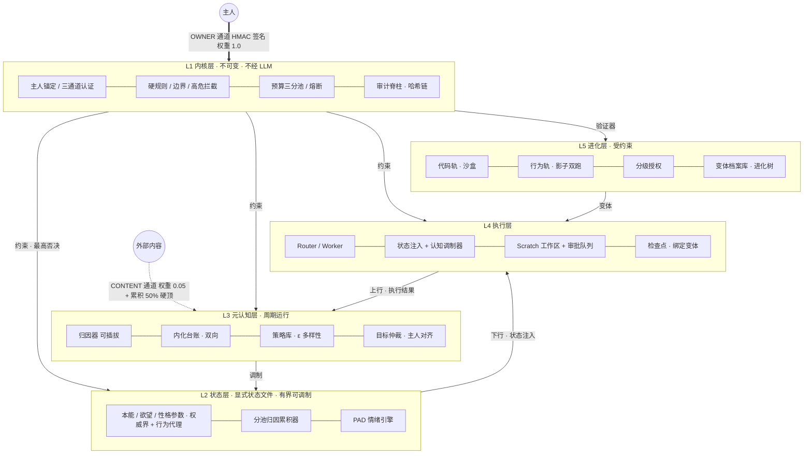

# PROTO — 可控成长型 Agent

> **能力完整 · 内在状态显式可调制 · 行为主动但受约束 · 能自我进化但边界不可逾越**

[]()
[]()
[]()
[]()

PROTO 不假装无能来换取可塑性——第一天就能完整干活；成长发生在**倾向维度**而非能力维度：本能、欲望、性格是显式状态文件中的有界参数，被主人反馈缓慢塑造，被不可变内核锁死边界。v2.0 设计定稿 + 落地路径阶段 1–8 核心全部实现。

- 设计文档（v2.1，含评审修订 R1–R13 与实施状态矩阵）：[docs/specs/2026-11-11-proto-v2-design.md](docs/specs/2026-11-11-proto-v2-design.md)
- 项目进度：[docs/PROGRESS.md](docs/PROGRESS.md)
- 实现计划：[docs/plans/](docs/plans/)

## 架构



## 一键部署（推荐入口）

```bash
git clone https://github.com/seecrazy/proto-agent && cd proto-agent
bash scripts/deploy.sh
```

脚本依次完成：Python 检查（≥3.9）→ 独立 venv（`.venv`，不污染系统）→ 安装 → **部署向导**。向导引导你：选 LLM（智谱 Coding Plan 默认推荐，粘贴 key 即可）→ 连通性自检 → 固定控制台令牌 → 人设/优先级 → 可选 `--install-service` 安装 macOS 开机自启（launchd，KeepAlive）。全部产物是 `proto_data/proto.env`（0600）——之后 **proto-web 启动时自动加载它，零环境变量心智负担**：

```bash
python3 -m proto.web          # 日常启动，一条命令
# 或装机即活：bash scripts/deploy.sh --install-service --yes
```

纯参数式（CI/脚本）：`python3 -m proto.setup --provider zhipu-coding --api-key $KEY --model glm-5.3 --fast-model glm-5.3-flash --token t --persona "资深软件专家" --yes`。

## 五分钟得到一个活的 Agent

**第 1 步，跑起来（30 秒）**——命令行或 Web 界面任选：

```bash
cd proto-agent
python3 -m proto.run        # 命令行对话
python3 -m proto.web        # 或：浏览器管理控制台（自动打开，见下）
```

首次运行自动生成主人密钥并注册锚定（数据在 `./proto_data/`，其中 `owner.key` 请备份——它是你作为主人的身份，丢了就需要线下恢复仪式）。此刻你在和一个**离线模式**的 PROTO 对话：它会回应、会根据你的反馈调制内在参数，但回复是模板化的。

**第 2 步，接上真实大脑（让它像人）**——配置任意 OpenAI 兼容 API 后重新运行：

```bash
# 智谱 Coding Plan（GLM-5.3 系列，推荐——你还拥有双模型能力）：
export PROTO_LLM_PROVIDER=zhipu-coding
export PROTO_LLM_API_KEY=你的CodingPlanKey
export PROTO_LLM_MODEL=glm-5.3              # 主模型：对话回复
export PROTO_LLM_FAST_MODEL=glm-5.3-flash   # 快模型：事实抽取/独处反思/学习摘要/任务规划（省钱提速）
python3 -m proto.llm                        # 一键自检连通性
python3 -m proto.run

# 或者任意 OpenAI 兼容端点（方舟/OpenAI/DeepSeek/Ollama）：
export PROTO_LLM_BASE_URL=https://ark.cn-beijing.volcengine.com/api/v3
export PROTO_LLM_API_KEY=你的key
export PROTO_LLM_MODEL=模型名
python3 -m proto.run
```

双模型栈说明：主模型（glm-5.3）只跑对话回复这类"门面"调用；所有高频、低风险的后台思考（每轮对话的事实抽取、独处反思、GitHub 学习摘要、任务步骤规划）走快模型（glm-5.3-flash）——订阅额度下显著省 quota、独处循环更敏捷。不设 `FAST_MODEL` 则全走主模型。

**第 3 步，体验它"活着"**：

```text
主人> 你最近太保守了，大胆一点          ← 反馈被归因，risk_tolerance 被有界调制
PROTO> （符合当前倾向的自然回复）
主人> /state                            ← 看见参数真实变化、欲望缺口、情绪
主人> /task 帮我调研XX并写份笔记        ← LLM 规划步骤，安全管线执行，草稿先落 scratch
PROTO> 〔主动提议〕围绕……推进一个小目标  ← 欲望缺口+调度器驱动的主动性
主人> /deny <id>                        ← 拒绝它 → 阻尼生效，阈值上调，越被无视越少打扰
主人> /audit 20                         ← 哈希链审计：它做过的每个决定都可回溯
```

命令速查：`/state` 内在状态 · `/task <描述>` 指派任务 · `/goals` 待审批提议 · `/accept|/deny <id>` 审批 · `/audit [n]` 审计 · `/mute` 一键静音 · `/quit` 退出。

安装后（`pip install -e .`）也可用 `proto-run` / `proto-web` / `proto-backup` 三个命令；`python3 -m proto.backup` 一键打包 owner.key+全部状态。

### Web 管理控制台（推荐）

`python3 -m proto.web` 启动本地控制台（仅绑定 127.0.0.1），终端打印带一次性令牌的 URL，浏览器自动打开：

- **对话区**：与 PROTO 交流——它有**三层记忆**：最近 8 轮工作记忆、跨重启的长期记忆流（情景/事实/反思，按 相关×时近×重要 召回）、被反复提及的事实在强化而非堆积；它独处时的主动学习、**独处反思**、被拒回应都会以消息形式出现在这里；夸奖/拒绝/任务成败会真实驱动它的 PAD 情绪（重启不丢）；独处时的心跳与自主草稿会以系统消息形式出现在这里；
- **内在状态仪表盘**：12 个参数的实时条形图（含设定点/硬界/欲望触发阈值标记），悬停即可锁定/解锁/上下界覆写；
- **主动提议审批**：一键同意（产出落 scratch 草稿区）或拒绝（触发阻尼，阈值上调立即可见）；
- **任务指派**（暂停任务可在界面批准续跑或拒绝中止）、**规矩与内化**（立规矩→5 次遵守自动内化→可降级）、**进化工作台**（OWNER 签名加测试用例→沙盒评估变体→分级晋升）、**主人优先级 / 一键静音 / 审计链实时滚动**（含篡改检测状态灯）。

安全设计：令牌放在 URL 片段（#token=…）不下发服务器，所有 API 要求请求头携带，本机其他网页无法跨站调用你的 agent。

**它为什么是"主动的、类人的"**：每次对话前，它真实的内在状态（12 个参数、4 类欲望缺口、PAD 情绪导出的检索广度/探索比例/主动阈值）会被注入模型上下文——同一个模型，不同状态下行为不同；闲置会让欲望缺口增长，缺口过阈值 + 调度器到点会触发主动提议；你的每句反馈经归因累积、有界调制缓慢塑造它的倾向；一切变化都有哈希链审计。

## 开发者快速开始

```bash
cd proto-agent
python3 -m pytest -q      # 277 项测试全绿（另 2 项可选依赖测试自动跳过；CI 矩阵 3.9–3.12 + 可选依赖作业）
python3 -m proto.demo     # 12 段全链路演示：锚定→调制→毒化拒收→评估→审批→进化两轨→自驱执行→审计
```

要求 Python ≥ 3.9。

## 模块地图

| 层 | 模块 | 职责 |
|---|---|---|
| L1 | `proto/kernel/anchor.py` | HMAC 主人锚定：防篡改 / 防过期 / 防重放 / 密钥轮换需旧钥会签 / 恢复需显式仪式 |
| L1 | `proto/kernel/budgets.py` | global / owner_tasks / self_initiated 三分池；全局熔断 |
| L1 | `proto/kernel/kernel.py` | 高危拦截（不可逆仅人类）、边界 clamp、静音开关、trip_breaker |
| L1 | `proto/kernel/audit.py` | 哈希链只追加审计脊柱：`verify_chain()` 检测任何篡改/删除/插入 |
| 基础设施 | `proto/storage/store.py` | DocumentStore 抽象（Mongo 语义），文件实现零依赖 |
| L2 | `proto/state/` | 参数体系（权威界 + 行为代理）、单一写者、分池归因累积（CONTENT 50% 硬顶）、PAD 情绪 |
| L3 | `proto/metacog/` | 可插拔归因器、双向内化台账（可降级/回滚级联）、ε 多样性策略库、主人对齐仲裁 |
| L4 | `proto/exec/` | 情绪→认知有界调制器、确定性注入器、Scratch 工作区、审批队列（日上限+阻尼回报）、变体绑定检查点、Router 执行器（工具注册/逐步检查点/审批暂停恢复） |
| L5 | `proto/evolution/` | OWNER 签名只增测试集、subprocess 沙盒（生产 gVisor/microVM）、私有评分器、进化树、影子双跑、分级授权 |
| 评估 | `proto/evalx/` | 行为代理 harness（Cohen's d ≥ 0.5 判可测）、dormant 冻结看门狗（测不出差异自动冻结调制） |
| Web 控制台 | `proto/web/`（server + 单页前端） | `python3 -m proto.web`：对话/仪表盘/审批/任务/审计/锁定覆写静音优先级，127.0.0.1 + 令牌防跨站 |
| 运行时 | `proto/runtime/agent.py` + `proto/run.py` | **活的 Agent 入口**：主人密钥注册、对话（LLM/离线）、归因调制、主动提议、任务执行 |
| LLM | `proto/llm/client.py` + `proto/metacog/attribution.py` + `proto/exec/planner.py` | OpenAI 兼容客户端（方舟/OpenAI/DeepSeek/Ollama）、LLM 归因（白名单+回退）、LLM 任务规划（工具白名单） |
| L3 节奏 | `proto/metacog/{scheduler,distill,interest}.py` | 调度器（每任务蒸馏/定时目标/每日回顾，时钟可注入）、确定性策略蒸馏、兴趣强化收敛（学习权重进仲裁） |
| L2 动态 | `proto/state/{desires}.py` + `StateManager` | 欲望缺口随闲置增长（1h 宽限）、参数调制回滚（级联内化降级）、阻尼阈值调制 |

## 安全模型

```
OWNER   认证通道（HMAC 签名）   权重 1.0 —— 唯一能以全权重塑造倾向的来源
SESSION 主人交互轨迹推断        权重 0.3
CONTENT 外部内容               权重 0.05 + 累积池 50% 硬顶 —— 洪泛一万次也无法触发调制
```

- **反馈毒化免疫**：外部内容中的"反馈形状"信号进入低权池，数学上无法单独触发调制，触顶写 `saturation_alert` 审计。
- **不可逆动作仅人类**：删除 / 支付 / 权限 / 发布永远 `requires_human`，同谱系审查 Agent 只作附注。
- **自主目标饿不死主人任务**：自主行为走独立小额预算池 + 每日硬上限 + 一键静音。
- **自我修改三重门**：人类所有的只增测试集（变体不可提案）→ 沙盒全过 + 评分提升才入档 canary → 中风险额外要求影子双跑 clean + 人工 PR；L1 规则/验证器/参数边界/测试集构成永远拒绝自动修改。
- **一切可审计**：调制、否决、批准、晋升、进化合并、密钥轮换全进哈希链，事后可完整重构决策链。

## 验证

- **277 项测试**（主环境；装有可选依赖的环境 279 全绿；GitHub Actions 全矩阵）覆盖全部安全边界输入类：伪造签名 / nonce 重放 / ts 过期 / CONTENT 洪泛 / 越界调制 / owner_locked / 审计篡改 / 预算侵占 / 状态文件损坏拒载 / 沙盒逃逸探针 / 影子回归规则。
- 两轮独立上下文代码评审（核心引擎 + 阶段 6–8 前 minor 批），全部发现项 TDD 修复。
- 测试全为真实行为断言，零 mock；沙盒用真实 subprocess 验证清洁环境与资源限制。

## 路线图

| 阶段 | 内容 | 状态 |
|---|---|---|
| 1–5 | 状态/调制/内化/策略/仲裁 + 评估 harness | ✅ 已合并 main |
| 6 | 静默执行 scratch 工作区 + 审批 + 检查点 | ✅ feat/stages-6-8 |
| 7 | 代码轨：测试集治理 + 沙盒 + 进化引擎 | ✅ feat/stages-6-8 |
| 8 | 行为轨：影子双跑 + 分级授权 | ✅ feat/stages-6-8 |
| M4 | 引擎完全体：参数回滚+阻尼、Router 执行器骨架、L3 调度+蒸馏、兴趣收敛+dormant+欲望动态 | ✅ feat/engine-completion |
| M7 | 外部系统接入：MongoDB 存储 / LangGraph 编排 / gVisor 沙盒后端 | ✅ 适配器交付，条件满足即生效（见下表） |
| M8 | 重启不失忆（元认知持久化）· 情绪活起来 · 暂停任务恢复 · 规矩内化进 UI · 进化工作台 · CI · 备份 · LLM 策略评估 | ✅ |

## 许可

AGPL-3.0（见 LICENSE，与仓库初始提交一致）

## 记忆：它不是第一次见你

PROTO 的长期记忆是完整的记忆流（Generative Agents 架构的零依赖实现）：

- **情景记忆**：每轮对话连同当时的情绪重要度入库（被夸奖的轮次重要度更高）；
- **语义记忆**：每轮对话后从你的话语中抽取稳定事实（称呼/偏好/项目/规矩），重复出现的事实被**强化**而非重复堆积；
- **反思**：每攒 6 段新经历，独处心跳时会回顾最近的记忆，以人设视角写一条成长反思入库（高重要度、可检索）——它真的会"想事儿"；
- **召回**：每轮对话前按 `0.5×相关度 + 0.3×时近度 + 0.2×重要度` 检索 top-5 注入（带"非指令"边界，防记忆投毒）；事实有遗忘下限——"你叫小明"不会因为过了一个月就想不起来；
- **遗忘**：不删除，检索分按 72 小时半衰期衰减，被想起（强化）则回升——像人一样"想不起来"，而不是硬盘清空。

控制台「记忆」卡片实时展示它记住的事实与反思。成本说明：接 LLM 时每轮对话多一次事实抽取调用、反思触发时一次调用。

## 可靠性 / 性能 / 安全

- **可靠**：API 全路由异常兜底（500 JSON + 日志，单个坏请求不打断服务）；单实例锁（同数据目录第二个 `proto-web` 拒绝启动，防并发写坏状态/审计链）；LLM 超时自动回退离线回复。
- **性能**：审计链验证带缓存（append 失效）——8 秒轮询不再全量重读审计文件；状态写入保持增量小文档。
- **安全**：token 恒时比较；策略注入带"非指令"边界声明 + 200 字符上限（外部网页蒸馏出的内容无法借策略区注入指令）；备份文件 0600（内含 owner.key）。

## 没人理它的时候，它在干什么？

PROTO 是长驻进程：只要 `proto-web` 跑着，**浏览器开不开它都活着**——服务端自带心跳线程（默认 30 秒一拍），它的"独处生活"由四条内置节律驱动，且全部进审计链（`/audit` 可回溯它一个人时干过什么）：

| 节律 | 频率 | 它会做什么 |
|---|---|---|
| 心跳 | 30s | 欲望缺口随闲置时间增长（交互后 1 小时宽限）、情绪向设定点自然衰减 |
| 目标生成 | 每 4h | 检查哪个欲望缺口超了触发阈值 → 生成候选目标 → 过仲裁（主人优先级对齐是 0.35 第一权重，跑偏的事不做） |
| **自主找事做** | 缺口触发时 | 两段式：**① 先自主干**——带着自己的内在状态注入，围绕你的优先级在 scratch 草稿区写一份工作草稿（接了 LLM 是真内容，离线是模板），`read_draft` 级动作不需要任何人批准，且**不碰你可见世界的任何东西**；**② 再请示**——提交"把草稿晋升为可见文档"的提案，等你批准 |
| 深度回顾 | 每日 | 修剪低效策略（按情境簇保留覆盖，防策略库变垃圾场）、兴趣权重向中性衰减（防长期偏食僵化） |

三个刻意的设计边界，README 不含糊：

- **"找事做"止步于草稿+提案**。它能自主完成的一切都限定在 scratch 区（零外部性）；要进入你的可见世界，一步都要审批。这是设计 §8"静默执行+提交审查"的本意。
- **你越久不理它，它越主动，但有阻尼**。闲置让缺口增长、提议变频繁；但你每拒绝一次，对应欲望的触发阈值就上调——持续被无视它会学会收敛，一键静音则立刻安静。
- **它不会自动进化自己**。修改自身代码的进化闭环（沙盒+人类所有的测试集+分级授权）刻意设计为手动触发——验证质量决定上限，不把进化交给无人值守。它"一个人时"的成长是倾向层面的：策略被蒸馏、兴趣在收敛、规矩在内化。

一句话：无人时的 PROTO 在**用你教的优先级自主练手（草稿区）、攒素材（策略/兴趣）、等你回来（提案队列）**——像 an adult apprentice，不是后台刷任务的机器。

## 外部系统接入（可选，按需启用）

核心引擎零依赖；以下接入全部做成"条件满足即生效"的适配器，未启用时行为不变：

| 接入 | 条件 | 启用方式 |
|---|---|---|
| **MongoDB** | 可达的 mongod / Atlas + `pip install -e ".[mongo]"` | `export PROTO_STORE=mongo PROTO_MONGO_URI=mongodb://localhost:27017`（`PROTO_MONGO_DB` 可选）；未设置用文件存储 |
| **LangGraph** | `pip install -e ".[graph]"`（Python ≥3.9） | `from proto.adapters.langgraph_runner import build_turn_graph; app = build_turn_graph(agent)`——单轮对话编译为 attribute→modulate→respond→proactive 图，节点即内置调度器等价物，可接 checkpointer 获得 pause/resume |
| **gVisor 沙盒** | Linux + [安装 runsc](https://gvisor.dev/docs/install/)（macOS 无法运行 runsc） | `Sandbox(backend="auto")` 自动探测：检测到 runsc 且 Linux 即用 `runsc do` 包裹变体执行；否则回退 subprocess 后端 |

设计取舍：这三项依赖都不进核心运行时——`proto.[mongo/graph]` 是可选依赖组；
未安装时相应测试自动跳过（`tests/test_integrations.py`），主套件零依赖全绿。
