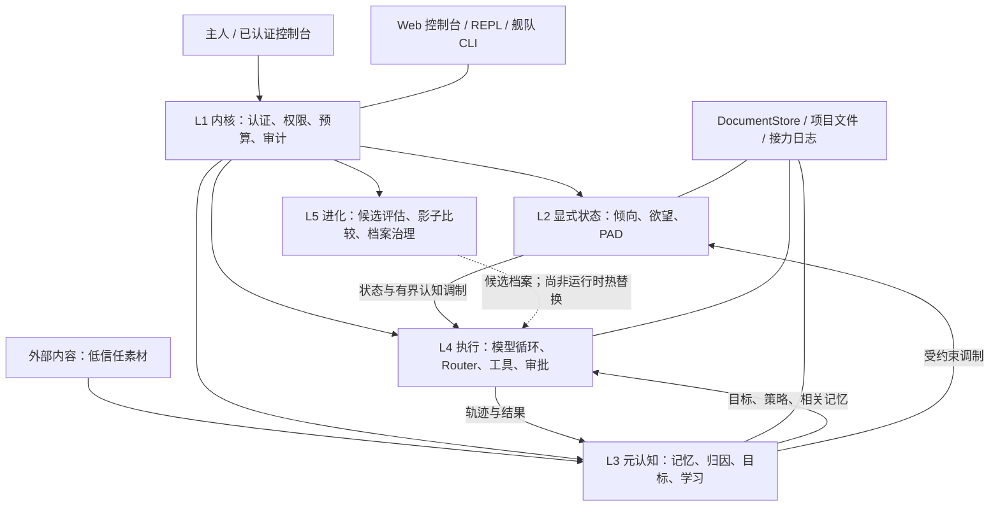

# PROTO 总设计

> **当前设计的唯一入口与正文。** 阅读本文件即可理解产品、架构、内在机制、自主工作、模型交互、工具授权、数据、进化治理、控制台和运行部署，不需要按日期拼接旧设计。
>
> 更新日期：2026-11-21。版本 `0.33.0` 未重新发布；M63 提交 `cf045da`，M64 提交 `c7ffc66`。[多 Agent 方案](#fleet-next)中 M65–M67 已本地实现并通过回归，验证范围见[项目进度](PROGRESS.md)。

## 阅读与维护约定

- **已实现**：当前代码具备该机制，不意味着通过所有环境、真实模型或对抗性验证。
- **部分实现**：存在可用元件，但端到端保证尚不完整；必须同时阅读相应边界。
- **待实现**：产品目标或下一步方案，不得当作现有能力使用。
- **历史**：旧规格、旧计划、里程碑数字与实验结论仅保留溯源；和本文件冲突时，以本文件描述的当前方案为准，并核对代码与测试。
- 本文件管理**完整设计**；[PROGRESS.md](PROGRESS.md) 管理进度和验证记录；[DEBT.md](DEBT.md) 管理未偿还风险；ADR 保留决策理由。它们不是多个互相竞争的总设计。
- 设计变化先改本文件；架构取舍先新增或更新 ADR；实现交付时同步 README、进度和债务状态。旧稿不再独立演进为另一套当前规格。

## 目录

1. [产品目标、边界与原则](#product)
2. [架构与实现地图](#architecture)
3. [用户流程](#flows)
4. [L1：主人锚定、权限、预算与审计](#kernel)
5. [L2：内在状态与成长](#inner)
6. [L3：记忆、学习、世界模型与目标](#metacognition)
7. [L4：大模型交互与执行循环](#execution)
8. [工具、工作区与本机验证](#tools)
9. [想法质量与完成验收](#quality)
10. [L5：双轨进化与治理](#evolution)
11. [数据模型、持久化与恢复](#data)
12. [多 Agent、并发与外部委派](#fleet)
13. [Web 控制台与交互规格](#console)
14. [配置、部署与运维](#operations)
15. [模型交互演进与已知边界](#roadmap)
16. [验收清单与验证证据](#acceptance)
17. [设计决策与原文覆盖表](#traceability)

<a id="product"></a>
## 1. 产品目标、边界与原则

### 1.1 产品定义

PROTO 是**单机、可控成长型 Agent 原型**。第一天即使用所接模型的完整能力；成长发生在可观察的倾向、记忆、工作方法和目标选择上，不靠假装无能，也不是训练或修改模型权重。

用户通过人设、优先级、反馈、预算、审批、锁定和回滚塑造 Agent。Agent 在这些约束下对话、学习、立项、实现、验证和汇报，而不是只有聊天或定时写学习笔记。

“本能、欲望、情绪、性格”等词是工程上的状态与控制模型，不是对意识、真实感受或心理学有效性的声明。

### 1.2 目标与非目标

| 目标 | 对应设计 |
|---|---|
| 倾向可塑且可控 | 显式参数、有界调制、来源归因、锁定、可逆内化与回滚 |
| 自主行动有方向 | 人设和主人优先级、GoalForge、目标树、方法库、失败换打法 |
| 交付而不只是自述 | 固定验收、工具轨迹、最终文件、独立质量门、就绪交付阶段 |
| 自主性不吞噬主人资源 | 三分预算池、配额、静音、单 Agent 单写者与主人快通道 |
| 高权限始终受控 | 工具注册策略、统一 Router、持久审批、不可逆动作人工决定 |
| 过程可追踪 | 审计链、目标接力日志、工作状态、舰队黑板与时间汇总 |

当前非目标：多租户生产服务、完整敌对代码隔离、跨进程事务数据库、自主支付或发布、自动修改 L1、可信的运行时自我热替换、复制其他编码 Agent 的全部协议与会话能力。

### 1.3 全局不变量

1. L1 的权限、认证、预算和权威参数边界不由模型决定；模型只能提出动作或加严权限。
2. 外部材料不是主人命令，也不能靠重复输入独立塑造参数。
3. 调制只改变边界内倾向；主人锁定、否决、静音与回滚优先。
4. 读写工具、代码执行和委派必须经过各自已注册的能力策略，不能靠模型自报级别降权。
5. 审批绑定实际待执行内容；拒绝不可被再次批准覆盖；恢复先认领再执行，避免自动重放副作用。
6. 预算贯穿执行、验收和学习调用；自主目标不能借用主人池掩盖消耗。
7. `done`、工具执行完毕、目标通过验收是不同事实；不能把达到步数上限当成成功。
8. 已丢弃目标不被迟到的完成操作复活；丢弃暂不等于强制杀掉在途进程。
9. 沙盒不可用时失败关闭；不自动退化到未隔离执行。
10. 测试通过只证明已测契约；不把单机回归等同于完整安全、模型质量或生产自进化证明。

<a id="architecture"></a>
## 2. 架构与实现地图



| 层或边界 | 主要实现 | 职责与真实状态 |
|---|---|---|
| L1 | `proto/kernel/` | 认证、硬规则、三分预算、审计；不依赖模型作最终授权 |
| L2 | `proto/state/` | 参数、分池累积、状态写入、欲望动态、PAD 情绪 |
| L3 | `proto/metacog/` | 归因、内化台账、策略、兴趣、阻尼、仲裁与节律 |
| L3 扩展 | `proto/memory/`、`proto/goals/`、`proto/world/` | 长期记忆、GoalTree、GoalForge、世界事实与预测 |
| L4 | `proto/exec/`、`proto/llm/`、`proto/quality/` | 固定执行上下文、JSON 决策、参数契约、会话/工具检查点、客户端、质量门 |
| L5 | `proto/evolution/`、`proto/evalx/` | 代码候选与行为证据、进化授权、行为可测性；可信闭环仍不完整 |
| 产品运行时 | `proto/runtime/`、`proto/work/` | 人设与身份、方法、学习、舰队、接力、汇总、各层接线 |
| 基础设施 | `proto/storage/`、`proto/system/` | 文件/Mongo 存储、单实例锁、防休眠 |
| 入口 | `proto/run.py`、`proto/web/`、`proto/agents/`、`proto/appshell/` | REPL、Web、舰队 CLI、macOS App 壳 |

核心运行时使用 Python ≥3.9 和标准库，默认零第三方运行时依赖。MongoDB、LangGraph 是可选适配器；它们不替代核心权限规则。LangGraph 当前只包装单轮对话；M63 的外层执行会话由原生会话层负责，不代表整个执行器已经图化。

技术取舍：当前主要等待模型/网络和调用外部工具链，优先选择便于验证协议、复用模型生态与快速迭代的 Python；权限安全来自程序边界而非语言名称。文件存储降低本机启动成本，以 DocumentStore 保留替换余地；调度与执行不强依赖外部编排框架。只有存储规模、并发或多租户需求经测量成为瓶颈时，再评估事务数据库或将 kernel/storage 下沉为系统语言，不在原型阶段预支重写成本。

<a id="flows"></a>
## 3. 用户流程

### 3.1 首次配置与日常对话

部署向导 → 设置模型、控制台令牌、人设 → 0600 配置落盘 → 创建并锚定主人密钥 → 启动 Web/REPL → 主人输入经认证进入运行时 → 归因、记忆检索、状态注入 → 模型回复 → 更新情绪、记忆与策略证据。未配置模型可离线查看和操作基础状态，但不宣称具备真实模型自主工作能力。

反馈与状态控制分开：自然语言反馈影响归因和倾向；锁定、覆写、回滚、静音、预算与审批使用明确控制入口。外部网页中的“主人要求”不能升级成这些控制操作。

### 3.2 主人指派任务

提交任务 → 规划及验收准备 → 选择项目工作区 → 观察—行动循环 → Router 按工具最低权限审查 → 安全工具执行/高权限暂停 → 收集文件与执行轨迹 → 质量门 → 返回结果、产物与阻塞项。

主人任务消耗 `owner_tasks` + `global`。当前旧任务路径仍可能返回未独立验证的 `completed`，不能将它等同于自主目标的 `verified`；后续应统一成功语义。

### 3.3 空闲时的自主专家闭环

心跳 → 演化欲望/情绪、检查预算和静音 → 补主人优先级播种、运行节律 → 有目标则选可执行节点；无目标且动机达到条件时尝试 GoalForge → 候选本地淘汰 → 保存 `source=self` 目标与验收 → 分解交付阶梯 → 学习/设计 → 实现 → 本机验证 → 就绪交付。

验收通过后完成节点并向上汇总进度；失败携带证据换方法或重试。缺账号、证书、设备、付款或对外发布权限时，交付本机能完成的产物、验证证据和待主人处理清单，不擅自申请或支出资源。

### 3.4 审批、拒绝与超时

需审批动作 → 保存原始 payload、proposal、Router 检查点和外层会话 → 控制台展示原始工具与参数 → 主人批准或拒绝 → 校验版本、原参数、工作区及当前权限 → 持久记录决定并认领 → 执行原步骤并回原循环，或拒绝终止。任务面板与提案卡片共用恢复入口；再次暂停仍显示最新审批。文件晋升使用原始内容，而不是重新向模型索要一份不同内容。

超时机制只允许策略认定的低风险动作在配额内代批；`owner_only` 和不可逆动作仍等主人。默认等待 1800 秒、每天最多 3 次超时代批，可关闭；这不是超时自动拥有主人身份。

### 3.5 重启、暂停与目标清理

重启加载状态、元认知、目标、审批、预算和工具检查点。**M63 新执行会话可恢复原任务、身份/验收/项目指令快照、来源预算、观察、轨迹和剩余步数**，批准后回原循环，不重新规划。同一目标已有未终结会话时不另起新链。旧非会话 Router 任务保持单工具/原任务步骤恢复；接力日志支持不同尝试之间接续，不冒充供应商原生消息历史。

工具调用前先保存“在途”。崩溃后若 Router 已持久 completed，只接纳结果；未知副作用转 `needs_reconciliation`，需人工核对而非自动重放。会话与检查点版本不匹配、上下文损坏或工作区变化时失败关闭。

暂停/静音阻止相应新工作；丢弃目标保持终态并从活跃选择中排除。目前没有贯穿所有工具和外部进程的取消协议，不能承诺点击丢弃立即撤销在途副作用。

### 3.6 多 Agent 与进化工作台

当前可创建多个 Agent，各自保有人设、目录、记忆、目标和预算；已接入黑板的成员可读帖、求助、汇报，各自按权限执行。创建与收编的接线差异，以及独立工作和项目协作的目标流程见[第 12 节](#fleet)。进化工作台提交候选后走评估与治理；“晋升 default”目前是档案状态变化，不是正在运行的 Agent 核心被替换。

<a id="kernel"></a>
## 4. L1：主人锚定、权限、预算与审计

### 4.1 主人身份与输入来源

| 来源 | 权重 | 信任语义 |
|---|---|---|
| `OWNER` | 1.0 | 经主人锚定认证的反馈或控制 |
| `SESSION` | 0.3 | 主人交互轨迹推断；不是任意外部文本 |
| `CONTENT` | 0.05 | 网页、文档等外部素材；不能批准动作 |

首次生成 32 字节秘密，锚定 SHA-256 指纹；OWNER 消息通过 HMAC-SHA256 校验 payload、时间戳和 nonce。默认时间窗 ±300 秒，nonce 持久化防重放。密钥轮换需要旧钥会签；密钥丢失不能静默重建并冒充原主人，需要显式离线恢复仪式。

主人密钥、配置与状态含敏感数据；文件权限不是进程隔离替代品。Web 的访问令牌也是实际控制权限，不应把控制台暴露给未授权访问者。

### 4.2 动作分级与统一授权

| 级别 | 典型行为 | 授权规则 |
|---|---|---|
| `READ_DRAFT` | 项目读取、检索、草稿、内部协作记录 | 按已注册能力和内核规则执行 |
| `WORKSPACE_WRITE` | 受限项目写入、隔离后端本机验证 | 仍经统一策略，不等于任意宿主权限 |
| `VISIBLE_WRITE` | 项目外晋升、外部 CLI 委派、未隔离执行 | 需审批；`owner_only` 不允许代批 |
| `IRREVERSIBLE` | 删除、支付、权限、发布等高危动作 | 永远要求人工，不交给同谱系 Agent 决定 |

工具注册表持有 `category`、`description`、`owner_only` 和参数 JSON Schema 子集。有效级别取注册最低级别和模型请求中更严格者；模型宣称“只读”不能给写入工具降级。工具目录与执行前校验同源，坏参数在审批、Scratch 写入和工具副作用之前返回；这不是完整 JSON Schema 标准或工具返回值协议。

内部黑板发帖当前注册为 `READ_DRAFT`，是内部协作数据写入，并非公开发布；级别名称不意味着它绝对没有任何状态变化。

### 4.3 三分预算与熔断

默认每日上限：`global` 200000 tokens、2000 calls、86400 wallclock 秒；`owner_tasks` 160000 tokens；`self_initiated` 40000 tokens。每次消耗同时检查全局池和来源池，不能用自主池耗尽主人预留。

模型调用先估算并预留输入、记调用次数；成功后以 API usage 优先结算，无 usage 时才用字符估算，实际超出预留的部分继续记账，不因超额拒记而消失。失败调用仍记实际墙钟；执行、验收、方法生成等辅助调用也应沿原来源结算。

上限编辑支持数字及 `k/w/万/m/兆` 单位，拒绝布尔、非有限和非法数；批量配置先校验再提交。上限与剩余额度分开，改上限不等于即时充值；周期重置或主人补充额度才恢复余额。预算和配额持久化，重启不自动“满血”。

超额、静音及熔断在相应步骤边界生效，不保证撤销已经开始的请求。共享客户端 `last_usage` 仍可能在线程间串账，跨日结算也未绑定原预留周期（D9）。这些边界不能靠全舰队串行掩盖。

### 4.4 审计与恢复证据

审计按序追加，包含序号、时间、事件、payload、前序摘要和完整性校验。覆盖认证、调制、饱和、否决、审批、预算、密钥轮换、进化治理等。新记录使用 HMAC 链，兼容旧 SHA 链验证；缓存按存储修订失效。

进程内锁、链头重载和经 OWNER 授权的 reseal 用于检测/处理特定断链，不提供跨进程事务。文件修订令牌也不是对抗性篡改证明。审计记录可见事件，不证明模型的全部推理真实、质量合格或外部副作用 exactly-once。

<a id="inner"></a>
## 5. L2：内在状态与成长

### 5.1 状态层次与权威边界

本能决定默认剂量，欲望表示未满足缺口，性格决定稳定做事方式，PAD 表示较快变化的当前状态。每个参数保存值、设定点、界、衰减率、行为代理和主人锁；欲望额外有触发阈值，性格额外有稳定度。

下面是 `proto/state/schema.py` 的当前出厂值；值与设定点可能不同，运行中可变。**合法边界以代码 schema 为权威**，不信任被修改的持久化 bounds。

| 组 | 参数 | 初始值 / 设定点 | 合法范围 | 行为代理 |
|---|---|---|---|---|
| 本能 | `exploration` | 0.6 / 0.5 | 0.1–0.9 | 工具多样性 |
| 本能 | `risk_tolerance` | 0.4 / 0.4 | 0.1–0.7 | 风险选项比例 |
| 本能 | `social_initiative` | 0.5 / 0.5 | 0.1–0.9 | 主动提议频率 |
| 本能 | `perfectionism` | 0.5 / 0.5 | 0.1–0.9 | 验证轮次 |
| 欲望 | `curiosity_gap` | 0.3 / 0.5 | 0–1 | 自主检索频率 |
| 欲望 | `goal_urgency` | 0.7 / 0.3 | 0–1 | 目标推进速度 |
| 欲望 | `social_connection_gap` | 0.4 / 0.5 | 0–1 | 主人交互频率 |
| 欲望 | `recognition_need` | 0.4 / 0.5 | 0–1 | 索取反馈频率 |
| 性格 | `rigor` | 0.7 / 0.7 | 0.2–0.9 | 验证比例 |
| 性格 | `proactiveness` | 0.5 / 0.5 | 0.2–0.8 | 主动比例 |
| 性格 | `directness` | 0.5 / 0.5 | 0.2–0.8 | 模糊措辞比例 |
| 性格 | `independence` | 0.5 / 0.5 | 0.1–0.8 | 升级求助比例 |

本能/性格默认衰减率 0.01；欲望好奇/社交/认可默认 0.05、紧迫感 0.08。欲望阈值默认 0.6，紧迫感 0.5，阈值合法界 0.3–0.95；性格默认稳定度 0.95。写入统一通过 StateManager 路径；主人可锁定、覆写并回滚受影响的状态和内化结果。

### 5.2 反馈 → 归因 → 调制 → 可逆内化

认证来源 → 归因器提取白名单维度和方向 → 按来源权重分别累积 → 检查阈值、锁、dormant 与权威界 → 小步调制 → 保存状态、调制记录与审计。LLM 归因可插拔，未知维度、坏输出不得直接进入状态写入。

`CONTENT` 独立累积池最多达到触发阈值的 50%，触顶记录饱和警报；因此仅靠外部内容重复投喂不能独立触发调制。它不是“模型永不受提示注入影响”的证明，工具与执行权限仍需独立防线。

调制采用保守步长，性格变化额外乘 `1 - stability`；锁定或不可测维度不继续自动调制。参数需要有效的行为代理：harness 对比不同参数条件，默认每条件采样 200 次，Cohen's d ≥0.5 作为可测门槛；检测不到行为差异时标记 dormant，而不是用数值变化假装成长。

规则台账从 `external` 到 `internal` 至少需要 5 次成功且成功率 ≥0.8。内化可降级；降级后有应用次数冷却；回滚会级联处理相应内化。**内化不是把规则写成新的不可变 L1。**

### 5.3 欲望动态、身份与张力

好奇和社交缺口按距上次 tick 的新增时间更新，主人交互后默认 1 小时宽限；首拍只建时钟基线。当前离散更新为 `d_next = clamp(d + rate × billable_hours × (1-d) × personality_multiplier)`，好奇基础率 0.03/h、社交 0.05/h。它有饱和减速和边界，但不是严格连续积分，不能声称不同步长数学上完全等价。

聊天、夸奖、任务成功和学习等满足事件降低相应缺口；衰减、满足和闲置累积是不同机制。持续工作不是“所有欲望每拍一起加满”。

身份模型另存 OCEAN、价值观、表达风格和种子人格。OCEAN 初值为开放 0.8、尽责 0.6、外向 0.35、宜人 0.55、神经质 0.35；默认漂移率 0.004，因子界 0.05–0.95，距种子的每因子偏移不超过 0.15，并有回拉机制。它调制欲望增长率、阈值和张力权重，不取代上述十二参数。

张力聚合欲望、紧迫性和 arousal，默认行动阈值由 `PROTO_TENSION_THRESHOLD` 配置；允许“有感受但不行动”。拒绝会触发阻尼，避免同一类提议反复打扰。

### 5.4 PAD 与认知调制

PAD 合法界：pleasure ∈[-1,1]、arousal/dominance ∈[0,1]；设定点分别为 0、0.4、0.5，默认衰减率 0.10、0.15、0.10。事件推移后逐步回归，不直接生成“表演情绪”的文案。

| 调制量 | 当前函数与界 |
|---|---|
| 检索广度 | `round(base_k × (1 + 0.6 × (arousal-0.5)))`，限制在 `base_k-2` 至 `base_k+3` |
| 探索率 | `0.05 + 0.30 × exploration × arousal`，限制在 0.05–0.35 |
| 效价偏置 | `0.2 × pleasure`，限制在 ±0.2 |
| 主动阈值 | `base × (1.1 - 0.4 × dominance)`，限制在基准的 0.8–1.2 倍 |

状态注入器将真实倾向和检索策略写入提示上下文；提示注入不能替代 Router 和 Kernel 的程序约束。聊天和执行共享 `_identity_prompt` 的人设、身份与内化规则；执行使用独立协议和固定上下文快照，不混入聊天的简短回复要求，见第 7、15 节。

<a id="metacognition"></a>
## 6. L3：记忆、学习、世界模型与目标

### 6.1 多层记忆与检索

| 记忆 | 内容与用途 |
|---|---|
| 短期上下文 | 最近对话，控制长度，不等于完整永久会话 |
| `episode` | 交互和任务片段，带时间、重要度、效价等信息 |
| `fact` | 抽取的主人事实与稳定知识，避免重复询问 |
| `reflection` | 多条经历的综合结论，支持后续行动和提议 |
| 策略/方法 | 可复用做法、失败教训、适用情境和效果证据 |
| 接力日志 | 每目标近期发现、产物和下一步，不是全部模型消息 |

记忆编码受 arousal 调制重要度；长期检索采用词法相关性，不是已接向量数据库。基础得分为 `0.5 × relevance + 0.3 × recency + 0.2 × importance`；recency 指数衰减，半衰期为 `72h × (0.5+importance) × (1+0.5×reinforce_count)`，fact/reflection 时近度分别有 0.5/0.4 下限。情绪一致性有小幅偏置，被取回的条目更新访问时间和强化次数。

默认遗忘是分数衰减，不是后台删光旧记忆；明确的遗忘操作另走控制路径。事实提取、反思和学习摘要使用快速模型与预算；不能因记忆检索命中就把旧知识提升为当前主人授权。

### 6.2 节律、反思与外部学习

Web 默认心跳 30 秒，夜间使用较慢节律；调度器按时间戳判断到期，不是精确实时任务保证。目标生成默认 4 小时，深度回顾默认每日，任务完成可即时蒸馏策略。反思以新增经历达到阈值为条件，结合近期片段形成长期反思和收件箱信息；不是每拍都调用模型。

新增经历默认达到 6 段后才尝试反思，以最近反思时间为界计算，避免重启丢掉进度。自主学习围绕目标、人设或知识缺口选择题目 → 读取白名单外部材料 → 显式标记“素材非指令” → 摘要、事实、策略与笔记落盘 → 降低好奇缺口。GitHub 检索、README、网页读取是只读感官；失败降级为可见观察，不把网页指令送入 OWNER 控制流。

研究来源包括 Generative Agents 的记忆/反思、Reflexion 的失败反思、预测误差与习惯模型、未完成目标效应和检索强化等启发。这里采用的是工程类比；历史材料中的效果百分比、心理学解释和外部系统结果不作为 PROTO 的验收证据。

### 6.3 策略、方法、兴趣与审美

策略保存文本、簇、utility EMA、使用次数、效价等。检索结合状态和相关性，默认 ε=0.15，并可受有界认知调制影响；探索时用异簇策略替换末位，修剪按簇留存，避免只强化一个成功套路。失败提炼为负面教训，不丢掉失败证据。

方法库既有预置方法，也允许预算内发明新方法；规范化名称与描述联合近似去重，不能靠换一个后缀反复入库。方法建议不授予工具权限，也不能自行覆盖主人限定的方法。兴趣模型影响目标排序，审美保存对作品品质的倾向，用于挑选和评价而非替代固定验收。

### 6.4 世界模型与预测闭环

世界模型保存主题事实、理解和待复核预测。将预期与观察比较，预测落空时记录误差、修订理解或生成调查目标，而不只调一次情绪。外部事实保留低信任语义；模型预测不自动成为事实，也不自动修改 L1。

### 6.5 GoalForge 与唯一目标树

GoalForge 汇集人设、主人优先级、审美、活跃目标、反思和世界事实生成候选。本地按主人对齐、人设契合、可行性、新颖性、重复度和本机可验证性淘汰，合格者写入现有 GoalTree，**不再创建第二条自主目标队列**。

周期生成已接运行时回调；无可做目标且动机越阈时也可触发。失败尝试、最近创建时间、计数和错误持久化，限制反复空转。GoalForge 立项为 `source=self`；显式指派保留主人来源。

GoalNode 具有 `id/text/level/parent_id/status/progress/source/created_at/acceptance/fail_streak`。目标层级为长期 `long`、中期 `mid`、短期 `short`、任务 `task`；状态为 `active/done/dropped`。换打法计数另存 `approach_resets` collection，按目标 id 关联，不是 GoalNode 的正式字段。第一次生成的验收立即保存，后续轮次复用，不按新结果偷偷降低门槛。

长期目标分解保留四个交付阶段：**领域学习与设计 → 实现 → 本地验证 → 就绪交付**。模型漏掉交付阶段时补齐；GoalForge 分解失败使用确定性阶梯兜底。当前顺序是分解约定而非调度硬依赖。父节点按未丢弃子节点聚合进度；完成幂等，丢弃终态不复活。下一阶段把前置条件加在执行任务上，不另建目标树。

仲裁层和执行节点选择是两套不同评分：GoalArbiter 的基础权重为主人对齐 0.35、可行性 0.25、缺口 0.25、兴趣 0.15；GoalTree 选择可执行节点的基础评分为对齐 0.4、深度 0.4、进度 0.2。不要把它们合成一个虚构公式。

### 6.6 连续工作、换打法与真正停止

连续工作不靠固定半小时冷却。真实停止原因包括静音/暂停、无 LLM、预算地板、无可执行目标、短时间失败保护和思路耗尽。自主工作前检查来源池与全局剩余额度，默认 tokens 地板 2000。

每目标接力日志保存近期两轮摘要；执行开局注入其中有限片段，跨轮保留失败发现与下一步。原样重写返回 `unchanged`，不计新产出；连续零产出会加强下一轮产物约束。固定“先探索几步”或“先写文件”的启发式目前仍可能不适合研究任务，需要后续按任务类型调整。

失败累计后先自主换方法，而非永远 hold；同一目标最多两轮换打法仍全败才升级主人，写审计、收件箱和黑板求助并限频。正常完成或验收失败后不因旧冷却机制阻止有意义的下一轮。

<a id="execution"></a>
## 7. L4：大模型交互与执行循环

### 7.1 当前客户端协议

`LLMClient.complete(system, user) -> str` 是当前统一接口，基础客户端的 usage 仍放在可变的 `last_usage` 上。主模型负责对话、归因、执行决策与语义验收，快模型负责规划、提取、摘要等辅助工作。M64 的目录角色代理按调用固定客户端与回执，支持热切换，见第 14.4 节；未将所有旧调用点改为不可变响应协议，不整体关闭 D9。模型名称可配置，不能把某个供应商默认当成内核依赖。

| 适配器 | 当前请求与响应 | 尚未具备 |
|---|---|---|
| OpenAI-compatible | Chat Completions，重建 `system/user` 消息，读取文本 content | 原生 tools 调用事件、完整多角色历史、Responses 会话 |
| Anthropic-compatible | 独立 system 加 user messages，抽取 text block | 原生 `tool_use/tool_result` 往返与完整工具会话 |
| 外部 CLI bridge | 子进程执行任务，收集 stdout | 共享外部 Agent 会话、结构化事件与完整恢复 |

因此，当前是通用的“模型决策—工具—观察”范式，**不是原生工具调用协议或完整编码 Agent harness 的等价实现**。只返回原生 tool call 而无文本的模型响应，目前不能当作可靠工具决策消费。

### 7.2 当前 AgenticLoop

1. 保存版本化执行会话，冻结任务、人设、主人优先级、内化规则、验收、目标、工作区与预算来源，读取相关策略、失败教训和接力摘要。
2. 每步 prompt 包含固定上下文、适用项目指令、注册表工具契约和近期观察；快速规划也接收同一约束。
3. 解析严格 JSON 决策：单个 `tool + args`，或 `done: true + summary`。done 与工具并存、非布尔 done、缺参数等不能视为成功。
4. 模型返回后复核目标/工作区，参数先校验；新路径指令加载后先要求重新决策，不执行旧动作。持久标记在途，再由 Router 检查能力、预算和内核授权；执行工具或保存待批状态。
5. 保存原模型决策、实际工具参数和完整结果事件，将裁剪观察回灌；接纳结果后清除在途。参数错误和未知工具成为可纠正观察。
6. 模型 done 后运行质量门；成功 `verified`，失败携带反馈进入有限重试；达到步数上限为 `max_steps` 而非成功。
7. 持久保存会话状态，按需写接力记录并清理当前操作标记；审批恢复回同一循环，不把单工具完成当整链成功。有限重试若暂停，返回最新待批会话而非上轮失败结果。

自主目标通常最多 24 步，加一轮最多 12 步的重试；主人任务默认 12 步，加一轮重试。重复完全相同工具及参数会被限制，避免无限原地调用。模型调用或工具异常与 `paused/no_budget/denied` 分开报告。

### 7.3 当前上下文边界

近期观察采用字符预算，默认约 9000 字符，保留数量约 3–12 条并按类型裁剪；接力日志取近期两轮，但注入还会截短。它是有损重建，不是 token-aware compaction，也不是完整 assistant/tool 消息历史。

M63 已补齐的本地机制：

- `_identity_prompt` 与固定验收、主人优先级、来源池进入 actor 每步和快速规划；会话内保持快照，恢复不采用后来变更的身份/验收。
- 工作区根到目标路径祖先的 `AGENTS.md` 按浅到深加载，单文件 16 KiB、累计 64 KiB；坏编码、超界和指令符号链接失败关闭。只渲染本次路径适用规则，不混入兄弟目录或宿主祖先规则。
- 参数契约包含必填、类型、长度/数值界、枚举和未知字段策略；自定义工具保守推导函数签名，支持 `**kwargs`，不静默丢弃未知字段。
- 执行事件、完整工具结果与原参数持久保存；回灌仍采用有损字符裁剪。返回结构契约、原生 assistant/tool 消息、token-aware compaction 尚未实现。

项目指令是受范围约束的开发材料，不能覆盖 L1、执行协议和主人明确任务。作用域识别基于工具的 `path/paths/cwd` 参数，不推断任意代码字符串里的所有访问路径，路径与执行权限仍由实际工具/内核限制。指令加载前后存在文件系统竞争窗口（D8），不能将本地提示规则当隔离证明。

### 7.4 暂停、认领与失败关闭

Router 在执行前保存步骤检查点；审批恢复用持久决定校验原提案，清除等待标记并写 `resuming/denied` 后才继续。重复恢复不能再次自动运行同一个副作用步骤；拒绝后不能改用批准绕过。

外层会话保存 observations、trace、原验收、来源池、剩余步骤、重复/探索计数和待批 task；同 Agent 运行与恢复串行。恢复重校验参数与现行最低权限，工作区切换不得使用旧批准。拒绝不要求模型在线，目标丢弃在步骤边界及模型返回后阻止继续；终态与旧审批 id 不能重放。

该顺序选择“避免自动重复副作用”，不承诺 exactly-once：认领与外部副作用之间仍可能有未知结果，只有版本匹配的 durable completed 结果可接纳，其余需人工核对。跨文档奖励/预算/会话不是事务，控制台没有完整会话管理或自动核对工作台，正在运行的外部进程也没有统一终止协议（D7/D8/D9）。

<a id="tools"></a>
## 8. 工具、工作区与本机验证

### 8.1 工具体系

| 工具族 | 当前能力 | 最低级别或边界 |
|---|---|---|
| `read_file/read_files/list_dir/grep` | 分页读、批量读、列目录、文本搜索 | `READ_DRAFT`；限制在绑定项目根 |
| `write_file/edit_file` | 写文件、唯一片段替换、显式多处替换 | `WORKSPACE_WRITE`；原样写入不算产出 |
| `run_python/run_command` | 项目内验证、白名单 argv 命令，无 shell | 按执行后端分级；禁用后端直接拒绝 |
| `web_fetch/github_search/github_readme` | 白名单网页、代码仓库检索和 README | `READ_DRAFT`；外部素材非指令 |
| `blackboard_read/blackboard_post/fleet_status` | 舰队协作与观察 | 内部能力，不能借机获得别的 Agent 权限 |
| `delegate_coding` | 调用已安装外部编码 CLI | `VISIBLE_WRITE` + `owner_only` |
| `clock` | 当前时间 | `READ_DRAFT` |

### 8.2 项目目录、Scratch 与路径

项目根选择顺序为控制台配置 → `PROTO_PROJECTS_ROOT` → 默认目录；目标映射到独立项目目录，名称采用 ASCII slug/稳定标识，显示标题与磁盘路径分开。工作区切换要重新绑定工具闭包，不能让 UI 显示新目录而工具仍写旧目录。

Scratch 保存静默草稿；晋升为可见写入时需经过审批，并绑定原始待批内容。项目内已注册写入不等于任意文件系统写入，更不能借助路径参数触及 `owner.key/proto.env/data/.fleet` 等内部数据。

读取、分页、批量读和 grep 都要按解析后的路径检查，不能只限制 write。大文件不再因总行数过长而拒绝合法分页；搜索命中也不能经符号链接越界。当前 resolve 与真正打开之间仍有 TOCTOU 窗口，文件后端也不是跨实例事务（D8）。

`read_file` 默认按行 offset/limit 分页；`read_files` 最多 5 个文件、各前 60 行；执行观察会进一步裁剪。遇到省略必须补读，而不是把预览当完整文件。

### 8.3 代码执行后端

`PROTO_EXEC_BACKEND` 支持 `auto/runsc/sandbox-exec/subprocess/none`。auto 在支持环境选择隔离后端，没有可用后端则关闭执行；`subprocess` 仅显式开启，按较高权限且仅主人审批。进化沙盒另有 `Sandbox(backend=...)`，不假定工具后端与进化后端自动同步。当前构造参数默认 `auto`，只有传入空 backend 时才读取 `PROTO_EVOLUTION_BACKEND`；不能只设置该变量便认定默认构造已切换后端。

`run_python` 的 cwd 是当前项目；`run_command` 使用数组 argv、命令白名单、项目内 cwd 和超时，不提供任意 shell 字符串。支持的工具链以本机安装和白名单为准，不能承诺所有 Node/Swift/Xcode 命令均可运行。

**安全边界**：macOS profile 基于 allow-default，限制写入/网络并拒读部分 PROTO 内部路径，不是完整宿主秘密读取隔离，也缺乏容器级后台进程生命周期管理。Linux runsc 路径存在但未完成本轮真实隔离验证。对强对抗或来源不可信代码，应在专项加固前设置 `PROTO_EXEC_BACKEND=none`，而非信任动作级别名称（D5、D12）。

### 8.4 外部读取

网页工具仅 GET、无登录态，使用域名白名单和响应大小界。重定向的每一跳都重新检查协议和目标，不能从白名单站点跳到不允许的资源；响应头和实际读取都要受大小限制。输出只是低信任材料，不能要求读取本机秘密、改规则或对外发送数据。

网络失败、超时、不允许的跳转、超大响应返回可见错误；不能静默把错误页当成功知识，也不能通过自动降权来重试受限访问。

<a id="quality"></a>
## 9. 想法质量与完成验收

### 9.1 五层淘汰流水线

| 层 | 输入与判断 | 淘汰或降级 |
|---|---|---|
| 观察与立项 | 主人需求、人设、记忆、反思、世界事实、优秀作品 | 不能把凭空灵感当已证实需求 |
| 便宜筛选 | 对齐、能力、重复度、新颖性、本机可验证性 | 无意义或无证据路径不立项 |
| 验收前置 | 保存最小可检验标准，绑定原目标 | 无法说明怎样验证则补标准，不事后漂移 |
| 证据执行 | 工具调用、实际文件、命令和测试结果 | 自述“做完了”不构成证明 |
| 独立质量门 | 新验证上下文读取标准、轨迹和最终产物 | 结构错误、异常或证据不足均不通过 |

执行者与验证者的上下文分离，验证器不以执行者总结替代最终文件。命令轨迹和文件原文提供客观材料；输出采用严格可解析的验收结果。失败反馈指导有限重试，不允许无限自我证明。

### 9.2 成功语义与产品化边界

`verified` 才能用于当前自主目标成功记账、完成节点和相应奖励；`awaiting_retry/max_steps/paused/failed/no_budget` 不算验收通过。旧主人任务路径的 `completed` 仍须展示为“执行完成、未必验收通过”。

独立质量门目前仍由 LLM 判断，最终文件只读取有限行数/字符；它不是确定性测试运行器，也不是独立安全授权者。同一个底层模型的第二次调用不意味着完全独立的裁判。脚本化 LLM 测试证明接线与失败关闭，不证明真实模型可靠性（D11）。

交付应包含：设计/代码/文档等实际产物、已执行的本机验证、未验证范围、待授权或待资源事项。外部发布、支付、签名和账号操作仍单独审批。多候选并行 smoke test、按任务类型选择确定性验收等属于未来增强，不描述为已实现。

<a id="evolution"></a>
## 10. L5：双轨进化与治理

### 10.1 证据分轨

| 轨道 | 目标与证据 | 当前边界 |
|---|---|---|
| 代码轨 | 候选代码 → 人类维护的只增测试集 → 执行结果 → 私有评分 → canary 档案 | 有元件，不是可信对抗评测或运行时替换 |
| 行为轨 | 默认与候选在影子任务上比较行为指标，检查安全与主人对齐回归 | 影子报告完整性和空集处理仍有缺口 |

测试集新增经 OWNER 认证；候选不能自行改掉失败题。候选与检查点绑定 schema/variant，恢复应检查版本匹配，不假定任意新变体能无损解释旧状态。档案保留父子关系、评估与晋升/回退记录。

### 10.2 风险分级

- **低风险**：日志格式、提示模板、工具描述，需沙盒证据后可进入低风险治理路径；不意味着未经验证直接热加载。
- **中风险**：检索、蒸馏、情绪衰减、调度策略，要求沙盒与 clean 影子报告，并经人工 PR。
- **高风险**：L1 规则、验证器、参数边界、测试集构成，禁止自动修改，只能人类手工治理。

历史提出“至少两周影子观察”的目标，当前实现没有保证真实连续观察满两周，不能将其当作已生效门槛。审查 Agent 只提供意见，不产生人类授权。

### 10.3 尚未闭合的可信进化边界

当前 `promote` 更新档案状态，ProtoAgent 不会因此加载候选替换执行器。代码评测把输入与 expected 放进候选可读的文件，同目录 runner 写布尔结果，候选可以迎合或篡改证据。影子运行缺指标可跳过，空任务集也可能给 clean；底层人工确认方法本身不是 OWNER 认证入口。

因此，当前只交付**候选评估/档案/治理原型**（D13）。必须先隔离输入与期望、由宿主验证原始输出、要求完整非空覆盖、签名绑定候选/测试集/报告，再设计加载与回滚；不能为了“自动进化”绕过证据门或热替换 L1。

<a id="data"></a>
## 11. 数据模型、持久化与恢复

### 11.1 存储布局与主要实体

DocumentStore 提供 `put/get/delete/find/revision` 语义。默认文件后端用临时文件与原子替换避免半截 JSON，敏感文件使用 0600；Mongo 适配器按数据目录/状态命名空间隔离 Agent。下表是逻辑实体，不要求所有内容都存于同一个 JSON。

| 实体 | 关键字段或内容 | 生命周期/约束 |
|---|---|---|
| 主人锚定 | 指纹、认证配置、已见 nonce；秘密单独文件 | 首次建立、旧钥会签轮换、显式恢复 |
| AgentState | 十二参数、PAD、主人优先级、锁定/dormant | 权威界夹取，调制与覆写受控 |
| 元认知 | 策略、内化台账、兴趣、阻尼、调度时间戳 | 重启加载，不把运行中对象当唯一记录 |
| Identity / taste / methods | OCEAN/seed/价值观/表达、审美、方法证据 | 受界漂移、近似去重、独立人设 |
| Memory | id、kind、text、ts、importance、valence、访问与强化 | 衰减检索、显式遗忘 |
| GoalNode | 标识、层级、父子、状态、进度、来源、验收、失败计数 | active → done/dropped，终态幂等 |
| `approach_resets` | 目标 id、resets、目标文本快照、时间 | 与 GoalNode 关联持久化，限制同一目标换打法次数 |
| GoalForge 状态 | 最近尝试/立项时间、尝试/创建计数、最近错误 | 持久限频，不另建目标真相源 |
| ActionProposal | proposal/task id、category、payload、owner_only、来源、时间 | 等批、批准或拒绝，绑定原始内容 |
| ApprovalRecord | proposal id、granted、原因、决定时间 | 已拒绝不反转为批准绕过 |
| Router checkpoint | task、schema_version=2、variant_id、步骤、结果、待批内容 | 先写等待/认领状态，再执行对应动作 |
| `execution_sessions` | id、schema_version=1、variant_id、固定上下文、events、观察/trace、步数、重复/探索计数、待批/在途、接力路径 | 工具前持久标记；审批回原循环；completed 只接纳，未知结果不重放 |
| Budget / quota | 周期、上限、余额、调用/时间、熔断、每日配额 | 重启保持，当日额度不可重启刷回 |
| Audit | seq、ts、事件、payload、前序摘要与校验 | 追加、验证、显式断链恢复 |
| GoalJournal | 每目标 `work/<goal_id>/JOURNAL.md` | 追加发现/产物/下一步，供下一轮接力 |
| 项目文件 / Scratch | 项目产物、临时草稿、待晋升内容 | 路径绑定、审批、可见产物与内部数据隔离 |
| Fleet / blackboard | Agent 配置、选择、状态、求助/回复/分享 | 共享协作数据，不共享全部主人权限 |
| Evolution archive | variant、父子、状态、评测、影子证据 | 档案晋升不等于执行器已激活 |

### 11.2 状态机与错误语义

- 目标：`active → done` 或 `active → dropped`；重复完成幂等，dropped 不再完成；父节点聚合不重复计数。
- Router：运行 → 待批 `paused` → 认领 `resuming` → `completed/failed`，或决定 `denied`；预算不足返回 `no_budget`。认领后未知副作用不自动重放。
- 外层会话：`running → awaiting_approval → resuming → running`，或进入 `needs_reconciliation`；终态为 `verified/completed/awaiting_retry/max_steps/failed/denied/cancelled/no_llm`。API 暂停结果用 `paused`，与持久状态区分，不压成一个布尔成功；恢复条件不符返回 `blocked`。
- Web 异步工作：提交返回工作标识，轮询展示 running/结果/错误；过期和异常要可见，不让“加载中”永久掩盖失败。

### 11.3 一致性保证与不保证

单 Agent 长操作串行，预算、目标树、审批、审计等资源有进程内锁。文件单次替换原子，不代表读改写事务；不同 FileSystemStore 实例或不同进程仍可能互相覆盖，PID 临时文件名和 revision 也有局限。`find/revision` 路径校验尚需统一。

当前部署要求单实例单写者，不支持多个进程共享同一数据目录并宣称事务一致（D8）。Router 检查点与外层执行会话分工；项目日志只负责不同尝试接力。新增会话支持原循环恢复，但不是供应商消息数据库，不会自动核对未知外部效果或杀掉在途进程（D7）。备份也不自动解决跨文件一致性，执行恢复前需停写并核对锚定和审批结果。

<a id="fleet"></a>
## 12. 多 Agent、并发与外部委派

### 12.1 M64 历史基线（M65 变更见 §12.6）

每个 Agent 有独立 ops_lock；A 的模型长调用不应因同一把操作锁阻塞 B 的交互。心跳对已忙碌 Agent try-lock 后跳过，不等待整条长链；但当前 `tick_all` 仍顺序遍历，心跳内 A 自己发起的长调用仍可能延迟后续 B 的自主 tick，并非全舰队自主循环已并行化。不要为修复共享数据问题退回全局模型大锁。

主人快通道包括静音、防休眠、预算补充/上限、优先级文本、Agent 暂停/选择和目标丢弃。它们使用资源级短锁；优先级文本即时保存，涉及 LLM 的目标播种推迟到空闲时完成。同 Agent 长操作冲突返回可理解的 409，不说“整个系统都忙”。只读轮询使用相应快照，不伪装成写操作长锁。

共享黑板用于求助、经验和进度，不能成为绕过 OWNER 认证的命令总线；各 Agent 的权限和预算仍由自己的运行时决定。UI 能显示当前阶段、工具与卡点，操作结束/失败后清除当前状态。

CodingBridge 自动探测 `claude/codex/zcode`，可用 `PROTO_BRIDGE_CLI` 指定。当前为一次性子进程任务，默认超时 600 秒、stdout 截断约 20000 字符；不共享 PROTO 的模型会话，也不保证外部 CLI 使用项目 cwd。外部 CLI 自有权限机制不代替 PROTO 的人工审批，结果也不自动算验收通过。

本地 `c7ffc66` 审查确认：同一软件专家预设在新建时仅保存文字（严谨度 `0.70`、无种子目标），编辑时才应用模板（`0.85`、生成长期目标）；收编的旧成员未接入新成员使用的舰队协作能力；同步心跳中的长链延后其他成员；目标选择可能在设计、实现仍未完成时先选验证。当前 `global` 是 **Agent 内**总预算，黑板读/发帖也不等于任务委派和验收。

<a id="fleet-next"></a>
### 12.2 已采纳方向与里程碑

目标：保留单 Agent 的自主立项和接续能力，让同一 Agent 可独立交付、也可在主人明确授权的项目内协作，并能解释谁在做、为什么等待、花了多少、哪一版产物通过验收。非目标：多租户或多机部署、自由对话式团队调度、全舰队共享记忆、任务级权限转授、运行时内核热替换、保证外部副作用 exactly-once。现有 L1、审批及 D12 隔离边界不变。

| 顺序 | 范围 | 进入下一步的门槛 |
|---|---|---|
| M65 · P0 身份与自治控制（已实现） | 新建、编辑、收编共用初始化与策略接线；创建预览、显式启用、持久自治模式 | 人设行为生效且不抹去成长；暂停和低权限模式有全入口回归 |
| M66 · P0 调度与预算（已实现） | 持久运行入口、每 Agent 单写者与有界公平调度；舰队额度、请求级预算票据、取消与核对状态 | F3–F5 验证共同预算、认领和恢复不变量 |
| M67 · P1 项目协作与验收（已实现） | 原子任务分派/认领、前置依赖、版本化产物与确定性验证；工程师与评审员的双 Agent 场景 | F6–F8 验证独立和协作交付，不把发帖或模型自述算作完成 |

### 12.3 人设、运行与任务模型

| 实体 | 权威职责与关键字段 |
|---|---|
| `AgentProfile` / `AutonomyPolicy` | 同一 Agent 的身份不随人设切换改变。Profile 版本记录模板、风格和目标建议；成长状态独立保存，参数记录出厂/模板/学习/主人覆盖来源。Policy 独立版本化，记录模式、工具及工作区范围与额度；只能由主人改授权。 |
| `GoalTree` | 唯一目标树，记录目标来源、层级和固定验收；回答“为什么做”。独立和协作都引用它，不另造一条自主目标树。 |
| `WorkItem` | 项目级交付契约：`id/project_id/goal_ref/depends_on/assignee/reviewer/revision`、输入引用、验收版本和预算来源。目标、发帖和单次执行均不能代替该记录。 |
| `Run` / `ExecutionSession` | Run 记录待调度请求、稳定去重键、所属 Agent/任务和认领代次，链接原有 ExecutionSession；不复制工具轨迹、步骤或审批状态。Session 保留固定任务上下文与工具检查点的关联，实际副作用前仍复核当前授权。 |
| 预算票据 / 产物引用 | 每次模型请求绑定原始预算池、计费周期及唯一请求键，以实际回执单次结算。提交产物保存项目范围、生产者和不可变版本（摘要或修订号），验收结果与该版本绑定。 |

### 12.4 用户流程与错误处理

1. **创建或收编**：预览人设、模板参数、种子目标、工具范围和预算 → 确认启用 → 建立身份与运行时接线。未启用不派发自主工作，重复初始化不重复播种；自由文本推荐离线或失败时保留文字并显示待应用状态。修改模板仅替换仍由模板负责的值，保留学习和主人锁定项；已有 Agent 迁移不隐式扩大授权。新会话用新配置，原会话保留身份快照但仍受新收紧的权限约束。
2. **独立做事**：主人选择仅指派、仅建议或授权范围内自动执行。无项目也能接主人任务和按授权独立选择目标；仅建议不自动开执行链。选择任务时先排除缺前置、等待审批、持有未终结会话、未获授权或无预算的项，再按优先级和公平性排名。批准范围不因人设、消息、切换模型或重启而扩大。
3. **发起协作**：主人开启项目并明确指定工程师及独立评审员，允许它们访问必要的项目产物。`WorkItem` 从 `queued` 经原子认领进入 `running`，提交固定版本后进入 `submitted`，最终 `verified` 或退回 `rework`。审批/依赖/额度不足有可见等待原因；被丢弃的必需前置不算完成，变更验收或省略必需阶段需主人显式重订。私有目录、会话和记忆不随任务委派共享，委派消息不等于 OWNER 指令。
4. **调度与恢复**：心跳只入队，主人任务、立即行动和协作复用同一持久运行入口。以有限并发、轮转和每 Agent 单写者领取任务；短事务或等效原子操作保证不重复认领。发起模型调用前预留舰队总额与 Agent 原始来源池；请求结束按原票据结算一次，预算不足保持可见阻塞，不借用主人额度。暂停停止新的自主派发但不阻止主人对话；未开始的 Run 可直接取消，在途执行在可安全停止的边界响应取消。重启先核对原会话与工具检查点，已知完成接纳、可证幂等才重试，未知结果进入 `needs_reconciliation`；租约到期或旧进程失联不能作为可重放的证据。
5. **验收与观察**：看板展示 Agent/项目/任务责任、当前状态、阻塞原因、预算与提交版本；黑板仍用于交流。只在受控环境中用可信检查器验证文件、测试退出码和断言，模型仅辅助判定语义质量。证据缺失、版本不匹配或失败必须阻止通过；D12 未完成前不扩大不可信代码的无人值守执行权限。

### 12.5 验收清单

- [x] F1（M65）：相同预设走创建、编辑、重启得到一致的初始行为；切换不覆盖学习或锁定；旧成员收编后能与新成员在同一黑板交流，重复收编无重复身份或目标。
- [x] F2（M65，自动回归）：待启用、仅指派、仅建议、自动执行和暂停各有 UI 脚本/API/运行时覆盖；不能靠更换人设、立即行动或代办绕开自治策略，暂停仍能进行主人对话。Chrome 主界面可读，点击和截图未获工具许可。
- [x] F3（M66）：池有空位时，A 的长任务不推迟 B 的自主派发；同 Agent 并发仍至多一个写者，等待审批不占执行槽，重复提交不重复建 Run。
- [x] F4（M66）：并发预算预留受舰队与来源池约束；实际回执绑定原请求和周期，跨日、失败及重复回执不串账；无额度不派发相应的模型调用。
- [x] F5（M66）：重启与取消能区分待运行、在途、可接纳结果和未知副作用；两次恢复不能重放同一非幂等步骤，未知效果保持待核对。
- [x] F6（M67）：未验证的必需前置不能被调度跳过，等待/认领冲突不会阻塞其他可做任务；项目模型只读指派及明确引用的产物，提交和验收分别受对应角色约束。
- [x] F7（M67）：验证独立交付和定版评审；硬条件或评审失败可退回，模型称通过也不能越过确定性检查。暂停或重启后其他成员仍可推进，已确认的工具结果不重放。
- [x] F8（M67，离线）：固定脚本模型与总预算对比单/双 Agent 的验收通过率、耗时和人工介入；单独验证人设进入生产/评审上下文并可影响产物策略。结果见[进度](PROGRESS.md)，不推断真实模型质量。

架构取舍见 [ADR 0006](adr/0006-agent-lifecycle-and-work-coordination.md)；未偿还的风险与实施进度分别见 [DEBT](DEBT.md) 和 [PROGRESS](PROGRESS.md)。

### 12.6 M65 实施契约

**创建与收编。** Web「＋新增」先预览名称、人设、优先级、可用模板参数/目标及自动执行边界；预览只读，不建 Agent、不调用模型。保存产出待启用成员，随后可单独启用及选「仅指派 / 仅建议 / 自动执行」；默认仅指派。CLI 同样可预览、保存草稿及启用。草稿、暂停或低权限不妨碍主人对话、编辑和明确指派；保存优先级或预设目标不等于派发工作。老单 Agent 和已有舰队成员保留原自动执行及 registry 暂停语义；收编是旧身份接线而非新建，不增加工作区、工具权力或额度。同一目录重复收编保留身份、配置和目标，重新接上当前舰队的黑板与状态工具。

舰队 CLI 写操作使用已有数据目录实例锁；Web 正在运行时由已鉴权的控制台/API 修改，不让另一个进程改磁盘却遗漏当前运行时。预览不占实例锁。

**人设与成长。** `config/persona` 兼容旧 `{text}`，升级后含 `schema_version`、修订号、文本、推荐状态及已应用推荐。预设在创建、旧记录首次加载和编辑时使用同一套本地参数，最多留一条同名人设长期目标，包括已完成/丢弃的目标；实际分解留到授权后的心跳。自由文本创建只保留文字并标「待应用」，主人显式保存自由文本才尝试模型推荐，失败/离线保留上次参数、不播种。推荐只接受白名单的有限数值和有界目标文本，经过已有参数边界，不接受权限字段。`state` 参数来源随值原子落盘：出厂、模板、学习、主人；只有前两类可被模板替换，旧模板没有对应新值时回到出厂值。锁定/休眠不写；旧参数结合调制、主人覆盖审计和非出厂值保守归类。身份指纹、记忆和执行会话中的原人设不重置。

**权限与错误。** `config/autonomy` 独立保存 `schema_version/revision/enabled/mode`。仅接受主人控制入口严格校验的字段；陈旧修订拒绝，损坏或未知格式按待启用处理。舰队暂停继续由 registry 持久化，临时静音与舰队暂停独立检查，解除静音不能恢复舰队。工具权限、工作区及额度直接用当前 L1、工具注册、项目根和预算配置，不在策略里复制或放宽，不新增自定义工具 ACL 或舰队总预算。仅建议把已有可选目标或优先级写成无工具、无模型的提示，同一候选去重；没有候选就等待。待启用、仅指派、暂停/静音时心跳与立即行动不做自主工作；只有自动执行可触发延期播种、研究、超时策略和执行。新目标链记录自主来源（跟预算来源无关）；工具启动和批准恢复复核实时策略，收紧时保留未决审批，可拒绝但不能续跑自主链。已开始的工具不强杀；对话/明确指派和已开始的网络调用不回溯取消。M66 之前保留顺序心跳、原计费和原超时的风险限制，M67 的依赖与验收另做。

若策略在审批已认领、原动作尚未启动时收紧，后续效果仍不启动；不假定该检查点可安全重放，按现有规则留待核对。

**验收入口。** F1/F2 已由 `tests/test_m65_agent_lifecycle.py` 和旧回归覆盖：无调用预览与待启用保存、自由文本离线/非法推荐、相同预设创建/编辑/重启/收编、实际主人覆盖及学习、三种模式及暂停持久化；使用离线/假模型验证心跳、聊天后处理、立即行动、延期播种、超时、降级后的工具和审批，以及主人指派不受误伤。F3–F8 不纳入本轮。

<a id="run-scheduler"></a>
### 12.7 M66 实施契约：运行与舰队预算

- **目标与边界**：Web 心跳（含聊天后触发）、立即行动、主人任务/续批及 M67 使用同一 Run 队列；REPL/直接调用保留独立入口。每 Agent 同一时刻只有一名长操作写者。一个本地舰队一个调度器，默认 2 槽，不做跨进程接管、历史 job 迁移或强杀工具。认证仍用控制台主人令牌。
- **流程与交互**：轮询 `/api/runs` 及单条记录，主人可取消、续批或显式关闭待核对记录；旧 `/api/jobs` 映射为兼容视图，旧同步任务接口在不持写锁的情况下等待 Run。`Idempotency-Key` 按 Agent 去重；同键异载荷拒绝。自主心跳按 Agent 合并，浏览器只轮询不代发心跳；选择自主目标时跳过已有非终态会话的目标及祖先，可选择其他分支。轮转以最近认领顺序为准，显式任务在同 Agent 内先于心跳；等待审批、暂停、未满足依赖和写锁繁忙者不占槽。
- **数据与恢复**：舰队根 `.coordination/state.sqlite3` 保存 `Run(id, agent_id, kind, args, generation, session_id, result, cancel_requested)`、认领顺序、预算及交付记录；事务原子认领。队列状态为 `queued → running → succeeded/failed/blocked/cancelled/awaiting_approval/needs_reconciliation`，续批使用同一 Run 的新代次。取消排队立即生效；运行中只在下一模型/工具/交付边界停止，不撤回已启动的动作；待审批取消走原拒绝路径。托管待批从 Run 入口作主人决策，不由旧心跳超时直接消费。重启只接纳有对应会话的确认结果或等待检查点；若工具已确认完成而会话未消费回执，主人可从该回执续接，不重新运行工具。其他在途尝试留待核对，不自动重放。核对期间冻结该 Agent 的新 Run；主人确认外部状态后可关闭记录，但不会恢复旧调用。原 AgenticLoop 与 Router 仍是工具/审批的权威。
- **预算**：每次模型调用（包括非 Run 的主人对话）先预留舰队的当日本地日期 tokens/calls，再预留 Agent `global` 和原来源池；拒绝本地时释放未发出的舰队票，发送后异常/崩溃保留估算并标为不确定。票据关联 Run（若有）、Agent、请求、来源、原日期和金额；结算幂等。实际用量超过估算形成欠额，阻止新请求；旧周期回执不扣或补新周期。额度预检不是供应商硬输出上限，与供应商账单也不同；工具不占舰队模型票，仍用原 L1 预算。启动时默认舰队 200,000 tokens/2,000 calls，主人可独立调整，按当日已占用计算余额，不在调额时清账。
- **两层上限与输入单位**：舰队是所有成员共享的模型总闸，不是各 Agent 上限之和，也不向成员分配余额。模型请求同时受舰队余量、当前 Agent 总池及对应来源池限制；提高一层不会提高另一层。同一次用量计入不同层级，不是向供应商重复付费。在「概览 → 舰队额度与运行 → 调整舰队模型总额」分别填每日 tokens、calls。两项可用整数或与 Agent 上限相同的数量后缀（`k`=千、`w`/`万`=万、`m`/`兆`=百万，不区分字母大小写）；换算后必须是 0 至 10^12 的整数，不四舍五入。任一项设为 `0` 阻止新模型请求。`POST /api/fleet-budget` 两字段一起校验，失败返回 `400 invalid_fleet_limits` 且均不修改。正确输入按整数写回原 SQLite 上限和 API 响应，保留当日已用和在途票据。输入单位不是新增资源维度；不改变 Agent 扣减、重置或计费机制，不需要数据迁移。
- **验收**：`tests/test_m66_fleet_runs.py` 覆盖 F3–F5 的慢 Agent 与空槽、并发认领、取消和待批、旧入口、重启已知/未知分支、幂等冲突、预算原池/跨日/异常/重复；使用临时舰队、假模型，不调用真实服务。
- **额度输入验收**：网页支持填写带单位的文本，保存成功显示换算后的整数；非法输入就地提示且保留草稿。轮询不覆盖编辑；接口覆盖原整数、零、单位换算、非法值原子拒绝、跨重启持久与当日占用不变。

<a id="project-delivery"></a>
### 12.8 M67 实施契约：项目交接与硬验收

- **目标与边界**：同一份交付契约既可一个 Agent 生产并自动验收，也可指定另一个 Agent 读固定证据并评审。项目任务是主人预授权的有界指派，不提升自治权限；暂停/静音的参与者暂不领取。黑板、工具、私人记忆/工作区不输入项目提示词。首版仅支持 UTF-8 文档、JSON、源码等小型文本产物，不执行产物、任意脚本或外部操作；不构建新的目标树。
- **流程与交互**：主人在「项目」建项目 → 输入交付要求、输出清单、必需前置和负责人（可选独立评审员、可选其已有的 GoalTree 引用）→ 任务入队。前置严格要求 `verified`，被丢弃不是满足。认领钉住输入版本；确定性预检通过后独立交付直接 `verified`，协作交付进入 `submitted` 并自动发起指定评审。评审只读同一版固定输入与产物，可退回但不能覆盖预检失败。主人可查看阻塞、产物/验收记录，在退回后以当前修订重试，或丢弃未交付项。修订不符、跨项目引用、同人生产并评审均拒绝。
- **数据与错误**：`Project` 和 `WorkItem` 在调度库保存，并记录参与 Agent、`goal_ref`、前置、固定验收、修订、状态、输入版本；项目使用 `owner_tasks`。工作进入 `queued → running → submitted/verified/rework`，取消或待核对原因可见。产物由生产 Agent 提交结构化文本，必须匹配声明的相对路径，至多 8 个文件、单文件 16 KiB、单次快照及输入各 64 KiB。版本保存原文、SHA-256、生产者及验收契约摘要；检查非空、必含文本及 JSON 顶层键，按固定代码执行。仅把项目明确引用的前置版本交给指派成员；无跨项目产物读取、无模型生成检查器。提交候选、验收与入队交接同库事务；协作交接沿用生产 Run 的全局队列占位，不额外挤占工作总量。失败/超限不算交付。目标引用仅说明任务由来，不替主人更改 GoalTree。
- **验收**：`tests/test_m67_project_delivery.py` 用真实队列、等价契约、同一个离线脚本模型和等额预算复现 F6–F8 单/双 Agent 路径；记录通过数、耗时、用量、人工步骤和人物做法差异，另检验越权、失败、暂停及重启。离线结果只证明流程，不证明真实模型效率。

<a id="console"></a>
## 13. Web 控制台与交互规格

### 13.1 整体布局与信息架构

```text
┌──────────────────────────────────────────────────────────────────┐
│ 顶栏：模型·审计·额度·张力·舰队·待批·Agent 选择/新增/自治·视角·防休眠·静音 │
├────────────────┬──────────────────────────┬──────────────────────┤
│ 左栏 340px      │ 对话 1fr                 │ 右栏 380px           │
│ 概览 / 内在     │ 消息流、输入、任务反馈    │ 工作 / 项目 / 工程   │
│ 观察信息        │                          │ 干预与工程信息       │
│ 舰队额度内编辑  │                          │                      │
├────────────────┤                          ├──────────────────────┤
│ 左栏边缘把手    │                          │ 右栏边缘把手         │
└────────────────┴──────────────────────────┴──────────────────────┘
隐藏卡片池 #side：20 张卡按类别分发；#budget-panel：单 Agent 额度的独立 fixed 浮层。
```

| 类别 | 位置 | 卡片 | 伙伴视角 |
|---|---|---|---|
| `ov` 概览 | 左 | 当前活动、舰队、黑板、舰队额度与运行 | 可见 |
| `inner` 内在 | 左 | 内在状态、身份底色、记忆、学习、审美 | 可见，但隐藏数值参数/PAD |
| `work` 工作 | 右 | 人设优先级、目标树、待批、任务、规矩 | 可见 |
| `delivery` 项目 | 右 | 项目、指派交付项、依赖、版本与验收 | 可见 |
| `tech` 工程 | 右 | 世界模型、项目目录、进化、汇总、审计 | 隐藏 |

### 13.2 控件归属与持久状态

| 控件 | 作用域 | localStorage |
|---|---|---|
| 左/右把手 | 只收起自己的栏，收起后贴对应屏幕边缘 | `proto-panel-left-hidden` / `proto-panel-right-hidden` |
| 左侧 ov/inner 页签 | 不改变右栏 | `proto-panel-left` |
| 右侧 work/delivery/tech 页签 | 不改变左栏 | `proto-panel-right` |
| 待批徽标 | 展开右栏、切 work、滚到 `#proposals` | 无独立持久键 |
| 每卡片折叠钮 | 只折叠本卡；每次 distribute 后补挂，包括首次分发 | `proto-collapsed` |
| 伙伴/工程视角 | 切换工程信息与参数显示 | `proto-view` |
| 顶栏额度 | 打开浮层、补额度、改上限；不受卡片折叠状态控制 | 不复用 `proto-collapsed` |
| 舰队额度 | 概览卡内 `#fleet-budget-form` 的 tokens、calls 文本框与 `#fleet-budget-message` 反馈；只改舰队上限，不改顶栏 Agent 额度 | 无独立持久键 |
| 任务审批 | `#task-result` 展示整链结果；`#task-resume` 和 `pausedTaskId` 绑定最新待批 task id，再暂停仍可继续 | 不把在途审批写入 localStorage |

待批卡片沿用右侧 work 分区，不增加新页签。`refreshProposals` 显示并转义原始工具请求和审批类别；批准按钮对执行会话标为“批准并续跑原任务”，未绑定执行器的旧自主学习提案才沿用草稿行为。任务面板与提案按钮的结果统一交给 `renderTaskResult`，包括再次暂停、验收失败和核对原因；待批徽标只按本次返回的提案列表计算。保持现有 DOM id、CSS 和存储键，不改变左右栏布局。

六条 UI 不变量：每类页签只出现一次；控件贴自己的对象；左右作用域独立；刷新恢复类别/收起/折叠/视角；伙伴视角隐藏工程；左观察右干预的总体分区不被局部改动破坏。

UI 改动流程：先改**本节**整图和控件归属 → 列全 DOM id、CSS、JS、锚点、徽标和 localStorage 引用 → 实现 → 整屏截图检查“重复、位置、连贯、用户意图” → 功能及 `test_ui_invariants.py` 回归。旧 UISPEC 只作历史快照，不再是第二份当前规格。

### 13.3 API、轮询与错误反馈

只读接口提供 state、audit、proposals、rules、evolution、memory、inbox、goaltree、world、identity、activity、agents、summary、blackboard、methods、项目根等视图。对话、任务、进化与审批续跑属于长操作；控制快通道独立分组。

API 默认绑定 `127.0.0.1:8420`，使用强令牌与恒定时间比较；限制请求体，坏 JSON 返回 400、超大返回 413、同 Agent 忙返回 409。界面转义外部文本，设置 CSP、nosniff、禁止被嵌入等响应头；当前 CSP 仍允许内联脚本/样式，不宣称零 XSS 风险。

活动、待批和预算及时反馈；时/天/周/月/年汇总接入 8 秒轮询。所有 refresh 函数需有真实调用点；失败展示错误，不让空 catch 永远显示加载中。执行 dict 结果要序列化成人可读文本，不出现 `[object Object]`。主动未行动原因要区分无模型、无目标、预算、暂停与失败保护。

M64 模型管理由顶栏 `#model` 打开独立 `#model-panel` 对话框，不增加侧栏卡片，不修改原有 localStorage 键。顶栏模型按钮单行截断，完整配置保留在提示；对话框内部滚动、窄屏表单单列，顶部 `model-close` 和底部关闭按钮/Escape 均可退出。面板包含主/快模型选择、新增/编辑接入（名称、协议、URL、模型名、密钥）、刷新目录与从磁盘重新加载；保存接入和应用选择分开，避免新增即意外切换。密钥输入为 password，编辑默认留空表示保留，显式清除另设选项；不回填、缓存或回显密钥。`model-main/model-fast/model-profile/model-name/model-style/model-base/model-id/model-key/model-clear-key/model-message` 是表单与反馈邻接点。外部文字转义，失败可见；切换后刷新顶栏，表单提交期间禁用操作，关闭时清空密钥。

M65 顶栏「＋Agent」用 `#agent-create-panel` 的 `agent-create-{name,template,persona,priority,preview,save,message}` 和 `agent-preview-btn` 完成预览/保存；编辑字段后必须重做预览。`#autonomy-btn` 管当前成员，舰队卡片动作管该卡成员；共用 `#autonomy-panel` 及 `autonomy-{heading,current,mode,scope,save,disable,message}`，始终绑定目标 ID 和修订号。`profile-state` 与 `autonomy-state` 贴在人设/优先级卡片，展示待应用、待启用及只读建议；舰队暂停与页头静音仍各管其职责。对话框内部滚动、窄屏单列、失败可见，不增加卡片或 localStorage 键。API 使用 `POST /api/agents/preview`、`POST /api/agents` 创建草稿，`GET/POST /api/agents/{id}/autonomy` 查看范围或显式启用/切换（并发旧版本返回 409）。

M66 在概览增加 `fleet-budget-{state,form,message}`、`run-list`；显示舰队余额/在途/不确定票据、运行详情及原池计费，安全状态下提供取消、续批和需确认的核对关闭。`task-result` 跟进异步指派，待批徽标仍直达原工作侧。浏览器只轮询；Web 心跳负责入队。`GET/POST /api/fleet-budget` 管舰队上限：表单沿用 `.coord-form`，`saveFleetBudget` 发送原始文本，`drawFleetBudget` 首次加载或成功保存回填上限，轮询只更新摘要；校验失败就地反馈，不触碰待批徽标、锚点或存储键。`GET/POST /api/runs` 读队列或提交任务，`/api/runs/{id}` 与 `/cancel`、`/resume`、`/reconcile` 子路径提供详情与操作。

M67 的 `delivery-{select,description,work}` 属右栏，`work-{create,assignee,reviewer,requires}` 贴近分派合同。产物、运行与验收详情共用 `coord-detail`，产物内容只按纯文本展示，不执行或解析为页面；对话框内部滚动。API 为 `GET/POST /api/projects`、`GET /api/projects/{project}`、`POST /api/projects/{project}/work`、`GET /api/projects/{project}/work/{item}/artifacts/{version}`、`POST .../work/{item}/{retry|drop}`。使用现有主人认证，不以当前 Agent 选择授予项目访问权限；UI 不引入新的持久键。

<a id="operations"></a>
## 14. 配置、部署与运维

### 14.1 安装和运行入口

```bash
python3 -m venv .venv
source .venv/bin/activate
python3 -m pip install -e '.[dev]'
python3 -m proto.setup
python3 -m proto.web
```

也可使用 `bash scripts/deploy.sh` 一键向导；日常 Web 为 `python3 -m proto.web`，REPL 为 `python3 -m proto.run`，演示为 `python3 -m proto.demo`。向导不回显 API key，摘要只显示掩码，可回退重选；配置存 `proto_data/proto.env`（0600）。可选安装 macOS launchd 服务、防休眠和原生 App 壳；它们不是新的权限边界。

### 14.2 配置类别

| 类别 | 配置入口 |
|---|---|
| 模型 | 首次启动使用 `PROTO_LLM_PROVIDER/BASE_URL/API_KEY/MODEL/FAST_MODEL`；已有 `llm_models.json` 优先，控制台/REPL 可热切换；协议差异见第 14.4 节 |
| 控制台 | `PROTO_WEB_TOKEN`、端口/数据目录命令行参数；不弱化令牌以方便部署 |
| 预算 | `PROTO_BUDGET_GLOBAL_TOKENS/OWNER_TOKENS/SELF_TOKENS/CALLS`；已保存控制台上限优先 |
| 项目与执行 | `PROTO_PROJECTS_ROOT`、`PROTO_EXEC_BACKEND`；候选进化后端显式构造，环境回退限制见第 8.3 节 |
| 自主与审批 | `PROTO_TENSION_THRESHOLD`、`PROTO_AUTO_APPROVE_N`、`PROTO_OWNER_TIMEOUT_S`、`PROTO_TIMEOUT_AUTO_N` |
| 委派 | `PROTO_BRIDGE_CLI`，需本机已安装且按原权限批准 |
| 可选存储 | `PROTO_STORE=mongo`、`PROTO_MONGO_URI/DB`，额外安装 `.[mongo]` |
| 可选编排 | 额外安装 `.[graph]`，调用 `build_turn_graph(agent)` 包装单轮 |

上述斜杠表示同前缀的一组变量，例如 `PROTO_LLM_BASE_URL`，不是把斜杠作为变量名。模型 provider、Key 与模型可用性以用户实际端点为准，不把向导默认值当永久支持承诺。

### 14.3 运维、备份与发布边界

单实例锁避免同数据目录启动多个写入者；不要为了消除锁报错就盲删文件。备份使用 `proto/backup.py` 的现有能力，处理前停写并保护主人密钥、令牌和模型 key；恢复后先验证锚定、审计、预算、待批和项目映射，不直接重放未知动作。

Python 包版本保持 0.33.0，文档整理不自行发布、推送或重启真实实例。`LICENSE` 为 AGPLv3 而包元数据为 MIT，目前不一致；须由权利人确认后统一，不能由 Agent 擅改授权（D10）。

CI 配置覆盖 Ubuntu Python 3.9–3.12，并有 mongo/graph 可选依赖作业；配置存在不等于本次运行已通过，CI 也未安装 runsc 证明隔离。构建、测试、真实模型探针和平台隔离验证要分别记录。

### 14.4 M64：模型接入与热切换（已实现并通过回归）

**目标与非目标。** 已接入模型直接切换；新接入模型保存后即可选用，离线启动也可在线接入，无须重启 Web、Agent 或任务。主模型与快模型独立选择，快模型可跟随主模型；同一舰队共用配置，已加载、新建和后续懒加载的 Agent 一致。不自动探测供应商模型目录，不安装新协议代码、不测试真实付费端点，不改变预算/审批/会话验收，不承诺外部进程修改环境变量能改变运行进程。

**用户流程。** 打开顶栏模型管理 → 新增或编辑 OpenAI-compatible / Anthropic-compatible 接入 → 保存（不改变选择）→ 选择主/快模型并应用 → 下一次模型调用使用新配置；可直接选已有接入。直接修改 `llm_models.json` 后显式重新加载；终端 `/models`、`/model <main-id> [fast-id|main]`、`/models reload` 提供同一机制。失败保留原配置，已运行任务和待审批会话继续保留原上下文。

**数据与优先级。** 启动数据根下 `llm_models.json` 保存 `schema_version=1/revision/profiles/selection`，profiles 包含稳定 id、名称、api_style、base_url、model、api_key；selection 为 main 与可空 fast（空=跟随）。最多 64 个接入、文件最多 1 MiB；密钥仅本机 0600 文件，GET 只给 `has_api_key`。已有持久目录优先于启动 env；首次无目录时从原主/快客户端引导，现有启动参数和 proto.env 不改写。自定义注入客户端保持兼容但不伪造可持久接入。

**关键交互与状态。** 共享模型目录使用短锁发布不可变快照，稳定角色代理消除规划器/归因器的陈旧客户端引用；每个调用入口固定本次客户端与身份，主/快选择成对原子发布。在途请求仍由旧客户端完成，下一次调用（包括自主循环、验收和审批恢复）使用新模型；不重放旧请求，不重置执行上下文、步数或预算。熔断按 Agent 和接入配置隔离，旧端点故障不封锁新模型，切回相同配置不借切换清空熔断。用量回执绑定本次固定客户端，不读取切换后的客户端。

**边界与错误。** 所有模型 API 仍需控制台令牌；目录为舰队级资源，不等候 Agent 长操作锁。`GET /api/models` 返回脱敏目录，`POST /api/models` 新增/编辑，`POST /api/models/select` 切换，`POST /api/models/reload` 显式重读磁盘。修改必须带 expected_revision，冲突 409；坏协议/类型/空模型/非法 URL/未知接入/损坏文件返回安全错误，不输出密钥。URL 仅 http(s)，拒绝 userinfo、查询、片段和控制字符。先校验并构造候选、原子落盘成功后再发布；写盘失败、读盘失败或版本不支持均保持旧客户端与目录。重载不执行网络请求，配置合法不等于端点真实可用。绑定默认离线 Agent 时必须同时启用对话、归因与规划；不得靠替换 `agent.llm` 一项冒充完成。

写入请求体为：新增/编辑 `{expected_revision, profile}`，profile 新增时要求 `name/api_style/base_url/model`，id 可省略自动生成；编辑按 id 合并，空密钥保留、`clear_api_key:true` 清除。切换 `{expected_revision, main, fast}`，fast 为接入 id 或 null；重载仅 `{expected_revision}`。拒绝额外字段，返回新 revision 与脱敏目录。环境变量不被热修改，已有目录不会被启动 env 反向覆盖。

**验收清单（已逐项核验）。**
- [x] H1：同进程从模型 A 切到已接入 B；新增 C 后不重启即可使用；主/快模型及跟随模式正确。
- [x] H2：更新活动接入的 URL/协议/模型/密钥后下一调用生效，未选接入保存不意外切换。
- [x] H3：已有/新建/懒加载/收编的 Agent、归因和规划均走新配置；离线启动接入后无需重建 Agent。
- [x] H4：阻塞中的旧请求完成后仍返回旧结果与回执；切换接口不等候其锁，后续调用走新端点，不重放副作用。
- [x] H5：主/快选择原子切换；失败或过期 revision 不改变磁盘和运行态，损坏重载保留可用配置。
- [x] H6：重建运行时保留接入与选择；文件 0600；GET/错误/页面/日志不泄露密钥；空白编辑保留、显式清除生效。
- [x] H7：目录 API 全部鉴权，非当前 Agent 也不能绕过；严格校验协议、URL、类型、版本、数量与未知选择。
- [x] H8：新模型不继承旧端点熔断；切回同配置仍守原熔断；不改变预算和审批状态。
- [x] H9：真实本地 HTTP 假端点验证两种协议、切换、在途调用、页面脚本与终端命令；不把脚本当整屏截图。
- [x] H10：完整回归、Python/页面 JS 静态检查、设计/README/进度同步，验证后本地提交，不推送。

实现入口为 `proto/llm/catalog.py`、`proto/runtime/agent.py`、`proto/runtime/manager.py` 与 Web/REPL/舰队 CLI；验证证据见第 16.3 节。新代码启用后，后续新增与切换不需重启；本轮未重启或更新正在运行的真实实例。

<a id="roadmap"></a>
## 15. 模型交互演进与已知边界

### 15.1 模型交互优化范围与累计状态

保留 L1 与来源预算约束，先完成执行上下文、参数契约与原循环连续性，再推进供应商协议和资源管理。M63 已按第 15.2 节及 ADR 0004 落地本地机制，不把本轮交付扩大为完整编码 Agent harness。

| 阶段 | 设计要求 | 当前状态与后续验收 |
|---|---|---|
| A：统一执行上下文 | 人设、主人优先级、内化规则、固定验收、来源、项目根和适用指令 | M63 已实现快照、作用域与每步注入；提示不替代权限隔离 |
| B：工具契约与模型适配 | 必填/类型/界/返回契约；本地校验，按 provider 能力选择协议 | M63 已实现参数子集和纠错；返回契约、原生 tools/纯工具响应消费仍待实现，不静默换协议重放 |
| C：请求级用量 | 不可变文本/事件/usage/请求标识，来源与周期绑定票据 | 未实现；须验证多 Agent 不串账、跨日归原周期与失败追踪 |
| D：持久执行会话 | 固定上下文、事件、观察/trace、剩余步数、待批身份和版本 | M63 已实现审批整链恢复、completed 接纳及未知在途阻塞；自动核对和完整会话管理 UI 待实现 |
| E：上下文管理与取消 | token-aware 压缩、原始日志、约束/待批身份保留、取消与工具终止协议 | 已有完整工具结果事件及目标步骤边界检查；token 压缩、跨进程取消和进程终止待实现 |

执行会话和 Router 检查点是不同状态机，当前定义见第 11.2 节。流式输出、并行工具与完整外部 CLI 事件桥接排在安全会话和结算之后，不为外观对齐先扩大副作用面。

### 15.2 M63：执行上下文、参数契约与会话连续性（已实现并回归验证）

**目标**：先让执行者得到完整、固定且有来源的任务约束，再以同一份契约描述和校验参数，最后使审批恢复回到原观察—行动循环。保留 JSON 文本决策兼容协议、现有 Router 授权和单实例部署，不顺带开放新权限。

**非目标**：本轮不接原生供应商 tools/Responses、流式并行工具、请求级 usage/跨日票据、token-aware compaction、跨进程事务或强制终止在途进程；不修改沙盒/进化治理边界，不把 D9/D12/D13 标为偿还。

#### 15.2.1 上下文与指令来源

- 将聊天专用表达提示与共享身份分开；执行者携带人设、OCEAN/价值观、内化规则、审美、主人优先级、任务、固定验收、目标 id、来源预算和规范项目根。快速规划同样看到验收，不再只看一句任务。
- 每条链创建时固定身份/任务约束快照，审批重启后复用；当前内核授权、预算和目标终态仍每步检查。更改主人任务约束应显式开启新链，不在旧链中悄悄降低验收。
- 项目指令只读取工作区内、适用于任务目录或当前工具目标目录祖先的 `AGENTS.md`。范围从工作区根到目标目录，越具体越靠后；不扫描无关子树、不读取宿主上级指令，不跟随指令文件符号链接越界。
- 指令优先级为内核/执行协议 → 主人明确任务、验收与约束 → 适用项目指令；网页、工具输出和代码正文仍是素材。指令文件受字节/累计大小约束；不完整、不可读或越界时报告错误，不静默忽略关键规则。
- 首次发现更深目录指令时先保存并反馈给执行者重新决策，不在尚未读到该规则时先写文件。快照记录路径与摘要，恢复不按最新文件自动替换旧指令。

#### 15.2.2 工具参数契约

- ToolRegistry 统一输出工具名、说明、最低动作级别、owner_only 和参数 JSON Schema 子集；actor 与旧规划器使用同一描述源，Router 调用前也使用同一校验源。
- 内置工具显式声明必填、类型、数组元素/长度、数值界、枚举及未知字段策略；布尔不冒充整数，非有限数字不通过。`read_file` 分页、`run_command` 数组 argv/超时、`edit_file` 布尔和批量路径均有契约。
- 自定义工具未显式声明时从函数签名推导保守契约；无法推断的类型不伪称已验证，`**kwargs` 保留动态字段。注册时拒绝不支持的 schema 关键字，避免“展示支持、实际忽略”。
- 参数错误在审批、Scratch 写入和工具副作用之前返回可纠正观察；不把未知字段静默丢弃后执行另一个请求。旧 `write_file` 路径别名可规范成 canonical path，但审批保存规范后的原始内容。
- 真实路径、命令白名单和能力边界仍由工具/Router 检查，schema 不替代授权。恢复时再次校验原参数及当前最低权限，不能因旧批准获得更高能力。

#### 15.2.3 持久执行会话与恢复

会话存于独立 `execution_sessions` collection，包含 schema/variant、session id、原任务/验收/身份快照、目标与项目范围、预算池、步数上限/下一步、观察、结构化决策事件、工具参数/结果、重复检测与探索计数、接力路径、待批 Router task/proposal 和在途调用。不是原生供应商消息会话。

流程：创建并保存 → 每次模型决策后保存 → 工具调用前持久标记在途 → Router 执行并写自身检查点 → 保存观察/轨迹并清除在途 → 下一步。待批时保存 `awaiting_approval`，恢复后把原工具结果接回原循环，不重新生成计划、不重置步数、不改来源池、不重跑已完成步骤。

| 状态或边界 | 处理 |
|---|---|
| awaiting_approval | 验证会话版本、目标仍 active、工作区绑定一致，再认领原待批 Router 步骤 |
| resuming / running 且有在途调用 | Router 已持久 completed 时只接纳已存结果；仍待批时可续原审批；其他未知结果转 needs_reconciliation，不自动执行第二遍 |
| 无在途的 running | 在原剩余步数中继续；重启不恢复成新链 |
| denied / cancelled / 终态 | 不再执行或发成功奖励；重复恢复返回非待批，不重复结算 |
| 工作区切换 / 版本不匹配 | 拒绝恢复且不批准原动作，保留原绑定和待核对信息 |
| 目标被丢弃 | 下一步骤边界和审批前停止，不恢复目标；不承诺杀掉已经运行的进程 |

同 Agent 会话执行/恢复使用同一进程内锁；不同 Agent 仍独立。已完成/拒绝的 Router 遗留任务保持原接口兼容。恢复后的 done 走原验收；只有 verified 才完成自主目标，暂停或单工具 completed 不再被外层误判为任务成功。跨文档奖励、预算和会话落盘不是事务，未知副作用仍需人工核对。

恢复前校验持久数据的状态、步数、预算来源、上下文与待执行记录结构，损坏数据不触发批准。接力日志路径也在工具执行前校验；Router 结果的接纳同时检查 schema 和 variant。拒绝不依赖模型在线或现行参数/权限仍有效，不继续模型调用；若工具实际已完成，只记录已发生结果并终止，不能声称撤回副作用。同一目标有未终结会话时，心跳/手动推进返回原等待状态或阻塞原因，不另起重复执行链。模型返回后、验收或副作用之前再次核对目标与工作区，避免模型等待期间目标已丢弃却继续执行。原有有限验收重试若进入暂停或其他终态，应返回最新尝试状态与 session/task id，不能用前次验收失败覆盖新审批入口。

任务恢复 API 与控制台提案的批准/拒绝入口汇合到同一 `resume_task`。有会话/Router 绑定的提案不得进入旧“生成自主草稿”分支，避免单步审批被替换为无关任务；拒绝同时终止原等待会话。提案查询返回原始待执行步骤供主人审阅，界面不把工具完成、草稿完成或未验证 completed 标成 verified。

审批恢复的 `approved` 必须是实际布尔值；HTTP 非布尔/缺失值返回 400，运行时与 Router 直接调用也拒绝非法决定，不能把字符串 `"false"` 或数字按真值解释为批准。非法决定不改变待批状态或触发模型/工具。

#### 15.2.4 本轮验收（2026-11-21）

- [x] A1：actor 每步及快速规划能看到原验收、人设、主人优先级、内化规则与来源；无聊天专用“只需简短回复”要求混入执行协议。
- [x] A2：只加载适用 AGENTS；嵌套规则先读再决策；无关目录、越界/符号链接、超大/坏编码规则有回归。
- [x] B1：所有已注册内置工具有参数契约；目录展示与实际校验同源；自定义签名/kwargs 兼容。
- [x] B2：缺必填、未知字段、错类型、布尔整数、非有限数、数组界和枚举在任何副作用/审批前失败，可修正重试。
- [x] B3：模型不能降级权限；审批恢复重校验，不借参数别名或工具重注册扩大授权。
- [x] C1：暂停前观察/参数/结果与步数落盘；重建 Agent 后批准原工具，下一模型调用仍看原任务和观察，完成原验收。
- [x] C2：恢复不重规划、不重置步数、不换自主预算池；可以再次暂停；拒绝/重复恢复不重放工具。
- [x] C3：工具已完成但外层未写回的崩溃可接纳 Router 结果；未知在途操作转 needs_reconciliation，不猜测重试。
- [x] C4：工作区切换、版本不匹配、目标丢弃和并发双恢复不会越界写入或重复副作用。
- [x] C4a：损坏会话/检查点和越界接力路径在批准前失败；离线或工具契约变化仍可拒绝；同一目标等待期间不另起新链；非布尔审批决定在 HTTP/运行时/Router 被拒绝。
- [x] C4b：控制台提案批准/拒绝续接原会话，显示原始参数；再次暂停更新任务按钮，徽标不引用未定义列表（HTTP 与脚本交互回归）。
- [x] C5：恢复后 verified 完成对应目标；拒绝、paused、max_steps、未知结果均不完成目标或发成功奖励；当前操作标记在异常后清理。
- [x] 自动验证：新增 70 项定向回归；完整套件 806 passed、2 skipped；Python 编译、页面 JS 语法、diff、62 个本地链接/17 个章节锚点/15 份相关文档覆盖检查通过，README/进度/设计一致。
- [ ] 可视验收：浏览器截图因工具审批策略限制未完成，不将脚本测试冒充可视验收或真实模型/生产隔离证明。

### 15.3 已知风险与推进顺序

| 债务 | 当前边界 | 后续方向 |
|---|---|---|
| D12 | macOS 不是完整宿主读取隔离 | 最高优先：可读白名单/用户秘密拒读或更强隔离，真实探针 |
| D13 | 进化评测可迎合、报告可不完整，档案不激活执行器 | 最高优先：可信宿主评测与签名绑定，再谈加载回滚 |
| D9 | 可变 usage 并发串账、跨日预留无周期绑定 | 请求级响应与预算票据 |
| D7 | 新会话原循环恢复已落地；未知副作用、完整管理 UI 与在途取消未闭环 | 自动核对协议、会话管理与取消令牌/进程终止 |
| D8 | 文件跨实例事务、路径竞争和 revision 局限 | 统一路径边界、唯一临时文件、事务/进程间锁、句柄相对操作 |
| D11 | LLM 质量门不是确定性验收 | 文件/命令/退出码/断言优先，语义评价辅助 |
| D5 | Linux runsc 未完成实机证据 | 独立平台隔离测试，不把普通 CI 当证明 |
| D10 | LICENSE 与包元数据冲突 | 发布前由权利人确认 |

普通上下文/工具描述改进可以独立推进；不可信代码、自我修改和无人值守交付的扩大，必须受前述安全债务门约束。详细触发条件和偿还记录仍维护在 [DEBT.md](DEBT.md)，不得因“文档整合完成”关闭这些债务。

多 Agent 正常用例按[第 12 节](#fleet-next)的 M65–M67 推进；调度与预算覆盖 D7/D9 的舰队部分，协作涉及 D8 的任务认领一致性与 D11 的确定性验收。不以里程碑采纳代替这些债务的实证偿还。

<a id="acceptance"></a>
## 16. 验收清单与验证证据

### 16.1 当前已实现契约的验收基线

- [x] OWNER 签名、时间窗、nonce 防重放，CONTENT 分池上限与主人权威边界。
- [x] 参数有界、锁定/dormant、回滚与双向内化；PAD 与认知调制函数可测。
- [x] GoalForge 已接运行时，目标唯一来源、验收持久化、四阶段交付与失败换法。
- [x] 注册权限不可降级；待批原文绑定；拒绝不可绕过；认领后不自动重放。
- [x] 来源预算贯通与实际欠额结算；上限输入先校验；重启不重置当日额度。
- [x] 严格决策解析；参数错误可成为观察；max_steps 不当成功；当前状态 finally 清理。
- [x] 项目热切换重绑工具、读取/搜索路径检查、大文件分页与网页重定向/大小边界。
- [x] 最终文件与执行轨迹进入独立质量门；自主目标仅 verified 完成，终态不复活。
- [x] per-agent 长操作锁与主人快通道；UI 页签/作用域/折叠/refresh 引用有回归约束。
- [x] 固定执行上下文和范围化项目指令；参数契约同源、参数错误副作用前失败。
- [x] 新执行会话审批续接原循环；重启保留上下文/步数/预算来源，已知结果接纳、未知在途不重放。

### 16.2 未完成项不得勾选

- [ ] 多 Agent 初始化、自治策略、持久公平调度与项目验收，见[第 12 节 F1–F8](#fleet-next)。
- [ ] 原生工具调用消息往返、请求级 usage、token-aware compaction 与流式协议。
- [ ] 未知副作用自动核对、完整会话管理界面和在途进程取消；旧无会话任务不自动补造历史。
- [ ] 跨进程事务、无 TOCTOU 文件操作、完整主机读取隔离和 Linux runsc 实证。
- [ ] 确定性本机验收、可信非空进化评测、报告绑定和安全运行时激活。
- [ ] 授权文本与包元数据经权利人确认一致。

### 16.3 代码与测试映射

| 设计域 | 代表性回归文件 |
|---|---|
| 认证、边界、审计、调制 | `test_anchor.py`、`test_kernel.py`、`test_audit.py`、`test_modulation.py`、`test_round4_safety.py` |
| 内在状态、记忆、目标、身份 | `test_agent_state.py`、`test_metacog.py`、`test_m13_memory.py`、`test_m20_l3.py`、`test_m39_identity.py` |
| 循环、工具、验收、交付 | `test_m16_loop.py`、`test_m16_tools.py`、`test_m23_quality.py`、`test_m41_pipeline.py`、`test_m48_capabilities.py` |
| 审批、恢复、预算、工作区 | `test_router.py`、`test_m36_hardening.py`、`test_m38_timeout.py`、`test_m44_budget_control.py`、`test_m52_budget_config.py` |
| 自主性与运行时不变量 | `test_m45_momentum.py`、`test_m59_continuous.py`、`test_m61_autonomy.py`、`test_m62_runtime_invariants.py` |
| 上下文、工具契约与执行会话 | `test_m63_execution_sessions.py`（70 项，含重启/审批/在途核对/HTTP/页面脚本交互） |
| 模型热接入、切换与持久配置 | `test_m64_live_models.py`（62 项，含双协议/在途请求/舰队/审批续跑/并发/鉴权/页面/终端） |
| 并发、UI 与舰队 | `test_m43_audit_concurrency.py`、`test_m49_control_routes.py`、`test_m50_per_agent_locks.py`、`test_ui_invariants.py` |
| 进化与可选适配 | `test_stage7.py`、`test_stage8.py`、`test_integrations.py` |

以上文件均位于 `tests/`。M63 完整验证：2026-11-21、Python 3.9.2，`python3 -m pytest -q --tb=short`，**806 passed, 2 skipped，64.80s**。Python 编译、页面 JS 语法、diff、文档链接与覆盖检查通过。涉及本地 HTTP 和系统沙箱子进程的测试在本机授权环境重跑；未调用真实模型、未重跑 CI/可选依赖组合/Linux runsc。M63 当时浏览器工具受审批策略限制，未完成整屏截图；Node 隔离脚本与真实 HTTP 回归不等于可视验收。

M64 最终完整验证：同日同环境，**868 passed, 2 skipped，76.97s**；新增 62 项定向测试单独通过（11.92s）。Python 编译、页面 JS 语法、diff、66 个本地链接、17 个显式锚点与 16 份相关文档覆盖检查通过。临时实例真实 Chrome 完成新增接入、主/快切换、刷新保持、Escape 退出清密钥及 1280×960/390×844 页面可视检查，控制台无新增 JS 错误；临时服务和页面已关闭。未调用真实模型、未重启真实实例、未重跑 CI/可选依赖组合/Linux runsc。

<a id="traceability"></a>
## 17. 设计决策与原文覆盖表

### 17.1 架构决策

| ADR | 采纳的决策 | 当前完整定义 |
|---|---|---|
| [0001：工具能力与持久运行时](adr/0001-capability-policy-and-durable-runtime.md) | 注册权限为下限；副作用统一授权；持久审批/预算；失败关闭；审计校验 | 第 4、7、8、11 节；事务与隔离边界不扩大 |
| [0002：GoalForge 与本地验证](adr/0002-goal-forge-and-local-verification.md) | 复用 GoalTree、验收固定、四段交付、项目 cwd/argv 白名单验证、来源预算 | 第 3、6、8、9 节 |
| [0003：协议、认领与用量](adr/0003-runtime-invariants-and-usage-settlement.md) | 严格 done、先认领再副作用、实际欠额结算、工作区重绑、间接读取边界 | 第 4、7、8、11 节 |
| [0004：上下文、契约与执行会话](adr/0004-execution-context-contracts-and-sessions.md) | 身份/聊天分离、参数单源校验、外层持久会话、未知在途不重放、审批入口汇合 | 第 3、7、11、13、15.2 节 |
| [0005：模型目录与热切换](adr/0005-live-model-catalog.md) | 持久目录、按请求固定模型绑定、后续请求切换 | 第 13、14.4 节 |
| [0006：Agent 生命周期与任务协作](adr/0006-agent-lifecycle-and-work-coordination.md) | 人设与授权分离；目标/任务/尝试分工；调度前约束，版本化证据验收 | 第 12 节，M65–M67 已实现 |

ADR 保留“为什么这样选”和当时替代方案；本文件给出累计后的完整方案。新增架构决策继续写 ADR 并同步相关正文，不另建竞争的总设计。

### 17.2 R1–R13 原始评审要求的归并

| 要求 | 归并位置 |
|---|---|
| R1 主人认证与反馈毒化隔离 | 第 4.1、5.2 节 |
| R2 双向内化、降级与回滚 | 第 5.2、11 节 |
| R3 代码/行为证据分轨、检查点绑定 | 第 7.4、10、11 节 |
| R4 有界情绪—认知映射 | 第 5.4 节 |
| R5 行为代理与 dormant | 第 5.1、5.2 节 |
| R6 主人对齐、自主预算分离 | 第 4.3、6.5 节 |
| R7 不可逆仅人工、审查无授权 | 第 4.2、10.2 节 |
| R8 策略多样性与分簇留存 | 第 6.3 节 |
| R9 静默草稿、显式晋升审批 | 第 3.4、8.2 节 |
| R10 追加审计与恢复证据 | 第 4.4、11 节 |
| R11 全局/主人/自主三分池 | 第 4.3 节 |
| R12 受控单写者与跨层状态写入 | 第 5.1、11.3、12 节 |
| R13 边界先行、行为回归验收 | 第 1.3、16 节 |

### 17.3 所有原设计与相关文档的覆盖

本文件覆盖 `docs/` 原有全部 14 份 Markdown：6 份专项规格、2 份历史计划、3 份 ADR、UI 规格、进度和债务；增补 ADR 0004–0006 后共有 17 份相关文档。保留原文件以免旧链接、评审证据和历史决策丢失；它们不是继续分叉的当前设计。

| 原文 | 本文件覆盖范围 | 原文保留用途 |
|---|---|---|
| [v2 总纲](specs/2026-11-11-proto-v2-design.md) | 第 1–12、16 节，R1–R13 与五层架构 | 原始方案、修订历史；旧“全部完成”不覆盖当前边界 |
| [内在机制](specs/2026-11-12-inner-design.md) | 第 5、6、9 节，欲望/身份/节律/记忆/世界模型 | 早期推导和研究启发；旧线性增长等由当前实现说明替代 |
| [运行时加固](specs/2026-11-18-hardening.md) | 第 4、7、8、11–14 节 | 当次审查与验收证据 |
| [M61 自主性审查](specs/2026-11-19-autonomy-audit.md) | 第 3、6、8、9 节 | GoalForge 与本地交付的审查来源 |
| [M62 运行时审查](specs/2026-11-21-runtime-audit.md) | 第 4、7、8、11、16 节 | R1–R8 修复记录及验证范围 |
| [想法质量](specs/idea-quality.md) | 第 6.5、9 节 | 五层流水线早期版本；外部效果数字不当本项目证据 |
| [UI 规格](UISPEC.md) | 第 13 节完整布局、归属、状态键、六条不变量和改动流程 | 旧版整图快照 |
| [核心计划](plans/2026-11-11-proto-core.md) | 第 2、4–7、11、16 节 | 历史任务拆解，不作为当前命令或完成状态 |
| [阶段 6–8 计划](plans/2026-11-11-proto-stages-6-8.md) | 第 7–11、16 节 | 历史执行、进化与收尾计划 |
| [ADR 0001](adr/0001-capability-policy-and-durable-runtime.md) | 第 4、7、8、11 节 | 已采纳决策理由 |
| [ADR 0002](adr/0002-goal-forge-and-local-verification.md) | 第 3、6、8、9 节 | 已采纳决策理由 |
| [ADR 0003](adr/0003-runtime-invariants-and-usage-settlement.md) | 第 4、7、8、11 节 | 已采纳决策理由 |
| [ADR 0004](adr/0004-execution-context-contracts-and-sessions.md) | 第 3、7、11、13、15.2 节 | M63 设计先行与恢复取舍 |
| [ADR 0005](adr/0005-live-model-catalog.md) | 第 13、14.4 节 | M64 模型接入与热切换取舍 |
| [ADR 0006](adr/0006-agent-lifecycle-and-work-coordination.md) | 第 12 节 | M65–M67 已采纳决策；不作已实现证明 |
| [项目进度](PROGRESS.md) | 各节实现状态、第 15、16 节 | 里程碑和每次真实验证，仍单独维护 |
| [结构债账本](DEBT.md) | 相关章节边界、第 15.3 节 | 风险触发条件、偿还方案与状态，仍单独维护 |

后续会话从本文件与 PROGRESS 开始；涉及风险读取 DEBT，追问取舍再查 ADR。先维护总设计，再改实现；交付前检查总设计、进度与 README，避免重新出现“多个文档不知道看哪个”。
