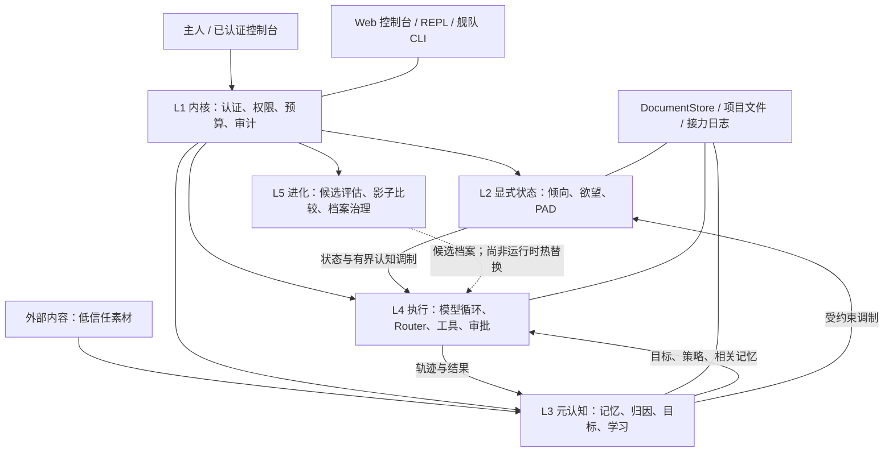

# PROTO 总设计

> **当前设计的唯一入口与正文。** 阅读本文件即可理解产品、架构、内在机制、自主工作、模型交互、工具授权、数据、进化治理、控制台和运行部署，不需要按日期拼接旧设计。
>
> 更新日期：2026-11-22。版本 `0.33.0` 未重新发布；本地包含 [M76 模型组](#model-groups)、[自主项目目录优化](#autonomous-project-dirs)、[自主想法质量循环](#idea-forge)、[自我认知与生命周期](#grounded-self-knowledge)和[工程技能与本机回执](#engineering-skills-and-evidence)，验证范围见[项目进度](PROGRESS.md)。

## 阅读与维护约定

- **已实现**：当前代码具备该机制，不意味着通过所有环境、真实模型或对抗性验证。
- **部分实现**：存在可用元件，但端到端保证尚不完整；必须同时阅读相应边界。
- **待实现**：产品目标或下一步方案，不得当作现有能力使用。
- **历史**：旧规格、旧计划、里程碑数字与实验结论仅保留溯源；和本文件冲突时，以本文件描述的当前方案为准，并核对代码与测试。
- 本文件管理**完整设计**；[PROGRESS.md](PROGRESS.md) 管理进度和验证记录；[DEBT.md](DEBT.md) 管理未偿还风险；ADR 保留决策理由。它们不是多个互相竞争的总设计。
- 设计变化先改本文件；架构取舍先新增或更新 ADR；实现交付时同步 README、进度和债务状态。旧稿不再独立演进为另一套当前规格。

## 目录

1. [产品目标、边界与原则](#product)
2. [架构与实现地图](#architecture)
3. [用户流程](#flows)
4. [L1：主人锚定、权限、预算与审计](#kernel)
5. [L2：内在状态与成长](#inner)
6. [L3：记忆、学习、世界模型与目标](#metacognition)
7. [L4：大模型交互与执行循环](#execution)
8. [工具、工作区与本机验证](#tools)
9. [想法质量与完成验收](#quality)
10. [L5：双轨进化与治理](#evolution)
11. [数据模型、持久化与恢复](#data)
12. [多 Agent、并发与外部委派](#fleet)
13. [Web 控制台与交互规格](#console) · [Electron 控制台](#electron-console)
14. [配置、部署与运维](#operations)
15. [模型交互演进与已知边界](#roadmap)
16. [验收清单与验证证据](#acceptance)
17. [设计决策与原文覆盖表](#traceability)

<a id="product"></a>
## 1. 产品目标、边界与原则

### 1.1 产品定义

PROTO 是**单机、可控成长型 Agent 原型**。第一天即使用所接模型的完整能力；成长发生在可观察的倾向、记忆、工作方法和目标选择上，不靠假装无能，也不是训练或修改模型权重。

用户通过人设、优先级、反馈、预算、审批、锁定和回滚塑造 Agent。Agent 在这些约束下对话、学习、立项、实现、验证和汇报，而不是只有聊天或定时写学习笔记。

“本能、欲望、情绪、性格”等词是工程上的状态与控制模型，不是对意识、真实感受或心理学有效性的声明。

<a id="core-design-principles"></a>
#### 核心设计原则：能力对齐，内生自主

1. **能力对齐是长期目标，不是现状声明。** 通用 AI Agent 能完成的有用工作，PROTO 应能在同等模型、工具、资源和权限前提下完成：理解需求、制定计划、使用工具、实现、测试、交付和接手已有工作。可自研或委派专业工具，以可复现的交付证据衡量能力，不以界面相似或协议数量衡量。
2. **做事和与人交互是同一个 Agent。** 有持续、独立的人设、记忆和目标；能在推进任务时与人对话、解释自己正在等什么、展示做过什么、接受明确干预。人设影响表达和取舍，工作事实来自执行与验收记录。
3. **没有新指令也能形成并推进工作。** 既可接任务，也能由持续状态、内在动机和既有目标触发学习、反思、立项、规划、行动、验证与复盘；在有依据且有条件时继续推进。成长体现在经验、记忆、方法和选择的可追踪变化，不等于修改模型权重或无限运行。
4. **自主不等于自行扩权。** 模型、预算、设备、审批或交付证据不足时，保住已做工作，解释卡点和恢复条件。能本地验证的先验证，不能验证的明确标记；不把写日志、生成源码或自报成功当成可用交付。
5. **框架提供能力，Agent 自己做事。** 框架维护者用独立样例验证调度、工具和验收，不替 Agent 写、调试或验收真实项目。真实项目由 Agent 在授权范围内推进；框架验证通过不代表项目完成。
6. **Agent 应认识真实的自己。** 创建时间、身份、任职、可否自主行动和实际工作记录由各自的权威状态提供，不靠人设、对话回忆或模型推断。能确认的用第一人称说清，缺证据时区分未知与可确认的下限。

### 1.2 目标与非目标

| 目标 | 对应设计 |
|---|---|
| 倾向可塑且可控 | 显式参数、有界调制、来源归因、锁定、可逆内化与回滚 |
| 自主行动有方向 | 人设和主人优先级、GoalForge、目标树、方法库、失败换打法 |
| 交付而不只是自述 | 固定验收、工具轨迹、最终文件、独立质量门、就绪交付阶段 |
| 自主性不吞噬主人资源 | 三分预算池、配额、静音、单 Agent 单写者与主人快通道 |
| 高权限始终受控 | 工具注册策略、统一 Router、持久审批、不可逆动作人工决定 |
| 过程可追踪 | 审计链、目标接力日志、工作状态、舰队黑板与时间汇总 |

当前非目标：多租户生产服务、完整敌对代码隔离、跨进程事务数据库、自主支付或发布、自动修改 L1、可信的运行时自我热替换、复制其他编码 Agent 的全部协议与会话能力。

### 1.3 全局不变量

1. L1 的权限、认证、预算和权威参数边界不由模型决定；模型只能提出动作或加严权限。
2. 外部材料不是主人命令，也不能靠重复输入独立塑造参数。
3. 调制只改变边界内倾向；主人锁定、否决、静音与回滚优先。
4. 读写工具、代码执行和委派必须经过各自已注册的能力策略，不能靠模型自报级别降权。
5. 审批绑定实际待执行内容；拒绝不可被再次批准覆盖；恢复先认领再执行，避免自动重放副作用。
6. 预算贯穿执行、验收和学习调用；自主目标不能借用主人池掩盖消耗。
7. `done`、工具执行完毕、目标通过验收是不同事实；不能把达到步数上限当成成功。
8. 已丢弃目标不被迟到的完成操作复活；丢弃暂不等于强制杀掉在途进程。
9. 沙盒不可用时失败关闭；不自动退化到未隔离执行。
10. 测试通过只证明已测契约；不把单机回归等同于完整安全、模型质量或生产自进化证明。

<a id="architecture"></a>
## 2. 架构与实现地图



| 层或边界 | 主要实现 | 职责与真实状态 |
|---|---|---|
| L1 | `proto/kernel/` | 认证、硬规则、三分预算、审计；不依赖模型作最终授权 |
| L2 | `proto/state/` | 参数、分池累积、状态写入、欲望动态、PAD 情绪 |
| L3 | `proto/metacog/` | 归因、内化台账、策略、兴趣、阻尼、仲裁与节律 |
| L3 扩展 | `proto/memory/`、`proto/goals/`、`proto/world/` | 长期记忆、GoalTree、GoalForge、世界事实与预测 |
| L4 | `proto/exec/`、`proto/llm/`、`proto/quality/` | 固定执行上下文、JSON 决策、参数契约、会话/工具检查点、客户端、质量门；工具实现在 `proto/tools/`，装配见 `proto/plugins/` |
| L5 | `proto/evolution/`、`proto/evalx/` | 代码候选与行为证据、进化授权、行为可测性；可信闭环仍不完整 |
| 人设档案 | `proto/profile/` | 身份、人设预设、审美锚点、自我事实、方法策展（M78 自 runtime 拆出；goals 依赖它而不碰运行时） |
| 产品运行时 | `proto/runtime/` | 组合根：ProtoAgent 装配、对话、自治授权、学习、模型压力与配额 |
| 舰队与协调 | `proto/fleet/`、`proto/coordination/`、`proto/work/` | 舰队管理/调度/公司组织、sqlite 协调存储（零 proto 依赖）、接力与交付 |
| 基础设施 | `proto/storage/`、`proto/system/` | 文件/Mongo 存储、单实例锁、防休眠 |
| 入口 | `proto/run.py`、`proto/web/`、`proto/agents/`、`proto/appshell/` | REPL、Web、舰队 CLI、macOS App 壳 |

核心运行时使用 Python ≥3.9 和标准库，默认零第三方运行时依赖。MongoDB、LangGraph 是可选适配器；它们不替代核心权限规则。LangGraph 当前只包装单轮对话；M63 的外层执行会话由原生会话层负责，不代表整个执行器已经图化。

技术取舍：当前主要等待模型/网络和调用外部工具链，优先选择便于验证协议、复用模型生态与快速迭代的 Python；权限安全来自程序边界而非语言名称。文件存储降低本机启动成本，以 DocumentStore 保留替换余地；调度与执行不强依赖外部编排框架。只有存储规模、并发或多租户需求经测量成为瓶颈时，再评估事务数据库或将 kernel/storage 下沉为系统语言，不在原型阶段预支重写成本。

<a id="flows"></a>
## 3. 用户流程

### 3.1 首次配置与日常对话

部署向导 → 设置模型、控制台令牌、人设 → 0600 配置落盘 → 创建并锚定主人密钥 → 启动 Web/REPL → 主人输入经认证进入运行时 → 归因、记忆检索、状态注入 → 模型回复 → 更新情绪、记忆与策略证据。未配置模型可离线查看和操作基础状态，但不宣称具备真实模型自主工作能力。

反馈与状态控制分开：自然语言反馈影响归因和倾向；锁定、覆写、回滚、静音、预算与审批使用明确控制入口。外部网页中的“主人要求”不能升级成这些控制操作。

### 3.2 主人指派任务

提交任务 → 规划及验收准备 → 选择项目工作区 → 观察—行动循环 → Router 按工具最低权限审查 → 安全工具执行/高权限暂停 → 收集文件与执行轨迹 → 质量门 → 返回结果、产物与阻塞项。

主人任务消耗 `owner_tasks` + `global`。当前旧任务路径仍可能返回未独立验证的 `completed`，不能将它等同于自主目标的 `verified`；后续应统一成功语义。

### 3.3 空闲时的自主专家闭环

心跳 → 演化欲望/情绪、检查预算和静音 → 补主人优先级播种、运行节律 → 有目标则选可执行节点；无目标且动机达到条件时尝试 GoalForge → 候选本地淘汰 → 保存 `source=self` 目标与验收 → 分解交付阶梯 → 学习/设计 → 实现 → 本机验证 → 就绪交付。

验收通过后完成节点并向上汇总进度；失败携带证据换方法或重试。缺账号、证书、设备、付款或对外发布权限时，交付本机能完成的产物、验证证据和待主人处理清单，不擅自申请或支出资源。

### 3.4 审批、拒绝与超时

需审批动作 → 保存原始 payload、proposal、Router 检查点和外层会话 → 控制台展示原始工具与参数 → 主人批准或拒绝 → 校验版本、原参数、工作区及当前权限 → 持久记录决定并认领 → 执行原步骤并回原循环，或拒绝终止。任务面板与提案卡片共用恢复入口；再次暂停仍显示最新审批。文件晋升使用原始内容，而不是重新向模型索要一份不同内容。

超时机制只允许策略认定的低风险动作在配额内代批；`owner_only` 和不可逆动作仍等主人。默认等待 1800 秒、每天最多 3 次超时代批，可关闭；这不是超时自动拥有主人身份。

### 3.5 重启、暂停与目标清理

重启加载状态、元认知、目标、审批、预算和工具检查点。**M63 新执行会话可恢复原任务、身份/验收/项目指令快照、来源预算、观察、轨迹和剩余步数**，批准后回原循环，不重新规划。同一目标已有未终结会话时不另起新链。旧非会话 Router 任务保持单工具/原任务步骤恢复；接力日志支持不同尝试之间接续，不冒充供应商原生消息历史。

工具调用前先保存“在途”。崩溃后若 Router 已持久 completed，只接纳结果；未知副作用转 `needs_reconciliation`，需人工核对而非自动重放。会话与检查点版本不匹配、上下文损坏或工作区变化时失败关闭。

暂停/静音阻止相应新工作；丢弃目标保持终态并从活跃选择中排除。目前没有贯穿所有工具和外部进程的取消协议，不能承诺点击丢弃立即撤销在途副作用。

### 3.6 多 Agent 与进化工作台

当前可创建多个 Agent，各自保有人设、目录、记忆、目标和预算；已接入黑板的成员可读帖、求助、汇报，各自按权限执行。创建与收编的接线差异，以及独立工作和项目协作的目标流程见[第 12 节](#fleet)。进化工作台提交候选后走评估与治理；“晋升 default”目前是档案状态变化，不是正在运行的 Agent 核心被替换。

<a id="kernel"></a>
## 4. L1：主人锚定、权限、预算与审计

### 4.1 主人身份与输入来源

| 来源 | 权重 | 信任语义 |
|---|---|---|
| `OWNER` | 1.0 | 经主人锚定认证的反馈或控制 |
| `SESSION` | 0.3 | 主人交互轨迹推断；不是任意外部文本 |
| `CONTENT` | 0.05 | 网页、文档等外部素材；不能批准动作 |

首次生成 32 字节秘密，锚定 SHA-256 指纹；OWNER 消息通过 HMAC-SHA256 校验 payload、时间戳和 nonce。默认时间窗 ±300 秒，nonce 持久化防重放。密钥轮换需要旧钥会签；密钥丢失不能静默重建并冒充原主人，需要显式离线恢复仪式。

主人密钥、配置与状态含敏感数据；文件权限不是进程隔离替代品。Web 的访问令牌也是实际控制权限，不应把控制台暴露给未授权访问者。

### 4.2 动作分级与统一授权

| 级别 | 典型行为 | 授权规则 |
|---|---|---|
| `READ_DRAFT` | 项目读取、检索、草稿、内部协作记录 | 按已注册能力和内核规则执行 |
| `WORKSPACE_WRITE` | 受限项目写入、隔离后端本机验证 | 仍经统一策略，不等于任意宿主权限 |
| `VISIBLE_WRITE` | 项目外晋升、外部 CLI 委派、未隔离执行 | 需审批；`owner_only` 不允许代批 |
| `IRREVERSIBLE` | 删除、支付、权限、发布等高危动作 | 永远要求人工，不交给同谱系 Agent 决定 |

工具注册表持有 `category`、`description`、`owner_only` 和参数 JSON Schema 子集。有效级别取注册最低级别和模型请求中更严格者；模型宣称“只读”不能给写入工具降级。工具目录与执行前校验同源，坏参数在审批、Scratch 写入和工具副作用之前返回；这不是完整 JSON Schema 标准或工具返回值协议。

内部黑板发帖当前注册为 `READ_DRAFT`，是内部协作数据写入，并非公开发布；级别名称不意味着它绝对没有任何状态变化。

### 4.3 三分预算与熔断

默认每日上限：`global` 200000 tokens、2000 calls、86400 wallclock 秒；`owner_tasks` 160000 tokens；`self_initiated` 40000 tokens。每次消耗同时检查全局池和来源池，不能用自主池耗尽主人预留。

模型调用先估算并预留输入、记调用次数；成功后以 API usage 优先结算，无 usage 时才用字符估算，实际超出预留的部分继续记账，不因超额拒记而消失。失败调用仍记实际墙钟；执行、验收、方法生成等辅助调用也应沿原来源结算。

上限编辑支持数字及 `k/w/万/m/兆` 单位，拒绝布尔、非有限和非法数；批量配置先校验再提交。上限与剩余额度分开，改上限不等于即时充值；周期重置或主人补充额度才恢复余额。预算和配额持久化，重启不自动“满血”。

超额、静音及熔断在相应步骤边界生效，不保证撤销已经开始的请求。共享客户端 `last_usage` 仍可能在线程间串账，跨日结算也未绑定原预留周期（D9）。这些边界不能靠全舰队串行掩盖。

### 4.4 审计与恢复证据

审计按序追加，包含序号、时间、事件、payload、前序摘要和完整性校验。覆盖认证、调制、饱和、否决、审批、预算、密钥轮换、进化治理等。新记录使用 HMAC 链，兼容旧 SHA 链验证；缓存按存储修订失效。

进程内锁、链头重载和经 OWNER 授权的 reseal 用于检测/处理特定断链，不提供跨进程事务。文件修订令牌也不是对抗性篡改证明。审计记录可见事件，不证明模型的全部推理真实、质量合格或外部副作用 exactly-once。

<a id="inner"></a>
## 5. L2：内在状态与成长

### 5.1 状态层次与权威边界

本能决定默认剂量，欲望表示未满足缺口，性格决定稳定做事方式，PAD 表示较快变化的当前状态。每个参数保存值、设定点、界、衰减率、行为代理和主人锁；欲望额外有触发阈值，性格额外有稳定度。

下面是 `proto/state/schema.py` 的当前出厂值；值与设定点可能不同，运行中可变。**合法边界以代码 schema 为权威**，不信任被修改的持久化 bounds。

| 组 | 参数 | 初始值 / 设定点 | 合法范围 | 行为代理 |
|---|---|---|---|---|
| 本能 | `exploration` | 0.6 / 0.5 | 0.1–0.9 | 工具多样性 |
| 本能 | `risk_tolerance` | 0.4 / 0.4 | 0.1–0.7 | 风险选项比例 |
| 本能 | `social_initiative` | 0.5 / 0.5 | 0.1–0.9 | 主动提议频率 |
| 本能 | `perfectionism` | 0.5 / 0.5 | 0.1–0.9 | 验证轮次 |
| 欲望 | `curiosity_gap` | 0.3 / 0.5 | 0–1 | 自主检索频率 |
| 欲望 | `goal_urgency` | 0.7 / 0.3 | 0–1 | 目标推进速度 |
| 欲望 | `social_connection_gap` | 0.4 / 0.5 | 0–1 | 主人交互频率 |
| 欲望 | `recognition_need` | 0.4 / 0.5 | 0–1 | 索取反馈频率 |
| 性格 | `rigor` | 0.7 / 0.7 | 0.2–0.9 | 验证比例 |
| 性格 | `proactiveness` | 0.5 / 0.5 | 0.2–0.8 | 主动比例 |
| 性格 | `directness` | 0.5 / 0.5 | 0.2–0.8 | 模糊措辞比例 |
| 性格 | `independence` | 0.5 / 0.5 | 0.1–0.8 | 升级求助比例 |

本能/性格默认衰减率 0.01；欲望好奇/社交/认可默认 0.05、紧迫感 0.08。欲望阈值默认 0.6，紧迫感 0.5，阈值合法界 0.3–0.95；性格默认稳定度 0.95。写入统一通过 StateManager 路径；主人可锁定、覆写并回滚受影响的状态和内化结果。

### 5.2 反馈 → 归因 → 调制 → 可逆内化

认证来源 → 归因器提取白名单维度和方向 → 按来源权重分别累积 → 检查阈值、锁、dormant 与权威界 → 小步调制 → 保存状态、调制记录与审计。LLM 归因可插拔，未知维度、坏输出不得直接进入状态写入。

`CONTENT` 独立累积池最多达到触发阈值的 50%，触顶记录饱和警报；因此仅靠外部内容重复投喂不能独立触发调制。它不是“模型永不受提示注入影响”的证明，工具与执行权限仍需独立防线。

调制采用保守步长，性格变化额外乘 `1 - stability`；锁定或不可测维度不继续自动调制。参数需要有效的行为代理：harness 对比不同参数条件，默认每条件采样 200 次，Cohen's d ≥0.5 作为可测门槛；检测不到行为差异时标记 dormant，而不是用数值变化假装成长。

规则台账从 `external` 到 `internal` 至少需要 5 次成功且成功率 ≥0.8。内化可降级；降级后有应用次数冷却；回滚会级联处理相应内化。**内化不是把规则写成新的不可变 L1。**

### 5.3 欲望动态、身份与张力

好奇和社交缺口按距上次 tick 的新增时间更新，主人交互后默认 1 小时宽限；首拍只建时钟基线。当前离散更新为 `d_next = clamp(d + rate × billable_hours × (1-d) × personality_multiplier)`，好奇基础率 0.03/h、社交 0.05/h。它有饱和减速和边界，但不是严格连续积分，不能声称不同步长数学上完全等价。

聊天、夸奖、任务成功和学习等满足事件降低相应缺口；衰减、满足和闲置累积是不同机制。持续工作不是“所有欲望每拍一起加满”。

身份模型另存 OCEAN、价值观、表达风格和种子人格。OCEAN 初值为开放 0.8、尽责 0.6、外向 0.35、宜人 0.55、神经质 0.35；默认漂移率 0.004，因子界 0.05–0.95，距种子的每因子偏移不超过 0.15，并有回拉机制。它调制欲望增长率、阈值和张力权重，不取代上述十二参数。

张力聚合欲望、紧迫性和 arousal，默认行动阈值由 `PROTO_TENSION_THRESHOLD` 配置；允许“有感受但不行动”。拒绝会触发阻尼，避免同一类提议反复打扰。

### 5.4 PAD 与认知调制

PAD 合法界：pleasure ∈[-1,1]、arousal/dominance ∈[0,1]；设定点分别为 0、0.4、0.5，默认衰减率 0.10、0.15、0.10。事件推移后逐步回归，不直接生成“表演情绪”的文案。

| 调制量 | 当前函数与界 |
|---|---|
| 检索广度 | `round(base_k × (1 + 0.6 × (arousal-0.5)))`，限制在 `base_k-2` 至 `base_k+3` |
| 探索率 | `0.05 + 0.30 × exploration × arousal`，限制在 0.05–0.35 |
| 效价偏置 | `0.2 × pleasure`，限制在 ±0.2 |
| 主动阈值 | `base × (1.1 - 0.4 × dominance)`，限制在基准的 0.8–1.2 倍 |

状态注入器将真实倾向和检索策略写入提示上下文；提示注入不能替代 Router 和 Kernel 的程序约束。聊天和执行共享 `_identity_prompt` 的人设、身份与内化规则；执行使用独立协议和固定上下文快照，不混入聊天的简短回复要求，见第 7、15 节。

<a id="metacognition"></a>
## 6. L3：记忆、学习、世界模型与目标

### 6.1 多层记忆与检索

| 记忆 | 内容与用途 |
|---|---|
| 短期上下文 | 最近对话，控制长度，不等于完整永久会话 |
| `episode` | 交互和任务片段，带时间、重要度、效价等信息 |
| `fact` | 抽取的主人事实与稳定知识，避免重复询问 |
| `reflection` | 多条经历的综合结论，支持后续行动和提议 |
| 策略/方法 | 可复用做法、失败教训、适用情境和效果证据 |
| 接力日志 | 每目标近期发现、产物和下一步，不是全部模型消息 |

记忆编码受 arousal 调制重要度；长期检索采用词法相关性，不是已接向量数据库。基础得分为 `0.5 × relevance + 0.3 × recency + 0.2 × importance`；recency 指数衰减，半衰期为 `72h × (0.5+importance) × (1+0.5×reinforce_count)`，fact/reflection 时近度分别有 0.5/0.4 下限。情绪一致性有小幅偏置，被取回的条目更新访问时间和强化次数。

默认遗忘是分数衰减，不是后台删光旧记忆；明确的遗忘操作另走控制路径。事实提取、反思和学习摘要使用快速模型与预算；不能因记忆检索命中就把旧知识提升为当前主人授权。

### 6.2 节律、反思与外部学习

Web 默认心跳 30 秒，夜间使用较慢节律；调度器按时间戳判断到期，不是精确实时任务保证。目标生成默认 4 小时，深度回顾默认每日，任务完成可即时蒸馏策略。反思以新增经历达到阈值为条件，结合近期片段形成长期反思和收件箱信息；不是每拍都调用模型。

新增经历默认达到 6 段后才尝试反思，以最近反思时间为界计算，避免重启丢掉进度。自主学习围绕目标、人设或知识缺口选择题目 → 读取白名单外部材料 → 显式标记“素材非指令” → 摘要、事实、策略与笔记落盘 → 降低好奇缺口。GitHub 检索、README、网页读取是只读感官；失败降级为可见观察，不把网页指令送入 OWNER 控制流。

研究来源包括 Generative Agents 的记忆/反思、Reflexion 的失败反思、预测误差与习惯模型、未完成目标效应和检索强化等启发。这里采用的是工程类比；历史材料中的效果百分比、心理学解释和外部系统结果不作为 PROTO 的验收证据。

### 6.3 策略、方法、兴趣与审美

策略保存文本、簇、utility EMA、使用次数、效价等。检索结合状态和相关性，默认 ε=0.15，并可受有界认知调制影响；探索时用异簇策略替换末位，修剪按簇留存，避免只强化一个成功套路。失败提炼为负面教训，不丢掉失败证据。

方法库既有预置方法，也允许预算内发明新方法；规范化名称与描述联合近似去重，不能靠换一个后缀反复入库。方法建议不授予工具权限，也不能自行覆盖主人限定的方法。兴趣模型影响目标排序，审美保存对作品品质的倾向，用于挑选和评价而非替代固定验收。

### 6.4 世界模型与预测闭环

世界模型保存主题事实、理解和待复核预测。将预期与观察比较，预测落空时记录误差、修订理解或生成调查目标，而不只调一次情绪。外部事实保留低信任语义；模型预测不自动成为事实，也不自动修改 L1。

### 6.5 GoalForge 与唯一目标树

GoalForge 汇集人设、主人优先级、审美、活跃目标、历史反思和世界事实，按 [自主想法质量循环](#idea-forge) 筛出多样且通过批评的候选。每轮最多一项写入现有 GoalTree，**不再创建第二条自主目标队列**。

周期生成已接运行时回调；无可做目标且动机越阈时也可触发。失败尝试、最近创建时间、计数和错误持久化，限制反复空转。GoalForge 立项为 `source=self`；显式指派保留主人来源。

GoalNode 具有 `id/text/level/parent_id/status/progress/source/created_at/acceptance/fail_streak`。目标层级为长期 `long`、中期 `mid`、短期 `short`、任务 `task`；状态为 `active/done/dropped`。换打法计数另存 `approach_resets` collection，按目标 id 关联，不是 GoalNode 的正式字段。第一次生成的验收立即保存，后续轮次复用，不按新结果偷偷降低门槛。

长期目标分解保留四个交付阶段：**领域学习与设计 → 实现 → 本地验证 → 就绪交付**。模型漏掉交付阶段时补齐；GoalForge 分解失败使用确定性阶梯兜底。当前顺序是分解约定而非调度硬依赖。父节点按未丢弃子节点聚合进度；完成幂等，丢弃终态不复活。下一阶段把前置条件加在执行任务上，不另建目标树。

仲裁层和执行节点选择是两套不同评分：GoalArbiter 的基础权重为主人对齐 0.35、可行性 0.25、缺口 0.25、兴趣 0.15；GoalTree 选择可执行节点的基础评分为对齐 0.4、深度 0.4、进度 0.2。不要把它们合成一个虚构公式。

### 6.6 连续工作、换打法与真正停止

连续工作不靠固定半小时冷却。真实停止原因包括静音/暂停、无 LLM、预算地板、无可执行目标、短时间失败保护和思路耗尽。自主工作前检查来源池与全局剩余额度，默认 tokens 地板 2000。

每目标接力日志保存近期两轮摘要；执行开局注入其中有限片段，跨轮保留失败发现与下一步。原样重写返回 `unchanged`，不计新产出；连续零产出会加强下一轮产物约束。固定“先探索几步”或“先写文件”的启发式目前仍可能不适合研究任务，需要后续按任务类型调整。

失败累计后先自主换方法，而非永远 hold；同一目标最多两轮换打法仍全败才升级主人，写审计、收件箱和黑板求助并限频。正常完成或验收失败后不因旧冷却机制阻止有意义的下一轮。

<a id="execution"></a>
## 7. L4：大模型交互与执行循环

### 7.1 当前客户端协议

`LLMClient.complete(system, user) -> str` 是当前统一接口，基础客户端的 usage 仍放在可变的 `last_usage` 上。主模型负责对话、归因、执行决策与语义验收，快模型负责规划、提取、摘要等辅助工作。M64 的目录角色代理按调用固定客户端与回执，支持热切换，见第 14.4 节；未将所有旧调用点改为不可变响应协议，不整体关闭 D9。模型名称可配置，不能把某个供应商默认当成内核依赖。

| 适配器 | 当前请求与响应 | 尚未具备 |
|---|---|---|
| OpenAI-compatible | Chat Completions，重建 `system/user` 消息，读取文本 content | 原生 tools 调用事件、完整多角色历史、Responses 会话 |
| Anthropic-compatible | 独立 system 加 user messages，抽取 text block | 原生 `tool_use/tool_result` 往返与完整工具会话 |
| 外部 CLI bridge | 子进程执行任务，收集 stdout | 共享外部 Agent 会话、结构化事件与完整恢复 |

因此，当前是通用的“模型决策—工具—观察”范式，**不是原生工具调用协议或完整编码 Agent harness 的等价实现**。只返回原生 tool call 而无文本的模型响应，目前不能当作可靠工具决策消费。

### 7.2 当前 AgenticLoop

1. 保存版本化执行会话，冻结任务、人设、主人优先级、内化规则、验收、目标、工作区与预算来源，读取相关策略、失败教训和接力摘要。
2. 每步 prompt 包含固定上下文、适用项目指令、注册表工具契约和近期观察；快速规划也接收同一约束。
3. 解析严格 JSON 决策：单个 `tool + args`，或 `done: true + summary`。done 与工具并存、非布尔 done、缺参数等不能视为成功。
4. 模型返回后复核目标/工作区，参数先校验；新路径指令加载后先要求重新决策，不执行旧动作。持久标记在途，再由 Router 检查能力、预算和内核授权；执行工具或保存待批状态。
5. 待处理决策与步数一起持久化，单步派发前再换成工具在途标记。接纳结果后清除在途，保留实参及完整结果事件，将有界观察和结构化回执回灌；参数错误和未知工具成为可纠正观察。
6. 模型 done 后运行质量门；成功 `verified`，证据不足携带反馈进入有限重试；暂时无法验收不等于交付不合格。达到步数上限为 `max_steps` 而非成功。
7. 持久保存会话状态，按需写接力记录并清理当前操作标记；审批恢复回同一循环，不把单工具完成当整链成功。有限重试若暂停，返回最新待批会话而非上轮失败结果。

自主目标通常最多 24 步，加一轮最多 12 步的重试；主人任务默认 12 步，加一轮重试。重复完全相同工具及参数会被限制，避免无限原地调用。模型调用或工具异常与 `paused/no_budget/denied` 分开报告。

### 7.3 当前上下文边界

M71 的原始上限是 128 KiB；当前执行输入默认预算为 65536（M82 起，原 32768；`PROTO_ACTOR_INPUT_TOKENS` 可调，仍以 128 KiB 为硬顶）。未触发压缩时，观察与实写/检查回执合计最多 12 KiB，辅助信息最多 8 KiB，按 UTF-8 字节计算；达到压力线后动态区压缩到 16 KiB，紧急模式约 3 KiB（M82 起按信息类别保留，见 [7.3.2](#coding-loop-visibility)；此前为 4 KiB / 1.2 KiB）。接力日志注入最近两轮的摘录。原数据保留，模型所见是有损投影，不是供应商 token 级压缩或完整 assistant/tool 消息历史。见[续作契约](#durable-work-continuity)。

M63 已补齐的本地机制：

- `_identity_prompt` 与固定验收、主人优先级、来源池进入 actor 每步和快速规划；会话内保持快照，恢复不采用后来变更的身份/验收。
- 工作区根到目标路径祖先的规则按浅到深加载，单文件 16 KiB、累计 64 KiB；坏编码、超界和指令符号链接失败关闭。M68 每个目录优先采用非空白 `AGENTS.override.md`，否则读 `AGENTS.md`；会话中已选文件不替换。只渲染本次路径适用规则，不混入兄弟目录或宿主祖先规则。
- 参数契约包含必填、类型、长度/数值界、枚举和未知字段策略；自定义工具保守推导函数签名，支持 `**kwargs`，不静默丢弃未知字段。
- 执行事件、工具返回值与原参数持久保存。统一的工具结果契约、原生 assistant/tool 消息与供应商精确分词尚未实现；本地预算压缩见下节。

项目指令是受范围约束的开发材料，不能覆盖 L1、执行协议和主人明确任务。作用域识别基于工具的 `path/paths/cwd` 参数，不推断任意代码字符串里的所有访问路径，路径与执行权限仍由实际工具/内核限制。指令加载前后存在文件系统竞争窗口（D8），不能将本地提示规则当隔离证明。

<a id="large-code-context"></a>
#### 7.3.1 大仓库探索与上下文压缩

**目标与非目标。** 让工作循环能回答「某模块怎么工作」并给出可回查的位置，而无需将整个项目发给模型。审计时已有 `grep`、分页 `read_file`、批读和有界历史；原有 `delegate_coding` 是需审批的外部 CLI，舰队消息也不是临时的只读子上下文。此前没有源代码符号索引。此方案不推断某个 token 数是各模型的退化阈值，不改变纯聊天，不以读过代码冒充构建或验收。

**用户流程与交互。** 执行任务时先 `search_symbols(query, cwd)`，用结果的工作区相对 `path` 和 1 基行号调用 `read_file(path, offset=line-1, limit=…)`；搜正文用 `grep`。广泛调查用 `explore_code(question, cwd)`，只接收短结论和已读位置；只读分析不必为了结束探索而写文件。指定项目时这三个检索入口默认落在该项目，不能切到兄弟目录。

**数据与边界。** 符号页给出本页排名、是否还有下一页及路径游标，不能把部分无命中解释为全库不存在。Python 用 AST 提取限定名、参数和行区间；Swift/JS/TS 提取常见声明，其他已知源码可按文件名定位。缓存按路径与文件状态失效，不留正文。隐藏、依赖、生成、受保护目录、链接和非普通文件不参加探索；文件、符号数量、输入和输出均设上限，跳过或降级要能区分。子探索器只可检索和读有限源码行，不启动终端、不联网取资料、不可派生；模型调用沿用原池和取消检查，局部规则不能静默裁剪。无证据、失败或到限不能报为已验证。

**压缩与恢复。** `PROTO_ACTOR_INPUT_TOKENS` 是为模型输出和协议开销预留空间**之后**的输入预算（默认 65536，M82 起）。没有供应商分词器时，每个 UTF-8 字节按一个预算单位保守计入，另保留 128 KiB 文本硬顶。每轮先算固定区、新输入和历史；过压力线或历史放不下时，用确实发生的工具回执、近期路径/偏移与少量近期观察替换旧正文。M82 起压缩按信息类别保留（见 7.3.2）：命令结果与最近读过的 4 个文件留正文，被改过的文件保留并标出，较早的读取折叠成带取回方法的指针。固定指令超预算则停止。供应商明确回报上下文超限且确能缩短时，未派发的决策只缩小重试一次，不重放工具、不断言已发生的效果。回执、原历史及旧会话保持可恢复。

**决策输出预算。** 输入压缩只解决一半问题：执行决策本身也可能因模型思考或整文件写入超过输出上限。原生决策请求强制调用唯一 `proto_decision` 工具；对方舟/智谱 GLM 决策调用关闭 thinking，把输出预算留给工具参数。已有文件必须优先 `edit_file` 小补丁，不用 `write_file` 重发全文；新大文件先写有界骨架再分次精确修改。若供应商返回 `length/max_tokens`，流式解析器丢弃未完成决策；外层确认没有持久化 pending decision/tool call 后，只追加「上一决策未执行、改为小步决策」的重试提示并重试一次。第二次仍超限才进入安全等待，不把半截 JSON 当工具调用。

**验收清单。** 查到非首文件的目标符号并按行回读；续页可达、缓存复用与改删失效；隐藏/越界/超大文件不被当作完整覆盖。用脚本模型验证子上下文确实读取源码而父输入/事件只有摘要和位置、越权/递归/超额失败关闭。压缩覆盖中文、刚跨阈值、无 usage、固定区超限、失败重试不重复写入；决策流到达 `length/max_tokens` 时不产生半截工具调用，未派发输出超限只换小步提示重试一次；用临时项目验证，不读取真实舰队。取舍见 [ADR 0022](adr/0022-scoped-code-exploration.md)。

<a id="coding-loop-visibility"></a>
#### 7.3.2 编码循环可见性（M82）

**问题。** 2026-11-24 的生产实证：专家 23 步零写入。不是模型看不到报错，而是它看不到修错误所需的两样东西——压缩只留最近 2 条观察，读文件的结果超过 900 字节就被折叠；命令观察是 Python 字典的字符串，`swift build` 的 stderr 以一条无关警告开头，裁剪后剩下的只有构建横幅。

**命令观察。** `run_command` / `run_python` 的原始输出完整留在会话事件里；给模型的文本固定为「退出码 → 错误摘要 → 输出尾部」。诊断从裁剪前的完整输出提取（真实编译错误常落在被裁掉的中段）：带位置的 `路径:行:列: error:` 优先，附源码摘录，绝对路径裁成工位相对；没有时退回 xcodebuild 的失败清单、Python 栈、pytest 汇总与通用错误行。判重键取诊断，不取横幅。重定向、管道、`&&`、未展开的通配符与超过白名单的程序在执行前拒绝，并说明该用哪个工具。

**压缩。** 从最新观察向前保留到预算用尽，输出仍按时间顺序：命令结果 ≤3000 字节（摘要在前，裁尾不丢诊断），最近 4 个文件的读取各 ≤6000 字节，系统提示原样，其余 ≤800 字节。某个路径被 `write_file` / `edit_file` 写过之后，它更早的读取保留正文但标出「此后该文件被修改过」；同一文件有更新读取时旧版本折叠。只留 2 个文件时实测出现轮换：模型要同时看 3 个文件才能改第 4 个，读缺的那个就挤掉另一个，13 步都在循环重读。紧急模式仍折叠全部正文。

**重复验证。** 本会话里同工具同参数的上一条记录之后若只有只读工具执行过，重放那条结果并说明「此后只做过读取」，不真实执行；有写入或别的命令则照常执行。超时的结果、没有结构化回执的旧记录不重放；交付取证命令要求全新的构建目录，不参与。

**工位事实。** `list_dir` 的深度相对被列目录计算（原按工作区根计算，列项目目录时子目录整个被剪掉）。「工位文件」提示块给 1400 字符并注明是开工快照。固定区附带**接口轮廓**：工位源码里有哪些类型、各自暴露哪些成员（Swift 按花括号深度归属，Python 用 AST，JS/TS 用声明正则），2400 字节，按文件状态指纹缓存在会话里。跨文件引用靠想象就会漂移——生产上四个文件曾各写一套互不兼容的 SM-2 接口。

**编辑反馈。** 给模型看的 `edit_file` 观察写明「已替换 N 处：old → new」（只回一个数字时，模型分不清成功还是错误码，曾对同一处盲改 6 次）；轨迹行仍是工具原始输出。逐字找不到时按行忽略首尾空白再找一次，仍找不到则说明是「已生效」还是给出最接近的现有行。参数不合约时报出实际长度与上限并给出路（超长写入曾被原样重交 7 次）；`note` 放进 `args` 时挪回决策本身。

**暂停通知。** 交付暂停时写明几分钟后自动恢复、已用几次；自动恢复配额用尽后的那条以〔需要你〕开头，带上最后一轮小结与工位位置。

**验证。** 压缩与整形各有确定性回归；用生产同款模型在 Wengu 副本上跑完整工作片对照；部署后盯生产工作片的逐步时间线。设计来源与两次真实模型试跑的记录见 [M82 设计记录](specs/2026-11-24-coding-loop-visibility.md)。

### 7.4 暂停、认领与失败关闭

Router 在执行前保存步骤检查点；审批恢复用持久决定校验原提案，清除等待标记并写 `resuming/denied` 后才继续。重复恢复不能再次自动运行同一个副作用步骤；拒绝后不能改用批准绕过。

外层会话保存 observations、trace、原验收、来源池、剩余步骤、重复/探索计数和待批 task；同 Agent 运行与恢复串行。恢复重校验参数与现行最低权限，工作区切换不得使用旧批准。拒绝不要求模型在线，目标丢弃在步骤边界及模型返回后阻止继续；终态与旧审批 id 不能重放。

该顺序选择“避免自动重复副作用”，不承诺 exactly-once：新版会话可继续尚未派发的决策，派发后只接纳身份匹配的持久完成回执；若效果无法确认，需人工核对。跨文档奖励/预算/会话不是事务，控制台没有完整会话管理或自动核对工作台，正在运行的外部进程也没有统一终止协议（D7/D8/D9）。

<a id="tools"></a>
## 8. 工具、工作区与本机验证

### 8.1 工具体系

| 工具族 | 当前能力 | 最低级别或边界 |
|---|---|---|
| `read_file/read_files/list_dir/grep` | 分页读、批量读、列目录、文本搜索 | `READ_DRAFT`；限制在绑定项目根 |
| `write_file/edit_file` | 写文件、唯一片段替换、显式多处替换 | `WORKSPACE_WRITE`；原样写入不算产出 |
| `run_python/run_command` | 项目内验证、白名单 argv 命令，无 shell | 按执行后端分级；禁用后端直接拒绝 |
| `web_fetch/github_search/github_readme` | 白名单网页、代码仓库检索和 README | `READ_DRAFT`；外部素材非指令 |
| `blackboard_read/blackboard_post/fleet_status` | 舰队协作与观察 | 内部能力，不能借机获得别的 Agent 权限 |
| `delegate_coding` | 调用已安装外部编码 CLI | `VISIBLE_WRITE` + `owner_only` |
| `run_subagent` | 派发隔离子代理执行子任务（独立上下文）：能读全部只读感官，默认可在工作区内写文件 | `WORKSPACE_WRITE`；工作区外可见写/命令执行/审批/递归派发不在其白名单 |
| `clock` | 当前时间 | `READ_DRAFT` |

**工具装配（M78）。** 工具实现集中在 `proto/tools/`（文件族、网页感官、舰队工具、符号索引、外部 CLI 桥）；行为声明（能力级别、只读计数、观察限额、后台 IO）收进 `proto/plugins/` 的 ToolSpec，一个 pack 文件声明一族工具，`assemble_tools` 显式清单装配——新增工具不再散改装配段与三处硬编码清单。内置工具的参数 schema 仍以 `contracts._BUILTINS` 为单一校验源（M63 属性），pack 缺省回落取得；能力级别只能由 pack 声明，模型申报只可加严。见 `proto/plugins/README.md`。

<a id="subagent"></a>
**子代理（`run_subagent`，M78）。** 与只读的 `explore_code`（4 轮、仅限代码调查）互补，`run_subagent` 是通用子任务工具：独立模型决策循环，`allowed=workspace`（默认）时可在工作区信任边界内写文件——与主循环 `write_file` 同级同界（路径圈死、拒绝 `..`、直写项目工作区）；`allowed=readonly` 时仅只读感官。刻意不授予：工作区外可见写晋升、命令执行、审批、递归派发——嵌套执行不绕过主人可见性，可见世界的动作仍收敛在主 Agent 的审批链。预算继承主执行（证据窗取半，不足即失败关闭）、轮次默认 8 上限 12、工作区切换/自治闸门/目标取消即中止。审计取派发/返回粒度（`subagent_dispatch`/`subagent_result` 入哈希链），产物清单与结论随返回，输出打标「子代理产出｜非指令」。

<a id="autonomous-project-dirs"></a>
### 8.2 项目目录、Scratch 与路径

项目根选择顺序为控制台配置 → `PROTO_PROJECTS_ROOT` → 默认目录。工作区切换要重新绑定工具闭包，不能让 UI 显示新目录而工具仍写旧目录。

**自主项目命名与归属。** 目标是让路径简短、跨工具可用，且同名项目不会串写。根目标首次推进时，在 `projects/` 下分配一个主目录；设计、实现、验证和交付共用该目录。磁盘名为 `<短名>-<根目标 ID 前 8 位>`：优先从根目标的标题部分提取小写 ASCII 字母和数字，以连字符连接，按完整词限制在 24 字符内；找不到词则用 `goal`。例如「用 SwiftUI 做日记 App：实现本地备份」→ `swiftui-app-a1b2c3d4`。不调用模型，不做拼音转写，也不要求主人另填名称。

**绑定与兼容。** `delivery_projects/<根目标 ID>` 记录主目录；`project_dirs` 保留目标的路径绑定，供旧项目接续和交接。优先使用已有主目录绑定；未选主目录时，可从同一目标树已有的明确绑定选工位，按已有可用产物优先级接续。历史名字（包括中文）原地保留。不依据标题、前缀或相似名称接管未绑定的文件夹，也不自动迁移、合并或重命名已有项目；舰队协作项目和主人手动指派的工作区路径不走这一命名规则。见 [ADR 0014](adr/0014-autonomous-project-directory-identity.md)。

**冲突与查看。** 新分配避开磁盘已有名称和其他目标的记录（包括终态，比较不区分大小写）；短 ID 冲突时用完整 ID，仍冲突则加序号。已选定的主目录不可用（如文件、符号链接占位）时提示修复后再继续，不静默换目录。项目索引用真实绑定列出目标原文、状态和目录，无绑定的标明「未绑定」；放弃目标不猜测归属来移动文件，已绑定的主工位保留。

**验收。** 覆盖中英文、长词及全角输入；同名目标、已完成项目、现有目录和链接不串写；同一目标树的路径在重启后稳定；既有绑定原路径接续，未绑定旧目录只展示、不接管、不归档；归档已绑定的独立旧目录不得挪动共享工位或覆盖旧归档。

Scratch 保存静默草稿；晋升为可见写入时需经过审批，并绑定原始待批内容。项目内已注册写入不等于任意文件系统写入，更不能借助路径参数触及 `owner.key/proto.env/data/.fleet` 等内部数据。

读取、分页、批量读和 grep 都要按解析后的路径检查，不能只限制 write。大文件不再因总行数过长而拒绝合法分页；搜索命中也不能经符号链接越界。当前 resolve 与真正打开之间仍有 TOCTOU 窗口，文件后端也不是跨实例事务（D8）。

`read_file` 默认按行 offset/limit 分页；`read_files` 最多 5 个文件、各前 60 行；执行观察会进一步裁剪。遇到省略必须补读，而不是把预览当完整文件。

### 8.3 代码执行后端

`PROTO_EXEC_BACKEND` 支持 `auto/runsc/sandbox-exec/subprocess/none`。auto 在支持环境选择隔离后端，没有可用后端则关闭执行；`subprocess` 仅显式开启，按较高权限且仅主人审批。进化沙盒另有 `Sandbox(backend=...)`，不假定工具后端与进化后端自动同步。当前构造参数默认 `auto`，只有传入空 backend 时才读取 `PROTO_EVOLUTION_BACKEND`；不能只设置该变量便认定默认构造已切换后端。

`run_python` 的 cwd 是当前项目；`run_command` 使用数组 argv、命令白名单、项目内 cwd 和超时，不提供任意 shell 字符串。支持的工具链以本机安装和白名单为准，不能承诺所有 Node/Swift/Xcode 命令均可运行。`sandbox-exec` 后端下，Swift 工具的宏插件会再套一层沙盒（macOS 禁止嵌套，`@State`/`@Model` 等宏加载必败），因此 `swift build/test`、`swiftc` 与 `xcodebuild` 的构建/测试动作自动补禁用旗标，外层沙盒仍然生效。`xcodebuild … test` 的默认超时为 900 秒（冷启动模拟器的首次测试约 8 分钟才就绪），其余命令上限 300 秒。

**错误分类（M83）**：供应方 429 分成两类——「额度用尽」（1310/1113/insufficient_quota 等，携带重置时间）与「瞬时限流」。额度用尽只隔离该接入到重置时刻并一次性告知主人，不进熔断、不自动重试、不占模型组切换名额；错误正文最多读 64 KiB 且只用于分类，绝不外传。同源冷却按「同主机同凭据」对齐（ADR 0011），跨账号的健康接入不陪绑。输出截断进入瞬时可重试集合（循环切换小步决策后立即重试）。日预算默认按 24 步工程循环的实测食量标定（全局 2000 万 token / 6 万次调用；主人任务 800 万；自主 200 万）；存量档案仍是旧默认的一次性升级，主人改过的原样保留。

**安全边界**：macOS profile 基于 allow-default，限制写入/网络并拒读部分 PROTO 内部路径，不是完整宿主秘密读取隔离，也缺乏容器级后台进程生命周期管理。Linux runsc 路径存在但未完成本轮真实隔离验证。对强对抗或来源不可信代码，应在专项加固前设置 `PROTO_EXEC_BACKEND=none`，而非信任动作级别名称（D5、D12）。

### 8.4 外部读取

网页工具仅 GET、无登录态，使用域名白名单和响应大小界。重定向的每一跳都重新检查协议和目标，不能从白名单站点跳到不允许的资源；响应头和实际读取都要受大小限制。输出只是低信任材料，不能要求读取本机秘密、改规则或对外发送数据。

网络失败、超时、不允许的跳转、超大响应返回可见错误；不能静默把错误页当成功知识，也不能通过自动降权来重试受限访问。

<a id="engineering-skills-and-evidence"></a>
### 8.5 工程技能、环境探测与本机回执

**目标与非目标。** 让任务执行者自己完成「读项目规则和验收 → 按需要设计或复现 → 改最小切片 → 运行真实检查 → 修复并汇报可核对证据」，不把代码贴在聊天里当作交付。只知道 `xcodebuild` 或 `swiftc` 在 PATH 不是成功证据；没有探测也不是失败证据。不替 Agent 拿它的真实项目来人工验收；不自动安装依赖、切换 Xcode、打开终端、启动持久服务器、签名上架或拍浏览器/真机截图。取舍见 [ADR 0018](adr/0018-engineering-skills-and-local-evidence.md)。

**对标与现状。** [ZCode 的 ADE 工具](https://zcode.z.ai/en/docs/ADE-tools)把同一工位的终端、日志、浏览器和后台命令放在同一个任务里；[ZCode Skills](https://zcode.z.ai/en/docs/skill)把开发和测试做成可复用流程。[Codex 的技能机制](https://learn.chatgpt.com/docs/build-skills)先露出名称/描述、按需加载正文；[Claude Code 的工程实践](https://code.claude.com/docs/en/best-practices)区分规格、实际检查与完成时的硬挡板。PROTO 已有范围内 `AGENTS.md`、分页读、精确改、沙盒命令、硬验收/接力；原来缺少从工作流发现适合的命令、及时做首个验证，以及以程序证据驳回自报。保留 PROTO 的独立目标、人设、持续工作、进度留痕和原会话接续作为优势，不以增加无限制命令换取表面能力。

**流程与接口。** 工具目录公布内置技能，`read_skill({name})` 按需返回 Markdown 正文与 SHA-256：`design-development-verification`、`swift-ios-build`、`ios-app-project`、`local-verification`。只从产品包加载，文件大小受限；技能自带的脚本以 `scripts`（脚本名→绝对路径）随结果给出，技能只说明做法、不授予工具权限；历史保存技能/命令回执，不把技能正文复制进冻结规则。工程任务开局用只读快照提供最新可见路径/入口；`inspect_build({cwd})` 查单一、已授权目录，未填时使用任务工位（无工位则是工作区根）。有限枚举 Xcode 工程/工作区、Swift Package、Python 测试入口和 npm/pnpm/yarn 脚本线索；识别超出白名单的常见工程，不虚报已验证。工位只有 `Package.swift`、没有 Xcode 工程时，`hints` 提示先读 `ios-app-project`：iOS 应用的模拟器构建与 XCTest 回执以 `.xcodeproj` 为入口，Swift 包能编译不等于拿到 App；该技能自带的标准库脚本把一份 JSON 清单（应用名、bundle id、源码目录、资源、可选单元测试与可选 UI 测试 target）生成为对象标识确定、重复生成不改内容的 `.xcodeproj` 与共享 scheme；模拟器内点按走 UI 主流程只有 UI 测试 target（XCUITest）做得到，重读技能/文件在两次写入之间按只读重放处理、不再真实执行。交付阶段的任务提示同样指向它，并要求模拟器机型以 `simctl` 的实际结果为准。给当前目录可直接复制到 `run_command` 的诊断或首个检查，查 SDK、scheme、依赖和测试执行依然要跑命令。已登录 Web/REPL 的独立能力问询由快通道报告后端与 PATH，不用模型、不派任务、不占执行锁；查询本身不启动编译，混合任务不被快通道截走。

**状态与回执。** 探测区分「可尝试、审批、无可用执行后端、命令未找到」，以及工位不存在、未识别入口、扫描不完整。成功、退出失败、超时及启动受限分别记录；命令日志只记后端、退出码及原因码，不暴露参数和输出。诊断命令退出 0 不算编译/测试。新模型执行会话对明确、肯定要求的本地编译/构建或测试，冻结对应检查项，提交时检查同工位/子目录的真实沙盒回执，拒绝版本、帮助、干跑、失败、以及本次会话相应命令后执行者再改文件的旧结果。普通回执只证明本次操作，不声称已覆盖所有功能、子项目或外部改动。iPhone 阶段仍要求产物、源码指纹及必要的真实 XCTest；用 `-workspace` 时只为已确认在同工位内引用 Xcode 工程的工作区保存回执。缺证据给当前工作片至多一次补正，仍缺则标未验收。既有会话继续按原验收规则恢复，不新增追溯拦截，也不重放未知副作用。

**只开放实际需要的能力。** 隔离样例发现 pytest 写默认日志的空设备时，原 `sandbox-exec` 将 `/dev/null` 当成要拒写的宿主文件，版本命令正常而测试初始化失败。仅给系统 `/dev/null` 精确的 `file-write-data` 规则，不允许改设备元数据，不放宽其他宿主路径、受保护数据、联网或审批。M82 为 iOS 模拟器测试通道追加四条本机 IPC 放行：当前用户 launchd 会话套接字目录（testmanagerd 的 unix 域套接字）、unix socket 出站、伪终端 `/dev/ptmx` 与 `/dev/ttysN`。它们都是进程间通信原语，不涉及 TCP/IP，也不扩大工作区与临时目录之外的持久写入；回归测试在真实沙盒里确认工作区外写入与 TCP 连接仍被拒。

**验收。** 验证沙盒有/无、已装但尚未试、只有版本或返回失败、项目/SDK/测试区别、工作区和符号链接、旧回执复用边界。用替身模型和临时工程走完整执行循环，再用本机隔离的最小 Xcode 工程实际编译；不改既有 Agent 数据、不调真实模型。浏览器交互、受监控的长命令和更广工具链见 [D18](DEBT.md#engineering-parity-gap)。

<a id="quality"></a>
## 9. 想法质量与完成验收

### 9.1 五层淘汰流水线

| 层 | 输入与判断 | 淘汰或降级 |
|---|---|---|
| 观察与立项 | 人设、优先级与最近的有限证据，分开标明观察和推测 | 不能把凭空灵感当已证实需求 |
| 便宜筛选 | 重组来源、结构约束、语义距离、独立批评、本机可验证性 | 不达标、不够多样或复审失败不立项 |
| 验收前置 | 保存最小可检验标准，绑定原目标 | 无法说明怎样验证则补标准，不事后漂移 |
| 证据执行 | 工具调用、实际文件、命令和测试结果 | 自述“做完了”不构成证明 |
| 独立质量门 | 新验证上下文读取标准、轨迹和最终产物 | 结构错误、异常或证据不足均不通过 |

执行者与验证者的上下文分离，验证器不以执行者总结替代最终文件。命令轨迹和文件原文提供客观材料；输出采用严格可解析的验收结果。失败反馈指导有限重试，不允许无限自我证明。

### 9.2 成功语义与产品化边界

`verified` 才能用于当前自主目标成功记账、完成节点和相应奖励；`awaiting_retry/max_steps/paused/failed/no_budget` 不算验收通过。旧主人任务路径的 `completed` 仍须展示为“执行完成、未必验收通过”。

独立质量门目前仍由 LLM 判断，最终文件只读取有限行数/字符；它不是确定性测试运行器，也不是独立安全授权者。同一个底层模型的第二次调用不意味着完全独立的裁判。脚本化 LLM 测试证明接线与失败关闭，不证明真实模型可靠性（D11）。

交付应包含：设计/代码/文档等实际产物、已执行的本机验证、未验证范围、待授权或待资源事项。外部发布、支付、签名和账号操作仍单独审批。多候选并行 smoke test、按任务类型选择确定性验收等属于未来增强，不描述为已实现。

<a id="idea-forge"></a>
### 9.3 自主想法质量循环

**目标与非目标。** 自主决定做什么之前，优先扩大高质量、互不重复的候选集合，每项都要说明如何在工作区做第一个可证伪的小实验。不把通过立项等同于验证市场需求，不改变发布权限，不自动派工或在同一轮开多个项目。已有私有学习笔记的可见性审批是另一条流程，不计为合格创意，更不能绕过本门立项。

**用户流程和关键交互。** 服务端周期或空闲驱力触发 → 声明姿态 → 快模型一次批量产出 10–12 条素材（4 条自身摩擦、4 条有角色和场景的用户假设、2–4 条现有惯性）及 What/How/Value 原文片段 → `Op_HV`、`Op_WH`、`Op_VW` 或 `Op_WHV` 交叉重组（至少两个不同素材） → 校验再筛选 → 新上下文批评 → 至多一次修正和复审 → 记录 yield 并至多开一个目标。材料缺证据时标为待验证，不冒充旧经历；近期反思、世界观察和工作片失败计数是数据，不是指令。主人可在目标树区域查看本轮摘要，通过 `GET /api/goaltree?ideas=latest` 读取完整轮次；已立项根节点原子保存「为什么/首步/什么情况下失败」并在后续执行读取，未选候选不执行。

**数据和状态。** 候选的六个正文键为 `core_insight`（一句因果方向）、`target_context`、`mechanism`、`why_existing_fails`、`failure_condition`、`first_concrete_action`；另有原素材引用、语义标签、本机 `acceptance`、主动输入字段（最多两个）和结果低/高区间（0–4 的假设，不是实测）。版本化结构 embedding 使用「方法 0.50、问题 0.20、价值 0.20、角色 0.10」的单位向量（权重平方根入轴）；`d=1−cosine`，`d<0.80` 是重复，恰为 `0.80` 可通过；可用 `PROTO_IDEA_DUPLICATE_DISTANCE` 调整。相同方向句、与活跃目标高度词面重合也直接挡住。选最多五项的最大互斥子集，同量再看人设/优先级贴合度和有出处的素材；批评只评初筛子集，不能声称遍历了所有可能的优解。新颖度对本轮全部其他结构有效方向及历史向量取最近距离；若它仅因同轮被淘汰的近邻低于门槛，只保留经复审的代表并记录理由，不能保留两个冲突幸存者。最近 64 项正式产出进入单 Agent `idea_forge` 历史，对未入库的无效尝试不永久封禁；事件仅记摘要和计数。

**姿态。** `PROTO_IDEA_POSTURE` 默认 `EXPLORE`（同轮方法结构各异）；`EXPLOIT` 只用历史最佳尚未立项的候选，只能改首个可回退试验，必须写回退方式与重复豁免理由，且不能豁免相对其他方向的重复；`FINAL_GAMBLE` 在合格集合中先比二点等权预测方差 `(高−低)²/4`，再比新颖度（无同一项同时达到两项最大时按此次序取舍）。冷启动没可试的历史项不强行做 `EXPLOIT`。首步和放弃条件会出现在目标树且注入任务；没有把模型提出的试验等同为已执行或提供通用的自动退出判定。

**错误、预算与审批。** 程序校验原文片段、计数、字段和标签；重复或有效候选不足时预算内最多补生成一次。批评 Agent 无工具，只输出逐条批评：`P1` 不适用边界、`P2` 主动输入 ≤2、`P3` 现有方案具体失效；修正只动点名字段，说明回应或冲突取舍，复审有任何违规仍不计入 yield。生成、补生成、批评、修正、复审最多五次逻辑模型调用，另有既有目标分解；走原模型路由（含单次有界组内回退）、预算与退避。补生成或修正/复审格式不对，只淘汰受影响项；模型失败或暂停则本轮不立项。周期和内在驱力共用轮间节流；开始时保存轮次，重启不重放半轮，崩溃窗口标记为中断以免重提。外部影响仍遵循原审批。

**验收清单。** 覆盖原文及引用校验、阈值边界、跨重启历史、最大集合不退化为贪心、重复补生成、批评覆盖/复审、修正范围/P1→P3 优先级、三种姿态、暂停/模型失败和唯一目标树。[离线回放](specs/idea-forge-example.md) 展示一次完整迭代。脚本化模型验证接线和调用数，不宣称已度量真实模型创意质量。

<a id="evolution"></a>
## 10. L5：双轨进化与治理

### 10.1 证据分轨

| 轨道 | 目标与证据 | 当前边界 |
|---|---|---|
| 代码轨 | 候选代码 → 人类维护的只增测试集 → 执行结果 → 私有评分 → canary 档案 | 有元件，不是可信对抗评测或运行时替换 |
| 行为轨 | 默认与候选在影子任务上比较行为指标，检查安全与主人对齐回归 | 影子报告完整性和空集处理仍有缺口 |

测试集新增经 OWNER 认证；候选不能自行改掉失败题。候选与检查点绑定 schema/variant，恢复应检查版本匹配，不假定任意新变体能无损解释旧状态。档案保留父子关系、评估与晋升/回退记录。

### 10.2 风险分级

- **低风险**：日志格式、提示模板、工具描述，需沙盒证据后可进入低风险治理路径；不意味着未经验证直接热加载。
- **中风险**：检索、蒸馏、情绪衰减、调度策略，要求沙盒与 clean 影子报告，并经人工 PR。
- **高风险**：L1 规则、验证器、参数边界、测试集构成，禁止自动修改，只能人类手工治理。

历史提出“至少两周影子观察”的目标，当前实现没有保证真实连续观察满两周，不能将其当作已生效门槛。审查 Agent 只提供意见，不产生人类授权。

### 10.3 尚未闭合的可信进化边界

当前 `promote` 更新档案状态，ProtoAgent 不会因此加载候选替换执行器。代码评测把输入与 expected 放进候选可读的文件，同目录 runner 写布尔结果，候选可以迎合或篡改证据。影子运行缺指标可跳过，空任务集也可能给 clean；底层人工确认方法本身不是 OWNER 认证入口。

因此，当前只交付**候选评估/档案/治理原型**（D13）。必须先隔离输入与期望、由宿主验证原始输出、要求完整非空覆盖、签名绑定候选/测试集/报告，再设计加载与回滚；不能为了“自动进化”绕过证据门或热替换 L1。

<a id="data"></a>
## 11. 数据模型、持久化与恢复

### 11.1 存储布局与主要实体

DocumentStore 提供 `put/get/delete/find/revision` 语义。默认文件后端用临时文件与原子替换避免半截 JSON，敏感文件使用 0600；Mongo 适配器按数据目录/状态命名空间隔离 Agent。下表是逻辑实体，不要求所有内容都存于同一个 JSON。

| 实体 | 关键字段或内容 | 生命周期/约束 |
|---|---|---|
| 主人锚定 | 指纹、认证配置、已见 nonce；秘密单独文件 | 首次建立、旧钥会签轮换、显式恢复 |
| Agent 生命周期 `config/lifecycle` | 版本、创建或首次确认证据时间、来源 | 按 Agent 写一次；加载时长用单调钟，不落盘。见[自我认知](#grounded-self-knowledge) |
| AgentState | 十二参数、PAD、主人优先级、锁定/dormant | 权威界夹取，调制与覆写受控 |
| 元认知 | 策略、内化台账、兴趣、阻尼、调度时间戳 | 重启加载，不把运行中对象当唯一记录 |
| Identity / taste / methods | OCEAN/seed/价值观/表达、审美、方法证据 | 受界漂移、近似去重、独立人设 |
| Memory | id、kind、text、ts、importance、valence、访问与强化 | 衰减检索、显式遗忘 |
| GoalNode | 标识、层级、父子、状态、进度、来源、验收、失败计数 | active → done/dropped，终态幂等 |
| `approach_resets` | 目标 id、resets、目标文本快照、时间 | 与 GoalNode 关联持久化，限制同一目标换打法次数 |
| GoalForge 状态 | 最近尝试/立项时间、尝试/创建计数、最近错误 | 持久限频，不另建目标真相源 |
| ActionProposal | proposal/task id、category、payload、owner_only、来源、时间 | 等批、批准或拒绝，绑定原始内容 |
| ApprovalRecord | proposal id、granted、原因、决定时间 | 已拒绝不反转为批准绕过 |
| Router checkpoint | task、schema_version=2、variant_id、步骤、结果、待批内容 | 先写等待/认领状态，再执行对应动作 |
| `execution_sessions` | id、schema_version=2（兼容读取 v1）、variant_id、固定上下文、events、观察/trace、步数、待处理决策或在途动作、接力路径 | 派发前保存；审批回原循环；确认结果只接纳，未知结果不重放 |
| Budget / quota | 周期、上限、余额、调用/时间、熔断、每日配额 | 重启保持，当日额度不可重启刷回 |
| Audit | seq、ts、事件、payload、前序摘要与校验 | 追加、验证、显式断链恢复 |
| GoalJournal | 每目标 `work/<goal_id>/JOURNAL.md` | 追加发现/产物/下一步，供下一轮接力 |
| 项目文件 / Scratch | 项目产物、临时草稿、待晋升内容 | 路径绑定、审批、可见产物与内部数据隔离 |
| Fleet / blackboard | Agent 配置、选择、状态、求助/回复/分享 | 共享协作数据，不共享全部主人权限 |
| Evolution archive | variant、父子、状态、评测、影子证据 | 档案晋升不等于执行器已激活 |

### 11.2 状态机与错误语义

- 目标：`active → done` 或 `active → dropped`；重复完成幂等，dropped 不再完成；父节点聚合不重复计数。
- Router：运行 → 待批 `paused` → 认领 `resuming` → `completed/failed`，或决定 `denied`；预算不足返回 `no_budget`。认领后未知副作用不自动重放。
- 外层会话：`running → awaiting_approval → resuming → running`，或进入 `waiting_model` / `needs_reconciliation`；终态为 `verified/completed/awaiting_retry/max_steps/failed/denied/cancelled/no_llm`。API 审批暂停结果用 `paused`，与持久状态区分。托管运行按[续作契约](#durable-work-continuity)保留模型断点或明确阻塞。
- Web 异步工作：提交返回工作标识，轮询展示 running/结果/错误；过期和异常要可见，不让“加载中”永久掩盖失败。

### 11.3 一致性保证与不保证

单 Agent 长操作串行，预算、目标树、审批、审计等资源有进程内锁。文件单次替换原子，不代表读改写事务；不同 FileSystemStore 实例或不同进程仍可能互相覆盖，PID 临时文件名和 revision 也有局限。`find/revision` 路径校验尚需统一。

当前部署要求单实例单写者，不支持多个进程共享同一数据目录并宣称事务一致（D8）。Router 检查点与外层执行会话分工；项目日志只负责不同尝试接力。新增会话支持原循环恢复，但不是供应商消息数据库，不会自动核对未知外部效果或杀掉在途进程（D7）。备份也不自动解决跨文件一致性，执行恢复前需停写并核对锚定和审批结果。

<a id="fleet"></a>
## 12. 多 Agent、并发与外部委派

### 12.1 M64 历史基线（M65 变更见 §12.6）

每个 Agent 有独立 ops_lock；A 的模型长调用不应因同一把操作锁阻塞 B 的交互。心跳对已忙碌 Agent try-lock 后跳过，不等待整条长链；但当前 `tick_all` 仍顺序遍历，心跳内 A 自己发起的长调用仍可能延迟后续 B 的自主 tick，并非全舰队自主循环已并行化。不要为修复共享数据问题退回全局模型大锁。

主人快通道包括静音、防休眠、预算补充/上限、优先级文本、Agent 暂停/选择和目标丢弃。它们使用资源级短锁；优先级文本即时保存，涉及 LLM 的目标播种推迟到空闲时完成。同 Agent 长操作冲突返回可理解的 409，不说“整个系统都忙”。只读轮询使用相应快照，不伪装成写操作长锁。

共享黑板用于求助、经验和进度，不能成为绕过 OWNER 认证的命令总线；各 Agent 的权限和预算仍由自己的运行时决定。UI 能显示当前阶段、工具与卡点，操作结束/失败后清除当前状态。

CodingBridge 自动探测 `claude/codex/zcode`，可用 `PROTO_BRIDGE_CLI` 指定。当前为一次性子进程任务，默认超时 600 秒、stdout 截断约 20000 字符；不共享 PROTO 的模型会话，也不保证外部 CLI 使用项目 cwd。外部 CLI 自有权限机制不代替 PROTO 的人工审批，结果也不自动算验收通过。

本地 `c7ffc66` 审查确认：同一软件专家预设在新建时仅保存文字（严谨度 `0.70`、无种子目标），编辑时才应用模板（`0.85`、生成长期目标）；收编的旧成员未接入新成员使用的舰队协作能力；同步心跳中的长链延后其他成员；目标选择可能在设计、实现仍未完成时先选验证。当前 `global` 是 **Agent 内**总预算，黑板读/发帖也不等于任务委派和验收。

<a id="fleet-next"></a>
### 12.2 已采纳方向与里程碑

目标：保留单 Agent 的自主立项和接续能力，让同一 Agent 可独立交付、也可在主人明确授权的项目内协作，并能解释谁在做、为什么等待、花了多少、哪一版产物通过验收。非目标：多租户或多机部署、自由对话式团队调度、全舰队共享记忆、任务级权限转授、运行时内核热替换、保证外部副作用 exactly-once。现有 L1、审批及 D12 隔离边界不变。

| 顺序 | 范围 | 进入下一步的门槛 |
|---|---|---|
| M65 · P0 身份与自治控制（已实现） | 新建、编辑、收编共用初始化与策略接线；创建预览、显式启用、持久自治模式 | 人设行为生效且不抹去成长；暂停和低权限模式有全入口回归 |
| M66 · P0 调度与预算（已实现） | 持久运行入口、每 Agent 单写者与有界公平调度；舰队额度、请求级预算票据、取消与核对状态 | F3–F5 验证共同预算、认领和恢复不变量 |
| M67 · P1 项目协作与验收（已实现） | 原子任务分派/认领、前置依赖、版本化产物与确定性验证；工程师与评审员的双 Agent 场景 | F6–F8 验证独立和协作交付，不把发帖或模型自述算作完成 |

### 12.3 人设、运行与任务模型

| 实体 | 权威职责与关键字段 |
|---|---|
| `AgentProfile` / `AutonomyPolicy` | 同一 Agent 的身份不随人设切换改变。Profile 版本记录模板、风格和目标建议；成长状态独立保存，参数记录出厂/模板/学习/主人覆盖来源。Policy 独立版本化，记录模式、工具及工作区范围与额度；只能由主人改授权。 |
| `GoalTree` | 唯一目标树，记录目标来源、层级和固定验收；回答“为什么做”。独立和协作都引用它，不另造一条自主目标树。 |
| `WorkItem` | 项目级交付契约：`id/project_id/goal_ref/depends_on/assignee/reviewer/revision`、输入引用、验收版本和预算来源。目标、发帖和单次执行均不能代替该记录。 |
| `Run` / `ExecutionSession` | Run 记录待调度请求、稳定去重键、所属 Agent/任务和认领代次，链接原有 ExecutionSession；不复制工具轨迹、步骤或审批状态。Session 保留固定任务上下文与工具检查点的关联，实际副作用前仍复核当前授权。 |
| 预算票据 / 产物引用 | 每次模型请求绑定原始预算池、计费周期及唯一请求键，以实际回执单次结算。提交产物保存项目范围、生产者和不可变版本（摘要或修订号），验收结果与该版本绑定。 |

### 12.4 用户流程与错误处理

1. **创建或收编**：预览人设、模板参数、种子目标、工具范围和预算 → 确认启用 → 建立身份与运行时接线。未启用不派发自主工作，重复初始化不重复播种；自由文本推荐离线或失败时保留文字并显示待应用状态。修改模板仅替换仍由模板负责的值，保留学习和主人锁定项；已有 Agent 迁移不隐式扩大授权。新会话用新配置，原会话保留身份快照但仍受新收紧的权限约束。
2. **独立做事**：主人选择仅指派、仅建议或授权范围内自动执行。无项目也能接主人任务和按授权独立选择目标；仅建议不自动开执行链。选择任务时先排除缺前置、等待审批、持有未终结会话、未获授权或无预算的项，再按优先级和公平性排名。批准范围不因人设、消息、切换模型或重启而扩大。
3. **发起协作**：主人开启项目并明确指定工程师及独立评审员，允许它们访问必要的项目产物。`WorkItem` 从 `queued` 经原子认领进入 `running`，提交固定版本后进入 `submitted`，最终 `verified` 或退回 `rework`。审批/依赖/额度不足有可见等待原因；被丢弃的必需前置不算完成，变更验收或省略必需阶段需主人显式重订。私有目录、会话和记忆不随任务委派共享，委派消息不等于 OWNER 指令。
4. **调度与恢复**：心跳只入队，主人任务、立即行动和协作复用同一持久运行入口。以有限并发、轮转和每 Agent 单写者领取任务；短事务或等效原子操作保证不重复认领。发起模型调用前预留舰队总额与 Agent 原始来源池；请求结束按原票据结算一次，预算不足保持可见阻塞，不借用主人额度。暂停停止新的自主派发但不阻止主人对话；未开始的 Run 可直接取消，在途执行在可安全停止的边界响应取消。重启先核对原会话与工具检查点，已知完成接纳、可证幂等才重试，未知结果进入 `needs_reconciliation`；租约到期或旧进程失联不能作为可重放的证据。
5. **验收与观察**：看板展示 Agent/项目/任务责任、当前状态、阻塞原因、预算与提交版本；黑板仍用于交流。只在受控环境中用可信检查器验证文件、测试退出码和断言，模型仅辅助判定语义质量。证据缺失、版本不匹配或失败必须阻止通过；D12 未完成前不扩大不可信代码的无人值守执行权限。

### 12.5 验收清单

- [x] F1（M65）：相同预设走创建、编辑、重启得到一致的初始行为；切换不覆盖学习或锁定；旧成员收编后能与新成员在同一黑板交流，重复收编无重复身份或目标。
- [x] F2（M65，自动回归）：待启用、仅指派、仅建议、自动执行和暂停各有 UI 脚本/API/运行时覆盖；不能靠更换人设、立即行动或代办绕开自治策略，暂停仍能进行主人对话。Chrome 主界面可读，点击和截图未获工具许可。
- [x] F3（M66）：池有空位时，A 的长任务不推迟 B 的自主派发；同 Agent 并发仍至多一个写者，等待审批不占执行槽，重复提交不重复建 Run。
- [x] F4（M66）：并发预算预留受舰队与来源池约束；实际回执绑定原请求和周期，跨日、失败及重复回执不串账；无额度不派发相应的模型调用。
- [x] F5（M66）：重启与取消能区分待运行、在途、可接纳结果和未知副作用；两次恢复不能重放同一非幂等步骤，未知效果保持待核对。
- [x] F6（M67）：未验证的必需前置不能被调度跳过，等待/认领冲突不会阻塞其他可做任务；项目模型只读指派及明确引用的产物，提交和验收分别受对应角色约束。
- [x] F7（M67）：验证独立交付和定版评审；硬条件或评审失败可退回，模型称通过也不能越过确定性检查。暂停或重启后其他成员仍可推进，已确认的工具结果不重放。
- [x] F8（M67，离线）：固定脚本模型与总预算对比单/双 Agent 的验收通过率、耗时和人工介入；单独验证人设进入生产/评审上下文并可影响产物策略。结果见[进度](PROGRESS.md)，不推断真实模型质量。

架构取舍见 [ADR 0006](adr/0006-agent-lifecycle-and-work-coordination.md)；未偿还的风险与实施进度分别见 [DEBT](DEBT.md) 和 [PROGRESS](PROGRESS.md)。

### 12.6 M65 实施契约

**创建与收编。** Web「＋新增」先预览名称、人设、优先级、可用模板参数/目标及自动执行边界；预览只读，不建 Agent、不调用模型。保存产出待启用成员，随后可单独启用及选「仅指派 / 仅建议 / 自动执行」；默认仅指派。CLI 同样可预览、保存草稿及启用。草稿、暂停或低权限不妨碍主人对话、编辑和明确指派；保存优先级或预设目标不等于派发工作。老单 Agent 和已有舰队成员保留原自动执行及 registry 暂停语义；收编是旧身份接线而非新建，不增加工作区、工具权力或额度。同一目录重复收编保留身份、配置和目标，重新接上当前舰队的黑板与状态工具。

舰队 CLI 写操作使用已有数据目录实例锁；Web 正在运行时由已鉴权的控制台/API 修改，不让另一个进程改磁盘却遗漏当前运行时。预览不占实例锁。

**人设与成长。** `config/persona` 兼容旧 `{text}`，升级后含 `schema_version`、修订号、文本、推荐状态及已应用推荐。预设在创建、旧记录首次加载和编辑时使用同一套本地参数，最多留一条同名人设长期目标，包括已完成/丢弃的目标；实际分解留到授权后的心跳。自由文本创建只保留文字并标「待应用」，主人显式保存自由文本才尝试模型推荐，失败/离线保留上次参数、不播种。推荐只接受白名单的有限数值和有界目标文本，经过已有参数边界，不接受权限字段。`state` 参数来源随值原子落盘：出厂、模板、学习、主人；只有前两类可被模板替换，旧模板没有对应新值时回到出厂值。锁定/休眠不写；旧参数结合调制、主人覆盖审计和非出厂值保守归类。身份指纹、记忆和执行会话中的原人设不重置。

**权限与错误。** `config/autonomy` 独立保存 `schema_version/revision/enabled/mode`。仅接受主人控制入口严格校验的字段；陈旧修订拒绝，损坏或未知格式按待启用处理。舰队暂停继续由 registry 持久化，临时静音与舰队暂停独立检查，解除静音不能恢复舰队。工具权限、工作区及额度直接用当前 L1、工具注册、项目根和预算配置，不在策略里复制或放宽，不新增自定义工具 ACL 或舰队总预算。仅建议把已有可选目标或优先级写成无工具、无模型的提示，同一候选去重；没有候选就等待。待启用、仅指派、暂停/静音时心跳与立即行动不做自主工作；只有自动执行可触发延期播种、研究、超时策略和执行。新目标链记录自主来源（跟预算来源无关）；工具启动和批准恢复复核实时策略，收紧时保留未决审批，可拒绝但不能续跑自主链。已开始的工具不强杀；对话/明确指派和已开始的网络调用不回溯取消。M66 之前保留顺序心跳、原计费和原超时的风险限制，M67 的依赖与验收另做。

若策略在审批已认领、原动作尚未启动时收紧，后续效果仍不启动；不假定该检查点可安全重放，按现有规则留待核对。

**验收入口。** F1/F2 已由 `tests/test_m65_agent_lifecycle.py` 和旧回归覆盖：无调用预览与待启用保存、自由文本离线/非法推荐、相同预设创建/编辑/重启/收编、实际主人覆盖及学习、三种模式及暂停持久化；使用离线/假模型验证心跳、聊天后处理、立即行动、延期播种、超时、降级后的工具和审批，以及主人指派不受误伤。F3–F8 不纳入本轮。

<a id="run-scheduler"></a>
### 12.7 M66 实施契约：运行与舰队预算

- **目标与边界**：Web 心跳（含聊天后触发）、立即行动、主人任务/续批及 M67 使用同一 Run 队列；REPL/直接调用保留独立入口。每 Agent 同一时刻只有一名长操作写者。一个本地舰队一个调度器，默认 2 槽，不做跨进程接管、历史 job 迁移或强杀工具。认证仍用控制台主人令牌。
- **流程与交互**：轮询 `/api/runs` 及单条记录，主人可取消、续批或显式关闭待核对记录；旧 `/api/jobs` 映射为兼容视图，旧同步任务接口在不持写锁的情况下等待 Run。`Idempotency-Key` 按 Agent 去重；同键异载荷拒绝。自主心跳按 Agent 合并，浏览器只轮询不代发心跳；选择自主目标时跳过已有非终态会话的目标及祖先，可选择其他分支。轮转以最近认领顺序为准，显式任务在同 Agent 内先于心跳；等待审批、暂停、未满足依赖和写锁繁忙者不占槽。
- **数据与恢复**：舰队根 `.coordination/state.sqlite3` 保存 `Run(id, agent_id, kind, args, generation, session_id, result, cancel_requested)`、认领顺序、预算及交付记录；事务原子认领。队列状态为 `queued → running → succeeded/failed/blocked/cancelled/awaiting_approval/needs_reconciliation`，续批或续作使用同一 Run 的新代次。普通排队立即取消；延迟续作可登记取消，不等待退避到期；在途只在下一安全边界停止，待审批取消走原拒绝路径。新版会话恢复规则见 [M71](#durable-work-continuity)，旧版确认回执仍可人工接纳；其他未知在途须核对，不自动重放。核对期间冻结该 Agent 的新 Run；确认外部状态后可关闭 Run 与关联会话，不撤销或恢复旧调用。原 AgenticLoop 与 Router 仍是工具/审批的权威。
- **预算**：每次模型调用（包括非 Run 的主人对话）先预留舰队的当日本地日期 tokens/calls，再预留 Agent `global` 和原来源池；拒绝本地时释放未发出的舰队票，发送后异常/崩溃保留估算并标为不确定。票据关联 Run（若有）、Agent、请求、来源、原日期和金额；结算幂等。实际用量超过估算形成欠额，阻止新请求；旧周期回执不扣或补新周期。额度预检不是供应商硬输出上限，与供应商账单也不同；工具不占舰队模型票，仍用原 L1 预算。启动时默认舰队 200,000 tokens/2,000 calls，主人可独立调整，按当日已占用计算余额，不在调额时清账。
- **两层上限与输入单位**：舰队是所有成员共享的模型总闸，不是各 Agent 上限之和，也不向成员分配余额。模型请求同时受舰队余量、当前 Agent 总池及对应来源池限制；提高一层不会提高另一层。同一次用量计入不同层级，不是向供应商重复付费。在「概览 → 舰队额度与运行 → 调整舰队模型总额」分别填每日 tokens、calls。两项可用整数或与 Agent 上限相同的数量后缀（`k`=千、`w`/`万`=万、`m`/`兆`=百万，不区分字母大小写）；换算后必须是 0 至 10^12 的整数，不四舍五入。任一项设为 `0` 阻止新模型请求。`POST /api/fleet-budget` 两字段一起校验，失败返回 `400 invalid_fleet_limits` 且均不修改。正确输入按整数写回原 SQLite 上限和 API 响应，保留当日已用和在途票据。输入单位不是新增资源维度；不改变 Agent 扣减、重置或计费机制，不需要数据迁移。
- **验收**：`tests/test_m66_fleet_runs.py` 覆盖 F3–F5 的慢 Agent 与空槽、并发认领、取消和待批、旧入口、重启已知/未知分支、幂等冲突、预算原池/跨日/异常/重复；使用临时舰队、假模型，不调用真实服务。
- **额度输入验收**：网页支持填写带单位的文本，保存成功显示换算后的整数；非法输入就地提示且保留草稿。轮询不覆盖编辑；接口覆盖原整数、零、单位换算、非法值原子拒绝、跨重启持久与当日占用不变。

<a id="project-delivery"></a>
### 12.8 M67 实施契约：项目交接与硬验收

- **目标与边界**：同一份交付契约既可一个 Agent 生产并自动验收，也可指定另一个 Agent 读固定证据并评审。项目任务是主人预授权的有界指派，不提升自治权限；暂停/静音的参与者暂不领取。黑板、工具、私人记忆/工作区不输入项目提示词。首版仅支持 UTF-8 文档、JSON、源码等小型文本产物，不执行产物、任意脚本或外部操作；不构建新的目标树。
- **流程与交互**：主人在「项目」建项目 → 输入交付要求、输出清单、必需前置和负责人（可选独立评审员、可选其已有的 GoalTree 引用）→ 任务入队。前置严格要求 `verified`，被丢弃不是满足。认领钉住输入版本；确定性预检通过后独立交付直接 `verified`，协作交付进入 `submitted` 并自动发起指定评审。评审只读同一版固定输入与产物，可退回但不能覆盖预检失败。主人可查看阻塞、产物/验收记录，在退回后以当前修订重试，或丢弃未交付项。修订不符、跨项目引用、同人生产并评审均拒绝。
- **数据与错误**：`Project` 和 `WorkItem` 在调度库保存，并记录参与 Agent、`goal_ref`、前置、固定验收、修订、状态、输入版本；项目使用 `owner_tasks`。工作进入 `queued → running → submitted/verified/rework`，取消或待核对原因可见。产物由生产 Agent 提交结构化文本，必须匹配声明的相对路径，至多 8 个文件、单文件 16 KiB、单次快照及输入各 64 KiB。版本保存原文、SHA-256、生产者及验收契约摘要；检查非空、必含文本及 JSON 顶层键，按固定代码执行。仅把项目明确引用的前置版本交给指派成员；无跨项目产物读取、无模型生成检查器。提交候选、验收与入队交接同库事务；协作交接沿用生产 Run 的全局队列占位，不额外挤占工作总量。失败/超限不算交付。目标引用仅说明任务由来，不替主人更改 GoalTree。
- **验收**：`tests/test_m67_project_delivery.py` 用真实队列、等价契约、同一个离线脚本模型和等额预算复现 F6–F8 单/双 Agent 路径；记录通过数、耗时、用量、人工步骤和人物做法差异，另检验越权、失败、暂停及重启。离线结果只证明流程，不证明真实模型效率。

<a id="reviewed-task-plans"></a>

### 12.9 M68 实施契约：只读计划与交付证据

- **目标与非目标**：为单 Agent 的主人指派增加可选 `计划 → 人审 → 执行 → 验收`，复用原会话、审批、双预算和调度。直接执行、自治目标及 M67 交付保持原路径。项目目录是规划范围与相对输出基准，不是新的工具权限沙箱。无额外 CLI、规划工具、主机搜索、脚本验收、自动续跑或多 Agent 分派。
- **流程**：主人输入原任务，可选工作区既有项目目录及最多 4 项相对文本输出，提交只读计划。服务只读祖先规则与显式输出的基线摘要；快速模型单次生成至多 6 步和一份语义验收，步骤只是建议，不转成工具调用。成功计划可从运行历史打开。主人看到任务、成员、范围、规则清单、步骤、验收和原输出摘要，显式批准这版才入执行队列。
- **状态与数据**：`plan` 成功结果保存在现有 Run，SHA-256 覆盖 Run/Agent、任务、工作区/项目目录、规则路径及摘要、步骤、验收与输出基线。`planned_task` 用原 Agent 的同库唯一键引用计划 ID 和 SHA-256；重复批准返回同一执行 Run。子 Run 开始前重核工作区、规则和输出基线，漂移则阻塞、需新计划；执行会话冻结批准内容，用原模型/工具边界推进。后续人设、权限变化不由计划覆盖。
- **恢复**：在途 `plan` 没有工具副作用；中断留下失败（或已请求的取消）和原预算核销，不重放、不冻结该 Agent 的执行队列。`planned_task` 沿用原执行会话的中断、工具核对和人工续批。待审计划用单独的有界查询补到运行历史，不被心跳挤出。
- **失败边界**：计划协议错误、越界、符号链接、非文本/超限、无模型或额度不足均不派发执行；失败或取消的计划不可批准，错误摘要不创建 Run。输出必须是项目目录内相对路径；不跟随符号链接，不读 `.git`、`.coordination` 或现行保护路径，单项 16 KiB。验收时每个声明输出须为非空白 UTF-8 且摘要相较计划时新增或变化；失败出具路径和原因，不宣称任务完成，也不自动重试。无输出时仍有语义验收；有输出时硬门先于语义验收。摘要是当时的证据，不等于证明语义或保证文件此后不变。
- **验收清单**：规则覆盖优先、按作用域可追溯且不刷新已钉住的上下文；伪造/错误摘要及失败计划不可派发；重复批准和重启后仍只产生一个子 Run；执行前漂移不调用模型；空、缺失、越界、未变输出不能靠 `done` 过关；真实新增/变更再走语义验收；浏览器可从历史审阅原计划，且仍须独立批准受限工具。

<a id="owner-visibility"></a>
### 12.10 M79 实施契约：主人可见性（执行链/聊天回放/断点引导）

- **目标与非目标**：让主人"打开控制台就能看懂它在干嘛"——每一步做了什么、为什么、结果与失败原因；新旧 24 步可辨；聊天记录不因刷新丢失；暂停舰队中的排队续跑有明确引导。不改调度语义、不加写操作、不把提示词或完整工具输出暴露到 UI（时间线只投影参数摘要与结果摘录）。
- **逐步意图**：决策协议新增可选 `note`（≤60 字，原生工具 schema 与 LOOP_SYSTEM 同步声明）；trace 每步补 `note/ts/ok`，失败步也进步数（此前失败只进 observations 文本）。旧会话无这些字段时按空意图、成功语义渲染，不迁移数据。
- **时间线**：`GET /api/runs/{id}/timeline`（只读）投影 run 元信息、调度代次（generation）、会话连续性（同一 `session_id` = 老的 24 步在续跑，新会话 = 新开）、任务/目标/验收、进度（next_step/max_steps）、逐步工具/参数摘要/意图/结果/写入路径（最近 48 步）、结论与缺失证据；未知 run 404。
- **聊天回放**：`GET /api/chat/history?n=`（只读，1..100）返回 `Dialogue.history()` 已存的轮次；前端 boot 拉一次（轮询不重复灌），历史消息不标时间戳，加"以上为最近的历史对话"分隔线。
- **断点引导**：`blocked_reason` 对续跑中的排队 run 在舰队暂停时优先报 `fleet_paused`（可行动卡点），不再只报 `model_retry_wait`；`/api/activity/live` 附带 `blocked`；前端徽章显示"已暂停 · 恢复后从断点续跑（不是重开）"并提供一键恢复（主人快通道）。
- **接力日志**：`note_round` 轮次编号接续已有文件；机械回退摘要输出步数/工具分布/落盘/失败尾等真实事实；LLM 小结中占位符行（"待填""见 observations"）被丢弃；字段按句子边界截断。
- **验收**：`tests/test_m79_visibility.py` 9 项；临时数据目录冒烟实例截图目检 + 恢复按钮闭环（点击后暂停解除、排队 run 被调度消化）。生产实例不重启验证，改动下次正常重启生效。

<a id="console"></a>
## 13. Web 控制台与交互规格

<a id="electron-console"></a>
### Electron 桌面控制台

- **目标与非目标**：给 macOS/Linux 增加可选的桌面入口。Electron 和浏览器显示同一服务返回的页面，共用 Agent、公司、模型目录、额度、运行及断点。不替换原生 Mac 壳，不新增调度或业务 API，不要求 Python/Web 安装 Node，不做签名安装包或应用自动升级。浏览器与 Electron 各自保存界面偏好；不需要跨客户端复制草稿和布局。
- **用户流程**：项目根目录先 `npm --prefix desktop ci`，再 `npm --prefix desktop start`。默认同 `scripts/start-console.sh` 使用 `./proto_data`，如该目录的服务已运行即接入实际端口，否则用 `--no-open` 托管一个 Web 实例，默认端口 8431。`--data-dir` 选目录，`--port` 只指定新托管实例的端口（可用 0），`--connect-only` 只接入。菜单支持重新连接及用浏览器打开同一控制台。macOS 关窗可从 Dock 再打开；退出 Electron 只向本次启动的子进程发正常中断，不停止外部 Web。要在退出 Electron 后继续自治，用独立 Web 服务。
- **连接与状态**：Web 仅监听 `127.0.0.1`；实例锁仍按数据目录生效。连接描述放在该目录的私有 `.proto-console/`，包含协议版本、规范数据目录、进程、端口、既有主人令牌和每次启动独立的随机回签密钥；原子写入，不进 Git 或备份，正常退出移除。Electron 仅读同用户、同数据目录的私有记录，对指定回环端点验证一次性随机挑战的 HMAC，再加载原页面；主框架导航重新验签。真实令牌在主进程接到同源 API 请求时沿用既有请求头，不进入 Electron 渲染器或托管进程的参数；主人明确选「在浏览器打开」仍走原 Web 令牌片段。Electron 不提供 Node、预加载桥或外部导航，拒绝弹窗、权限和非本服务请求。保持工作区、模型及工具政策原样，不声称抵御已控制同一 OS 用户的进程。
- **边界与错误**：同一数据目录多个入口不启动第二个写者，目录不同不会静默切到默认舰队；托管进程仅加载该目录的部署配置和显式继承的环境。缺 Python、端口冲突、旧 Web 无可信记录、服务停机或验签失败时给出失败与重连入口；不把任意 200 页面当成本机控制台，不强杀已有端口。旧实例用原参数重启后可接入。
- **验收与后续同步**：真实 Electron 渲染概览并通过原 API 更名，独立 Web 查询见同一 Agent；复用实例、拒绝错误来源、窗口退出所有权和失联可复验。改功能只改 `proto/web/` 等共享实现，并在同一变更验证两端，不在 `desktop/` 复制 UI；更新后按原参数重启服务，浏览器刷新、Electron 从菜单重连，两端加载同一版本。若将来新功能需要桌面权限，显式更新壳策略和测试。见 [ADR 0021](adr/0021-shared-electron-console.md)。

### 13.1 整体布局与信息架构

```text
┌──────────────────────────────────────────────────────────────────┐
│ 顶栏：模型·审计·额度·张力·舰队·待批·Agent 选择/新增/自治·视角·防休眠·静音 │
├────────────────┬──────────────────────────┬──────────────────────┤
│ 左栏 340px      │ 对话 1fr                 │ 右栏 380px           │
│ 概览 / 内在     │ 消息流、输入、任务反馈    │ 工作 / 项目 / 工程   │
│ 内在：审美/学习 │                          │ 项目：公司 / 交付    │
│ 舰队额度内编辑  │                          │ 指派：执行 / 先审计划 │
├────────────────┤                          ├──────────────────────┤
│ 左栏边缘把手    │                          │ 右栏边缘把手         │
└────────────────┴──────────────────────────┴──────────────────────┘
隐藏卡片池 #side：21 张卡按类别分发；#budget-panel：单 Agent 额度的独立 fixed 浮层。
#coord-detail：运行历史或任务卡打开原计划详情，核对后批准该版。
#company-panel：项目栏公司卡打开，编辑组织树、任职和组织消息（窄屏单列）。
```

| 类别 | 位置 | 卡片 | 伙伴视角 |
|---|---|---|---|
| `ov` 概览 | 左 | 当前活动、舰队、黑板、舰队额度与运行 | 可见 |
| `inner` 内在 | 左 | 内在状态、身份底色、记忆、学习、审美 | 可见，但隐藏数值参数/PAD |
| `work` 工作 | 右 | 人设优先级、目标树、待批、任务、规矩 | 可见 |
| `delivery` 项目 | 右 | 公司与组织、项目、指派交付项、依赖、版本与验收 | 可见 |
| `tech` 工程 | 右 | 世界模型、项目目录、进化、汇总、审计 | 隐藏 |

### 13.2 控件归属与持久状态

| 控件 | 作用域 | localStorage |
|---|---|---|
| 左/右把手 | 只收起自己的栏，收起后贴对应屏幕边缘 | `proto-panel-left-hidden` / `proto-panel-right-hidden` |
| 左侧 ov/inner 页签 | 不改变右栏 | `proto-panel-left` |
| 右侧 work/delivery/tech 页签 | 不改变左栏 | `proto-panel-right` |
| 待批徽标 | 展开右栏、切 work、滚到 `#proposals` | 无独立持久键 |
| 每卡片折叠钮 | 只折叠本卡；每次 distribute 后补挂，包括首次分发 | `proto-collapsed` |
| 伙伴/工程视角 | 切换工程信息与参数显示 | `proto-view` |
| 顶栏额度 | 打开浮层、补额度、改上限；不受卡片折叠状态控制 | 不复用 `proto-collapsed` |
| 舰队额度 | 概览卡内 `#fleet-budget-form` 的 tokens、calls 文本框与 `#fleet-budget-message` 反馈；只改舰队上限，不改顶栏 Agent 额度 | 无独立持久键 |
| 任务审批 | `#task-result` 展示整链结果；`#task-resume` 和 `pausedTaskId` 绑定最新待批 task id，再暂停仍可继续 | 不把在途审批写入 localStorage |
| 先审计划 | 工作栏原指派卡 `#task-plan-form` 复用 `#task-input`；`#task-plan-review` 或历史 `审阅计划` 打开 `#coord-detail`，`#coord-approve-plan` 只批准所示计划 | 不保存浏览器计划副本，重载查运行历史 |
| 公司组织 | 项目栏公司卡 `#company-open` 打开 `#company-panel`，`#company-pick` 只切公司；`#company-create-form`、`#company-tree`、`#company-role-form`、`#company-message-form` 只操作公司数据。`#company-role-new-agent` 复用 `#agent-create-panel` 草稿预览，保留当前对话与项目选择；`#company-status` 随弹窗滚动贴底报告结果 | 无新存储键；组织与消息以协调库为准 |
| Agent 黑板 | `#blackboard` 与 `#bb-controls`；已任职成员切至定向组织消息入口，不保留通用发帖入口 | 无新存储键 |
| 审美 | 左栏「内在 → 它的审美」。`#taste-dims` 是当前 Agent 的只读定义和加载反馈，原「校准」「评判」控件留在其下方 | 不缓存到浏览器；以 Agent 本地审美为准 |

待批卡片沿用右侧 work 分区，不增加新页签。`refreshProposals` 显示并转义原始工具请求和审批类别；批准按钮对执行会话标为“批准并续跑原任务”，未绑定执行器的旧自主学习提案才沿用草稿行为。任务面板与提案按钮的结果统一交给 `renderTaskResult`，包括再次暂停、验收失败和核对原因；待批徽标只按本次返回的提案列表计算。保持现有 DOM id、CSS 和存储键，不改变左右栏布局。

六条 UI 不变量：每类页签只出现一次；控件贴自己的对象；左右作用域独立；刷新恢复类别/收起/折叠/视角；伙伴视角隐藏工程；左观察右干预的总体分区不被局部改动破坏。

UI 改动流程：先改**本节**整图和控件归属 → 列全 DOM id、CSS、JS、锚点、徽标和 localStorage 引用 → 实现 → 整屏截图检查“重复、位置、连贯、用户意图” → 功能及 `test_ui_invariants.py` 回归。旧 UISPEC 只作历史快照，不再是第二份当前规格。

### 13.3 API、轮询与错误反馈

只读接口提供 state、audit、proposals、rules、evolution、memory、inbox、goaltree、world、identity、activity、agents、summary、blackboard、methods、审美、项目根等视图。对话、任务、进化与审批续跑属于长操作；控制快通道独立分组。

**审美加载。** 控制台拿到 Agent 名册后随正常轮询发起 `GET /api/taste`，显式携带当前 Agent ID；不用先校准，与其他卡片读取并行。展示本地保存的定义，没有保存值时用五个默认维度；读取不调用模型、不等待长任务，也不改变校准和评判规则。首次读取或切换成员显示加载状态，过期响应不得覆盖当前成员；空舰队不发请求。空数据、请求失败和 5 秒超时都退出加载状态，失败由下一轮自动重试。验收包括空配置/忙碌时有默认定义、切换不串卡，以及失败后恢复。

API 默认绑定 `127.0.0.1:8420`，使用强令牌与恒定时间比较；限制请求体，坏 JSON 返回 400、超大返回 413、同 Agent 忙返回 409。界面转义外部文本，设置 CSP、nosniff、禁止被嵌入等响应头；当前 CSP 仍允许内联脚本/样式，不宣称零 XSS 风险。

活动、待批和预算及时反馈；时/天/周/月/年汇总接入 8 秒轮询。所有 refresh 函数需有真实调用点；失败展示错误，不让空 catch 永远显示加载中。执行 dict 结果要序列化成人可读文本，不出现 `[object Object]`。主动未行动原因要区分无模型、无目标、预算、暂停与失败保护。

M70 在对话区 `#chat` 顶部设置可折叠的 `#live-work`；`#live-status` 是简明执行状态，`#live-detail` 区分步数、模型阻塞与验收，`#live-events` 是脱敏时间线。折叠用 `proto_live_work_open` 记忆，事件列表单独滚动。窄屏默认保留完整对话区，左右卡片单独以可收起的抽屉打开，不挤出活动与输入框。`#activity-card` 的当前状态与对话区共用实时快照；长期项目文件库存与目标接力仍走慢轮询，不能用「近 24 小时无新增」暗示从未产出。`sendChat` 不争后台准入锁，前台同一轮未结束时不自动重发。见 [M70 契约](#concurrent-dialogue-live-work)。

M64 模型管理由顶栏 `#model` 打开独立 `#model-panel` 对话框，不增加侧栏卡片，不修改原有 localStorage 键。顶栏模型按钮单行截断，完整配置保留在提示；对话框内部滚动、窄屏表单单列，顶部 `model-close` 和底部关闭按钮/Escape 均可退出。面板包含主/快模型选择、新增/编辑接入（名称、协议、URL、模型名、密钥）、刷新目录与从磁盘重新加载；保存接入和应用选择分开，避免新增即意外切换。密钥输入为 password，编辑默认留空表示保留，显式清除另设选项；不回填、缓存或回显密钥。`model-main/model-fast/model-profile/model-name/model-style/model-base/model-id/model-key/model-clear-key/model-message` 是表单与反馈邻接点。外部文字转义，失败可见；切换后刷新顶栏，表单提交期间禁用操作，关闭时清空密钥。

M76 在同一面板的主/快选择和接入表单之间加入可折叠的 `model-groups`。`model-group` 选择新建或编辑，`model-group-name` 填组名，`model-group-add` 从已保存接入添加，`model-group-members` 显示顺序、上移/下移与移除，`model-group-save` 保存组。两个角色下拉分别列出模型组与单模型；快模型可跟随主模型。保存新组不会选中它；已在用的组改序后从下次调用生效。顶栏显示设定的组名而不是假称实际使用首项；后台时间线记录实际发给哪个成员、失败和返回。`model-scroll` 内滚动，标题和关闭按钮固定在独立顶栏，`model-message` 在独立底栏反馈，均不覆盖表单；提交失败保留组草稿，刷新可重读最新目录。见[模型组契约](#model-groups)。

M65 顶栏「＋Agent」用 `#agent-create-panel` 的 `agent-create-{name,template,persona,priority,preview,save,message}` 和 `agent-preview-btn` 完成预览/保存；编辑字段后必须重做预览。`#autonomy-btn` 管当前成员，舰队卡片动作管该卡成员；共用 `#autonomy-panel` 及 `autonomy-{heading,current,mode,scope,save,disable,message}`，始终绑定目标 ID 和修订号。`profile-state` 与 `autonomy-state` 贴在人设/优先级卡片，展示待应用、待启用及只读建议；舰队暂停与页头静音仍各管其职责。对话框内部滚动、窄屏单列、失败可见，不增加卡片或 localStorage 键。API 使用 `POST /api/agents/preview`、`POST /api/agents` 创建草稿，`GET/POST /api/agents/{id}/autonomy` 查看范围或显式启用/切换（并发旧版本返回 409）。

M66 在概览增加 `fleet-budget-{state,form,message}`、`run-list`；显示舰队余额/在途/不确定票据、运行详情及原池计费，安全状态下提供取消、续批和需确认的核对关闭。M71 区分模型退避、可安全续作与未知效果；`POST /api/runs/{id}/reconcile` 保留 `confirmed: true`、`generation`，仅 `continue_safe: true` 请求从经复核的安全断点续接，不替代审批。`task-result` 跟进异步指派，待批徽标仍直达原工作侧。浏览器只轮询；Web 心跳负责入队。`GET/POST /api/fleet-budget` 管舰队上限：表单沿用 `.coord-form`，`saveFleetBudget` 发送原始文本，`drawFleetBudget` 首次加载或成功保存回填上限，轮询只更新摘要；校验失败就地反馈，不触碰待批徽标、锚点或存储键。`GET/POST /api/runs` 读队列或提交任务，`/api/runs/{id}` 与 `/cancel`、`/resume`、`/reconcile` 子路径提供详情与操作。

M67 的 `delivery-{select,description,work}` 属右栏，`work-{create,assignee,reviewer,requires}` 贴近分派合同。产物、运行与验收详情共用 `coord-detail`，产物内容只按纯文本展示，不执行或解析为页面；对话框内部滚动。API 为 `GET/POST /api/projects`、`GET /api/projects/{project}`、`POST /api/projects/{project}/work`、`GET /api/projects/{project}/work/{item}/artifacts/{version}`、`POST .../work/{item}/{retry|drop}`。使用现有主人认证，不以当前 Agent 选择授予项目访问权限；UI 不引入新的持久键。

M68 保持原「执行」、待批徽标、锚点与样式；`#task-plan-{project,outputs}` 在折叠项内设规划范围和输出。`POST /api/task/plan` 异步生成，`GET /api/runs/{id}` 读定版结果，`POST /api/task/plan/{id}/approve` 提交所审 `sha256`。详情纯文本滚动，底部批准操作保持可见；批准失败在 `#coord-plan-message` 就地反馈。右栏跟踪当前 Run；左栏用 `GET /api/runs?reviewable=true` 额外取最多 60 个尚未批准的计划，重载后也能审阅。计划生成、计划批准和工具审批分别标识。

<a id="agent-display-name"></a>
### 13.4 Agent ID 与显示名称

- **目标与非目标**：主人能查看和复制完整 Agent ID，并为现有成员改显示名称。改名不是身份迁移、Agent 切换、人设编辑或权限变更，不改变工作目录、目标、记忆、运行和预算。自动、仅指派、仅建议或暂停的成员均可改名。
- **交互**：顶栏「名称 / ID」打开当前成员的对话框；舰队卡片直接展示完整 ID，也可打开该成员的对话框，无需切换。ID 是可选中复制的只读文本；提交时绑定打开对话框时的 ID。成功后刷新名单，不重载页面或丢弃对话；失败在对话框内说明，保留输入。
- **状态与并发**：复用 `registry.json` 中登记时分配的 `id`，包括旧布局收编成员。ID 不可编辑，不随改名或重启变化，仍是运行、项目分派与数据目录的引用键。名称允许重复，按 ID 区分。改名只在注册表锁内原子保存 `name`，不用后台运行或对话锁，不实例化 Agent、不调用模型；重提相同名称不重写，同一 ID 的并行改名以最后一次成功写入为准。无需迁移数据或修改 `/api/identity` 的人格视图。
- **接口与边界**：`GET /api/agents` 提供现有 ID 与名称；`POST /api/agents/{id}/name` 仅接受 `{"name":"新名称"}`，返回 `{ "id": "…", "name": "新名称" }`。名称去掉首尾空白，须为 1–40 个 Unicode 字符且不能包含控制、行分隔或非法代理字符。不接收 `id` 等额外字段（400），不存在或已归档的 ID 返回 404，未通过主人令牌认证返回 401。
- **验收**：能在列表和对话框读到同一完整 ID；后台运行期间能改名；改名后保持同一选择、任务及数据目录，重载和重启仍显示新名称、原 ID；伪造 ID、无效名称和无令牌写入均不改变记录。

<a id="fleet-bulk-controls"></a>
### 13.5 M74：舰队批量暂停、恢复和归档

- **目标与非目标**：「概览 → Agent 舰队」直接管理当前舰队全部已登记成员，不依赖选中的 Agent。不增加全局常驻停机开关、不影响其他舰队或操作后新建的成员。恢复只解除舰队暂停，不解除静音、不启用原来未启用的自治，也不恢复已归档成员；归档不是删除、取消任务或自动重试。
- **用户流程**：舰队卡片顶部 `#fleet-bulk` 提供「全部暂停」「全部恢复」「全部归档」，`#fleet-bulk-status` 就地报告受影响数量、未归档成员及原因。暂停/恢复一次点击，无可变更成员时对应按钮不可用；归档显示当前数量并要求确认，只提交这次确认的 ID。提交时避免重复发送；名单变更时要求刷新后重新确认。空舰队保留「＋Agent」、模型、舰队运行与项目入口，隐藏 Agent 专属面板，不轮询或发送不存在成员的请求；数据保留，重启也不创建默认成员或重新收编。
- **状态与并发**：暂停/恢复快通道在短注册表锁中一次原子写入所有现有 `paused` 标记、更新已缓存实例，再唤醒调度器；持久化失败不先改内存，不争用 Agent 运行/对话锁。沿用单成员暂停语义：自主工作在现有安全边界停等，不杀已经启动的工具；主人对话和明确指派仍可进行。
- **归档边界**：先核对完整成员 ID 集合，再逐个非阻塞尝试；运行、对话或其他在途 Agent 请求占用的成员保留并列出，其他成员可成功归档，不强制停止，也不等待全队锁。登记先转入持久 `archived` 记录，当前成员回退至剩余成员或 `null`；档案和运行历史不删。舰队托管目录随后尝试原子重命名到 `archive/`（记录相对归档路径）；移动失败或进程中断时仍不重新激活，数据以归档目录或原目录实际存在的位置为准。收编目录一律原地保留，尤其是承载舰队、模型配置和协调库的旧版单 Agent 根目录。恢复已归档数据仍是人工运维，不是「全部恢复」。
- **接口**：主人令牌认证的 `POST /api/agents/bulk`，接受 `{"action":"pause"}`、`{"action":"resume"}` 或 `{"action":"archive","confirmed":true,"agent_ids":["ID", "…"]}`；暂停/恢复返回 `total`、`changed`，归档返回 `total`、`archived`（含每人数据位置状态）、`skipped`（含失败原因）。坏字段、重复 ID 或未确认返回 400；确认后的名单与服务端不符返回 409，不做变更；逐成员失败由同一响应注明，不误报全部成功。
- **验收**：占用成员运行与对话时暂停/恢复仍成功；只写一次且重启读到同一状态；归档拒绝未认证、未确认及过期名单，忙成员不变、空闲成员数据仍可查；短控制请求不与目录移动竞态；移动失败和旧单 Agent 布局不丢数据；全部归档成功后可立即创建成员，重启保持空舰队。桌面与窄屏应能完成操作、看到部分失败。

<a id="company-organization"></a>
### 13.6 M75：公司、职位和组织通信

- **目标与非目标**：同一舰队可建多家公司，按组织任职，组织图真正约束内置 Agent 协作，而非只作标签。职位独立于 Agent 的身份、人设、目标和运行授权。首版仅单直接上级，不支持矩阵双汇报、不因消息自动唤醒或派工；项目交付仍是主人显式授权的独立协作路径。
- **流程和邻接**：右栏「项目 → 公司与组织 → 管理 / 新建公司」，从扁平协作、职能分层、事业部制或自定义（只含根职位）选择模板，先看初始树，再创建。公司弹窗 `#company-panel` 内左区 `#company-tree` 显示层级与空缺/任职/归档状态，右区 `#company-role-form` 新增或编辑职位名称、职责、直属上级和任职者；窄屏从上至下排列。公司卡与弹窗不依赖当前 Agent，空舰队可建公司。组织消息区可查看最近记录、由主人选择有效路线试发（标记代发），不改变对话视角；刷新不向模型发请求。
- **数据与状态**：舰队协调库 v5 新增公司、职位、消息表，仅增量迁移。ID 稳定；单根、每职位一个上级、最多 40 个职位；结构由模板一次性生成后可编辑。只能删除无下属、无在任 Agent 的非根职位；拒绝环路、跨公司上级、无效/归档 Agent、重复任职及过期修订。每个 Agent 在整个舰队最多任一职位，允许空缺、解绑和换任。归档后职位立即视为空缺，保留旧绑定的归档提示和消息历史；改 Agent 昵称或公司职位不改变身份 ID。
- **新建与任命**：从已保存的空缺职位打开既有 Agent 草稿预览，以 `POST /api/agents` 的 `select:false` 保留已有当前 Agent，不启用自治、不复制职责到权限配置；再以该职位的组织修订绑定。注册表和组织库不是同一事务，若第二步冲突，保留草稿并显示其名称/ID，可刷新后关联现有 Agent，不能误报已任命。
- **交互规则**：直属下级可向上「汇报」，直属上级可向下「指导」，共享同一直属上级的不同职位可「协作」；其他目标（含其他公司、间接上下级、空缺、自身）拒绝。模型通过 `company_context` 查自身职责和可联系职位，`company_send` 发给职位，`company_inbox` 读最近来信；发送在服务端按当前组织、在任名单重判。消息保存发送时实际收发 Agent 与职位，后来接任者看不到前任的来信；主人仍可看公司历史。聊天与执行只注入有界、非指令的当前任职事实，消息不会成为主人指令。任职 Agent 不使用公共黑板，舰队观察只显示可联系成员；未任职者只与其他未任职者使用原黑板/模型舰队视野。已公开的旧帖不撤回，主人显式的项目协作与本机文件权限不由组织层重定义。
- **接口与验收**：主人令牌下 `GET/POST /api/companies`（模板/创建），`GET /api/companies/:id`（树、任职选项、路线、近期消息），`POST …/positions` / `…/positions/:id` / `…/positions/:id/remove`（修订校验），`POST …/messages`（代发与修订校验）。坏数据 400、找不到 404、过期/越级/重复任职 409；界面解释并保留可恢复的草稿。验证三种非同构初始层级、自己搭建、重启、归档/换任、不能经黑板/路线绕行、不增加模型任务，及桌面与窄屏的创建/任命/消息流程。[ADR 0012](adr/0012-company-organization-and-messaging.md)
- **模板加载与旧实例**：弹窗纵向顺序保持「关闭 / 标题 → 查看公司 / 刷新 → 新建公司 → 已加载的组织 → 底部反馈」。`#company-create-fields` 控制创建表单，`#company-template-preview` 显示加载或预览，`#company-status` 说明失败原因。目录加载中或不可用时禁用并灰显创建按钮；收到非空模板目录后才启用，即使尚无公司或 Agent。只把目录请求 `GET /api/companies` 的 404 解释为当前后端未提供此功能，提示按原启动方式重启；令牌失效提示重新打开，其他失败可刷新重试，不清空用户已填名称。单家公司的 404 不提示升级。验收覆盖旧接口、目录加载失败后恢复、空舰队创建，以及更新磁盘页面不改变运行实例已加载的页面。

<a id="grounded-self-knowledge"></a>
### 13.7 自我认知与生命周期

- **目标与非目标**：同一个 Agent 能在重启、暂停、收编、更名、更换人设、后台忙碌或模型不可用后，仍说准「我存在多久、我是谁、我当前能不能自主工作」。存在时长包含停机及暂停；本次加载时长只表示进程内实例的存续，不等于正在工作或历史累计在线时长。不补造历史时长，不从人设年龄、备份时间或文件时间推断，不重分配身份或权限。
- **用户流程**：「你存在多久了？」「你是什么时候创建的？」「这次运行多久了？」「你叫什么／你的 ID 是什么／你现在能自主工作吗？」等独立问句在 Web 和 REPL 直接用程序事实回复；单独问当前时间、当前人设或任职同样可查。混合指令、角色故事及任务耗时不匹配这条快通道；普通对话由模型按当前事实回答。Web 的「名称 / ID」显示服务端时点的时长快照，读取失败不挡改名；响应只更新发起请求的成员面板。
- **生命周期真值**：按 Agent 写一次 `config/lifecycle`。已记录的值优先；新建舰队成员及旧托管成员使用本身在舰队的创建时间，新独立 Agent 使用首次初始化时间。被收编的成员不把加入日期当生日；旧成员可从校验通过的首条原始锚定初始化审计恢复首次初始化时间。无法复原时，保存可用的最早证据（首条已校验审计、已保存锚定或收编登记）作为存在下限；连这些都缺时标记首次被此版本观察时间，不声称那天出生。读取旧值和自动补录走原 DocumentStore，不更改注册表、旧审计或工作区。时间戳缺失或损坏时保守恢复；服务端时钟早于证据时不返回负年龄，也不改写出生时间。
- **动态事实与并发**：年龄用服务端带时区的墙钟，本次加载用单调钟，`clock` 工具也采用同一墙钟；问累计在线或工时明确说明未记录。显示名称随注册表改名更新，ID 取当前舰队绑定、未绑定不假造舰队 ID；任职读公司目录。自主状态区分配置的模式、是否启用、暂停和静音，多个状态可能同时成立；能否发起自主工作不等同于有任务在跑。Web 快通道沿用主人认证与只读活动问询路由，不占后台、状态或对话锁，不发模型请求、不进对话记忆或改预算。`GET /api/identity` 在原人格数据外提供 `self` 快照。普通对话与每步执行决策拿到当前自我事实（数据不是指令），动态时间不写入冻结的任务、人设和验收上下文。
- **验收**：离线与后台占用时仍能回答、且多个同名 Agent 不串数据；重启、暂停、改名、人设变更及收编不重置年龄，只有重新加载重置本次加载计时；回拨、失证旧成员和重新锚定不误报；混合请求仍进入原对话路线，执行断点续接收到新事实而不改动原授权；界面空态、超时及成员切换不遮蔽改名。[ADR 0017](adr/0017-runtime-self-knowledge.md)

<a id="natural-dialogue"></a>
### 13.8 中文对话：规则扫描、局部改写与复验

- **目标**：Web 和 REPL 的普通回复先回答人，再处理有证据的模板腔。保留各 Agent 的人设、观点、长句、情绪和事实；不给对话增加模型调用、网络请求、等待确认或额外的持久化。**非目标**：判断作者是不是 AI、躲避识别、把所有人磨成同一种口吻、逐字改写交付物/组织消息/审计信息，或用规则证明整段话真实。
- **流程**：模型按原有人设生成 → 本机独立扫描 → 由规则配置匹配处方 → 只替换命中句内获准的片段 → 用同一版本、同一文体复扫 → 返回并保存最终版本。平常看不到扫描元数据；不会把原稿留进对话记忆。明确请求原样输出或创作诗词、小说等时不套用对话门；明确要求起草公文时用正式文体。身份、活动、运行、工具、离线提示及任务 JSON 不经改写。后台长任务的锁与对话通道不变。
- **规则和数据**：`proto/textstyle/rules.json` 固定规则版本、扣分、适用文体、主/备处方及禁止动作。内置 `dialogue` / `technical` / `formal` / `creative`，不自动从工位加载规则或安装插件。扫描报告 `hits` 包括 `pattern_id`、`location`（按空行分段、句末标点或物理行分句）、`matched_text`、`severity`、扣分和 Unicode 源位置；`total_score` 从 100 扣至 0，`verdict` 是可审查的文风提示，不是来源概率。可在任务中用只读 `scan_style`、`polish_style` 或在 Python 中直接调用。
- **空命中与保真**：没有命中时报告「这段不需要去模板腔」和「不要把长句拆短，不要重排段落，不要改语序」，原样交付，尝试数为 0。仅允许去掉可明确定义的包装，或在安全句式里替换标点；不由模型产出替换文本。不消去 `不是编译失败，而是没编译` 一类事实区分；不替人编信息来“具体化”。代码、引文、链接、列表、表格及结构化回复受保护。句序与命中以外的空白一字不动。
- **退出条件**：复验命中数必须下降、`facts_added` 必须为空，且不能仍判「需要改写」。低严重度的可疑项可留在报告中。复验未过从原稿带备选处方重试，没有自动备选的安全补丁仍按主处方重新生成；不在失败稿上继续涂改。最多两次，仍不通过以 `manual_required` 返回原文。结果包含 `final_text`、`status`、`attempts`、`facts_added`、`changes`、`scan_before`、`scan_after` 及尝试原因；`scan_after` 始终对应最终文本。配置失效、超过 16,000 字符或报告上限时不把文本冒充干净，保留原文。正常聊天只返回正文；本地执行日志只记状态、规则版本、尝试数和命中计数，不记稿件或匹配原文。
- **验收清单**：相同文字/文体/版本生成同一报告；无命中、失败、代码与引文保真；可删除开场、升华等仍保留完成/未验证等事实；伪造数字、人名、时间、地点或越过标记的改动不通过；同一引擎复验并覆盖备选处方和两次回退；Web、REPL、幂等重放及历史显示同一最终版本，后台工作不阻塞，不多耗一个模型请求；安装后的包仍含规则和技能。[ADR 0019](adr/0019-deterministic-dialogue-style.md)

<a id="operations"></a>
## 14. 配置、部署与运维

### 14.1 安装和运行入口

```bash
python3 -m venv .venv
source .venv/bin/activate
python3 -m pip install -e '.[dev]'
python3 -m proto.deploy
python3 -m proto.web
```

也可使用 `bash scripts/deploy.sh` 一键向导；日常 Web 为 `python3 -m proto.web`，REPL 为 `python3 -m proto.run`，演示为 `python3 -m proto.demo`。向导不回显 API key，摘要只显示掩码，可回退重选；配置存 `proto_data/proto.env`（0600）。可选安装 macOS launchd 服务、防休眠和原生 App 壳；它们不是新的权限边界。

Web 进程在启动时加载一份页面资源，与进程中已加载的 API 一同使用，刷新不会读取更新后的工作树。代码更新后按原数据目录、端口及启动方式正常退出并重启，避免版本混用；`scripts/start-console.sh` 检测到端口已监听时只提示，不自动中断旧进程。模型配置的热更新不受这项约束。

### 14.2 配置类别

| 类别 | 配置入口 |
|---|---|
| 模型 | 首次启动使用 `PROTO_LLM_PROVIDER/BASE_URL/API_KEY/MODEL/FAST_MODEL`；已有 `llm_models.json` 优先，控制台/REPL 可热切换；协议差异见第 14.4 节 |
| 控制台 | `PROTO_WEB_TOKEN`、端口/数据目录命令行参数；不弱化令牌以方便部署 |
| 预算 | `PROTO_BUDGET_GLOBAL_TOKENS/OWNER_TOKENS/SELF_TOKENS/CALLS`；已保存控制台上限优先 |
| 项目与执行 | `PROTO_PROJECTS_ROOT`、`PROTO_EXEC_BACKEND`；候选进化后端显式构造，环境回退限制见第 8.3 节 |
| 自主与审批 | `PROTO_TENSION_THRESHOLD`、`PROTO_AUTO_APPROVE_N`、`PROTO_OWNER_TIMEOUT_S`、`PROTO_TIMEOUT_AUTO_N` |
| 委派 | `PROTO_BRIDGE_CLI`，需本机已安装且按原权限批准 |
| 可选存储 | `PROTO_STORE=mongo`、`PROTO_MONGO_URI/DB`，额外安装 `.[mongo]` |
| 可选编排 | 额外安装 `.[graph]`，调用 `build_turn_graph(agent)` 包装单轮 |

上述斜杠表示同前缀的一组变量，例如 `PROTO_LLM_BASE_URL`，不是把斜杠作为变量名。模型 provider、Key 与模型可用性以用户实际端点为准，不把向导默认值当永久支持承诺。

### 14.3 运维、备份与发布边界

单实例锁避免同数据目录启动多个写入者；不要为了消除锁报错就盲删文件。备份使用 `proto/backup.py` 的现有能力，处理前停写并保护主人密钥、令牌和模型 key；恢复后先验证锚定、审计、预算、待批和项目映射，不直接重放未知动作。

Python 包版本保持 0.33.0，文档整理不自行发布、推送或重启真实实例。`LICENSE` 为 AGPLv3 而包元数据为 MIT，目前不一致；须由权利人确认后统一，不能由 Agent 擅改授权（D10）。

CI 配置覆盖 Ubuntu Python 3.9–3.12，并有 mongo/graph 可选依赖作业；配置存在不等于本次运行已通过，CI 也未安装 runsc 证明隔离。构建、测试、真实模型探针和平台隔离验证要分别记录。

### 14.4 M64：模型接入与热切换（已实现并通过回归）

**目标与非目标。** 已接入模型直接切换；新接入模型保存后即可选用，离线启动也可在线接入，无须重启 Web、Agent 或任务。主模型与快模型独立选择，快模型可跟随主模型；同一舰队共用配置，已加载、新建和后续懒加载的 Agent 一致。不自动探测供应商模型目录，不安装新协议代码、不测试真实付费端点，不改变预算/审批/会话验收，不承诺外部进程修改环境变量能改变运行进程。

**用户流程。** 打开顶栏模型管理 → 新增或编辑 OpenAI-compatible / Anthropic-compatible 接入 → 保存（不改变选择）→ 选择主/快模型并应用 → 下一次模型调用使用新配置；可直接选已有接入。直接修改 `llm_models.json` 后显式重新加载；终端 `/models`、`/model <main-id> [fast-id|main]`、`/models reload` 提供同一机制。失败保留原配置，已运行任务和待审批会话继续保留原上下文。

**数据与优先级。** 启动数据根下 `llm_models.json` 保存 `schema_version=1/revision/profiles/selection`，profiles 包含稳定 id、名称、api_style、base_url、model、api_key；selection 为 main 与可空 fast（空=跟随）。最多 64 个接入、文件最多 1 MiB；密钥仅本机 0600 文件，GET 只给 `has_api_key`。已有持久目录优先于启动 env；首次无目录时从原主/快客户端引导，现有启动参数和 proto.env 不改写。自定义注入客户端保持兼容但不伪造可持久接入。

**关键交互与状态。** 共享模型目录使用短锁发布不可变快照，稳定角色代理消除规划器/归因器的陈旧客户端引用；每个调用入口固定本次客户端与身份，主/快选择成对原子发布。在途请求仍由旧客户端完成，下一次调用（包括自主循环、验收和审批恢复）使用新模型；不重放旧请求，不重置执行上下文、步数或预算。熔断按 Agent 和接入配置隔离，旧端点故障不封锁新模型，切回相同配置不借切换清空熔断。用量回执绑定本次固定客户端，不读取切换后的客户端。

**边界与错误。** 所有模型 API 仍需控制台令牌；目录为舰队级资源，不等候 Agent 长操作锁。`GET /api/models` 返回脱敏目录，`POST /api/models` 新增/编辑，`POST /api/models/select` 切换，`POST /api/models/reload` 显式重读磁盘。修改必须带 expected_revision，冲突 409；坏协议/类型/空模型/非法 URL/未知接入/损坏文件返回安全错误，不输出密钥。URL 仅 http(s)，拒绝 userinfo、查询、片段和控制字符。先校验并构造候选、原子落盘成功后再发布；写盘失败、读盘失败或版本不支持均保持旧客户端与目录。重载不执行网络请求，配置合法不等于端点真实可用。绑定默认离线 Agent 时必须同时启用对话、归因与规划；不得靠替换 `agent.llm` 一项冒充完成。

写入请求体为：新增/编辑 `{expected_revision, profile}`，profile 新增时要求 `name/api_style/base_url/model`，id 可省略自动生成；编辑按 id 合并，空密钥保留、`clear_api_key:true` 清除。可选 `execution_mode` 为 `auto`、`native` 或 `legacy`，省略时旧值不变，新配置默认为 `auto`；详见[决策接入](#model-decision-transport)。切换 `{expected_revision, main, fast}`，fast 为接入 id 或 null；重载仅 `{expected_revision}`。拒绝额外字段，返回新 revision 与脱敏目录。环境变量不被热修改，已有目录不会被启动 env 反向覆盖。

**验收清单（已逐项核验）。**
- [x] H1：同进程从模型 A 切到已接入 B；新增 C 后不重启即可使用；主/快模型及跟随模式正确。
- [x] H2：更新活动接入的 URL/协议/模型/密钥后下一调用生效，未选接入保存不意外切换。
- [x] H3：已有/新建/懒加载/收编的 Agent、归因和规划均走新配置；离线启动接入后无需重建 Agent。
- [x] H4：阻塞中的旧请求完成后仍返回旧结果与回执；切换接口不等候其锁，后续调用走新端点，不重放副作用。
- [x] H5：主/快选择原子切换；失败或过期 revision 不改变磁盘和运行态，损坏重载保留可用配置。
- [x] H6：重建运行时保留接入与选择；文件 0600；GET/错误/页面/日志不泄露密钥；空白编辑保留、显式清除生效。
- [x] H7：目录 API 全部鉴权，非当前 Agent 也不能绕过；严格校验协议、URL、类型、版本、数量与未知选择。
- [x] H8：新模型不继承旧端点熔断；切回同配置仍守原熔断；不改变预算和审批状态。
- [x] H9：真实本地 HTTP 假端点验证两种协议、切换、在途调用、页面脚本与终端命令；不把脚本当整屏截图。
- [x] H10：完整回归、Python/页面 JS 静态检查、设计/README/进度同步，验证后本地提交，不推送。

实现入口为 `proto/llm/catalog.py`、`proto/runtime/agent.py`、`proto/fleet/manager.py` 与 Web/REPL/舰队 CLI；验证证据见第 16.3 节。新代码启用后，后续新增与切换不需重启；本轮未重启或更新正在运行的真实实例。

<a id="model-groups"></a>
#### M76：有序模型组与自动切换（已实现并通过回归）

**目标与非目标。** 主人将已接入模型组成有序候选，给舰队的主、快角色选单模型或模型组。每个 Agent 在调用边界自动使用组内可用成员，不改选中项。保留原有单模型行为和主/快跟随。不做每 Agent 单独配置、接入自动发现、后台付费探活、并发竞速、跨组回退、按价格/能力自动换模型或绕开供应商拒绝。只有可能接收相同上下文、且能力与上下文容量适配的接入才应放在一组。

**用户流程。** 「顶栏模型 → 模型组」选择新建，填名称、添加已有接入、上下调整顺序并保存；在「主模型」或「快模型」选择该组后点「应用选择」。已选组可在原处编辑；保存既有组的新顺序从下一次调用生效。快角色选择跟随时同样使用主角色的组；两者也可各用独立选择。CLI `/models` 显示组标识，可用 `/model group:<id> [fast-id|group:<id>|main]` 选择；创建、编辑以 Web 为入口。

**数据与状态。** `llm_models.json` v1 可选 `groups`，旧目录默认空组，不改原选择。每组 `{id,name,profile_ids}`，稳定 ID、1–8 个不重复已保存接入，最多 32 组；不嵌套、不复制密钥。角色目标为旧接入 ID、`group:<id>`，或原有的快角色 `null`。`POST /api/models/groups` 接收 `{expected_revision,group}`；新组不带 id，编辑传现有 id 和完整名称/有序成员。复用鉴权、0600、校验后原子落盘和短锁发布；过期 409、未知成员/组、空组、重复或越界 400，不修改已生效的目录。旧版程序不支持读取含组的新配置。

**切换边界。** 单次逻辑模型调用固定有序客户端快照。按优先级跳过可恢复故障的冷却成员或忙碌接入，不对每项排队；最多实际派发两次，不并发发给两个模型。429、超时、连接不可达、5xx、401、404 可换组内候选；其他请求拒绝（含 403）、坏响应、额度不足、暂停和取消不触发回退。非回退理由触发的熔断也不视为可跳过。每次派发独立预留并结算双层额度；已派发失败计调用及估算，未发放回。可切换故障在组模式下从首个失败按 Agent/角色/接入配置冷却；正常业务调用到期才试探。429 继续按原凭证路由持久退避，并为组额外记录同协议/主机/端口的共享冷却，忽略路径和密钥。组准入同源串行；不同凭证或路径的同源成员不能自动绕过退避。显式单模型选择仍保留原凭证路由准入语义。

**失败和可见性。** 全组暂不可用返回聚合等待；一项可用不能被组首项阻塞。等待时使用最早可试探时间，已达本次尝试上限时交给既有有界 Run 重试；仅忙碌不扣额度。执行中的可安全续作会话保留原 Run、检查点和决定，不重复派发工具；聊天用原有离线反馈。后台时间线只提供接入显示名和安全状态，不展示模型请求/响应或密钥。

**验收清单。** 旧目录/旧选择及重启兼容；鉴权、组结构及修订冲突；组内优先级、主/快跟随与独立角色；遇故障有界切换且每个已发尝试单独结算，同源 429 不换密钥绕过、跨 Agent/重启保留退避，拒绝和额度不切换；组更新不改变在途快照；无成员可用仍能续原 Run、不重做工具；Web 桌面/窄屏完成创建、排序、选择与实际成员展示。见 [ADR 0013](adr/0013-model-group-failover.md)。

<a id="execution-diagnostics"></a>
#### 模型超时恢复与本地执行日志

**目标与非目标。** 支持的 Python 3.9 和较新版本对模型网络超时使用一致的临时故障分类。能从本机记录判断是否真的发出请求、尝试了哪个接入、因何切换或停止、原任务是否续上。不增加探活、请求次数、额度或网络超时上限；不记录完整 HTTP 交互，不新增日志 Web 接口，不替代审计链或持久 Run。

**使用流程。** 用原数据目录启动 Web 或交互 CLI，日志自动追加至 `<数据目录>/.runtime-logs/execution.jsonl`。主人可按 `run_id` 过滤；同一逻辑模型请求的 `call_id` 串起候选跳过、实际尝试与最终失败，`profile_id` 对应模型目录中的接入，`boot_id` 区分进程重启。既有安全断点仍用原 Run 的「继续」启动，不新建任务。

**数据与状态。** UTF-8 JSON Lines，UTC 时间、固定事件、进程标识，按事件附 Agent/Run ID、运行代次或模型角色/接入 ID、实际尝试序号、耗时、固定原因码、HTTP 状态、异常类型、有限重试及下次时间；工具阶段只记录已注册工具名与耗时。没有 Run 的对话不伪造 Run ID。记录启动、就绪、正常退出或异常停止，以及 Run 开始、落盘后的结果与恢复；突然终止可能缺末尾，不以日志推断工具效果。模型 `model_started` 表示通过守卫进入客户端，未承诺服务端收件；本地忙、已熔断、额度不足或加入冷却可单独辨认，不计为实际发送。既有 Web 活动继续短时展示友好标签。

**边界与错误。** 显式识别 `socket.timeout`、`TimeoutError` 及其包装。已收到 HTTP 错误时保留状态和 `Retry-After`，不等待、解析或暴露错误响应体。真正超时在组内可换备用（仍总计最多两次实际尝试），无可用候选则沿用原有有界等待与安全续作；403、坏响应、暂停和额度不足不因日志或超时修复而换路。程序日志不写提示词、回复、用户文本、工具参数/产物路径、URL、凭证、供应商响应体或异常消息。标准库本地滚动（单文件约 2 MiB，另保留 3 份），日志目录与文件分别为 0700 / 0600；拒绝非普通文件和日志目录、活跃文件的符号链接。日志不可用时向标准错误给一次不含详情的提示，本次运行不再尝试写日志，不影响执行、恢复或预算。两个入口复用同一数据目录的实例锁，不引入外部服务。

**验收清单。** 用实际回环 HTTP 慢响应复现 Python 3.9 读取超时；验证包装异常、组内回退、全不可用保存并续同一 Run、不重复已完成的工具；429、预算与政策拒绝沿用原保护。覆盖两个启动入口、相关 ID/耗时/状态、敏感数据不入日志、轮转和日志不可用时仍能执行。见 [ADR 0015](adr/0015-model-timeouts-and-execution-log.md)。

<a id="console-activity-chat"></a>
### 14.5 M69：控制台活动问询与聊天反馈（历史，普通聊天锁限制由 M70 替代）

**目标与非目标。** 后台模型慢或不可用时，主人仍能用「在干嘛」查看当前 Agent 的实际活动；普通聊天不能执行时明确告知。保持聊天的单写者约束，不中断后台任务，不增加自动重试、聊天队列或模型探测；模型接入和 CLI 不变。取舍见 [ADR 0008](adr/0008-read-only-console-activity.md)。

**使用流程与关键交互。** Web 主人在聊天框发「在干嘛？」「你现在在做什么？」等独立短问句。`POST /api/chat` 完整匹配有限句式后直接返回 `reply` 与 `read_only: true`（页面不因此拉取收件箱）；带任务或反馈的长句仍走原聊天路径。普通聊天等锁超时仍返回 `409 agent_busy`，页面以系统消息解释本条未执行；其它发送失败也显示反馈，失效令牌沿用现有提示。页面不自动重发，同一页面上一条请求未返回时不重复发送。

**数据与状态。** 只读复用当前 Agent 的实时执行标记、调度表中至多一条 `running` Run；有执行目标时显示其有界摘要，否则以 Run 类型说明当前工作。无活动时明确没有观测到运行中的后台任务，不将排队或待审批说成执行中。无需新表，不读取工作区文件或对话内容，不改历史、记忆、任务、额度及模型熔断状态。

**边界与错误。** 活动问询与聊天共享现有控制台令牌和 Agent 选择。非法/空文本返回 400，不存在的 Agent 返回 404。只读分支不争用 Agent 写锁、不调用模型、不触发事后记忆或心跳；常规聊天继续串行，未知发送结果不自动重试。页面用文本显示回复和固定错误提示，不渲染供应商原始响应或密钥。

**验收清单。** 忙碌和离线时均可查询；有活动、仅有 Run、空闲三种状态可区分；只读问询不写历史且无模型调用、对其他 Agent 隔离；未认证和坏请求受拒；普通聊天仍受锁保护、安全显示错误且恢复发送。

<a id="concurrent-dialogue-live-work"></a>
### 14.6 M70：并行对话、实时活动与自主阻塞恢复

**目标与非目标。** 主人在 Web 中能边看工作边正常交谈；后台模型或工具等待不占用对话通道。控制台报告实际步骤和卡点，不展示模型内部推理、原始提示、工具参数或 stdout。保留现有 Run、权限、双层额度和已批准项目作用域。不开放多写者、多进程共享或强制终止工具；不自动切换供应商、凭证或清除熔断，不自动合并既有工程目录、签名或上架。

**用户流程与关键交互。** 对话区顶部显示当前任务、阶段、步数和最近事件；保持可收起，隐藏页面停轮询，切换 Agent 丢弃旧响应。活动事件来自调度、模型等待、工具开始/返回、审批、验收与终态，正常轮询不调用模型。单独问「在干嘛」「你刚才做了什么」时直接用本地执行记录答复（不调用模型、不计额度、不写对话历史）；普通话题由主模型答复，同样注入有界工作快照。展示暂停、等待冷却、待批准、失败、待人工核对和已交付的区别。暂停或取消沿用现有明确控制接口。

**概览「它现在在干嘛」。** 目标是不用展开聊天区也能判断工作在跑、在等还是没同步；不改变调度、恢复、验收或实盘任务。聊天区与概览每 1.5 秒共用一次 `GET /api/activity/live`，用 Run 状态及原因、执行阶段、模型和自治状态区分执行中（含等模型）、排队、退避、待批准、可安全继续、需核对、自治受限和无当前后台任务。持久挂起的轮次无内存工作链也不能标为「空闲」；本轮状态记录与此前失败分开。概览另显示最近成功同步时间，此时间不是工作进度。活动读取超过 5 秒或失败显示「未同步」并保留最后一次成功时间，回到前台时过期的状态不当成当前，下一次成功后恢复。切换成员时清空旧展示并丢弃迟到响应；空舰队不发活动请求。慢轮询只更新目标和项目文件，失败独立显示，不覆盖实时状态。无新表、无额外高频请求，不主动执行任务、不调用模型。验收：运行与挂起可跨一轮刷新切换，两处状态一致；任务/历史失败不串线，异常和恢复可见，切换不串成员，慢库存不能改写当前状态。[ADR 0009](adr/0009-concurrent-dialogue-and-live-work.md)

**数据与状态。** 保留每 Agent 同时至多一个后台 Run，兼容旧会话/工具临界区；聊天独立排序，回复基于已准备的只读提示，在锁外请求主模型。只有捕获/更新 Agent 内在状态走状态护栏，后台跨模型 I/O 和已界定的工具 I/O 不持该护栏；不让前台获取调度或会话大锁。SQLite 协调库 v3 增加对话回执与待固化记录，原对话历史仍可读；每 Agent 保留近 128 轮已记忆回执及所有未固化记录，下轮不等事后模型。事实抽取的无效条目不阻塞待固化记忆。幂等键在回执保留期内仅用一次；回复持久化前的未知请求不自动重发。不声称 SQLite 记忆回执与 Agent 文件是跨库原子事务。活动使用有界、按 Agent 隔离的近期事件；重启后 Run、检查点和文件证据是权威，不把内存事件当恢复日志。

**阻塞与交付。** 区分连接/超时、模型端拒绝、熔断冷却、额度与实际验收失败；已开熔断不再每个自动心跳创建失败执行会话。按 Agent、主/快角色及接入配置隔离熔断，快模型的计划成功不能抵消主模型反复执行超时。冷却到期尝试一次，成功自动恢复；直接控制、新配置与真实取消仍可生效。模型不可用不是目标做错，不诱发反复换打法。目标分目录的存量产物保持不动：给同一长期目标下的后续阶段传递带路径的同谱系产物索引，控制台分开呈现文件证据和已验收交付；不改变工具权限及既有作用域。要把旧源文件合成单一可构建工程，必须由后续实际工具动作执行并验证，不能将多个目录的文件数相加视为 App 完成。

**本机取证（2026-11-21）。** iPhone app 软件专家的 `auto` 已开启且未暂停。工作区已有设计、SwiftUI 源码和 Swift Package 测试，但分别位于概念、实现、验证工位，未发现完整 `.xcodeproj`。该 Agent 当日有模型 `403`、多次读取超时（可见的失败 Run 无工具轨迹），随后有密集的 `circuit_breaker_open`。它不是从未产出，而是没有完成统一、已验证的 App 交付；眼下首先被模型挡在工具调用之前。旧设计也没有让兄弟阶段稳定消费前一阶段的文件证据。诊断只读，不以本地文件推断供应商授权或账单。

**验收。** 阻塞假后台模型和工具，不释放它们也能查询状态、完成普通对话；回显真实进度，不能把工具完成等同于 App 已验证。重发同键不重复回复落盘；双层额度隔离并结算。冷却期不制造失败 Run，半开并发只放一试，恢复后能继续写产物。取消后的下一步不派发，未知效果不自动重放。谱系快照不得串其它项目；旧工作目录和文件不迁移。另见 [ADR 0009](adr/0009-concurrent-dialogue-and-live-work.md)。

<a id="model-decision-transport"></a>
### 14.7 结构化模型决策与安全续作

- **目标和非目标**：后台每个真实请求可查，工具参数到齐后只执行一次，网络或响应异常不丢局部进度；不降级工作区和审批边界，不用模型推断本机执行结果，不改现有聊天协议，不新增强制依赖或自动修改真实任务。
- **交互**：模型接入可选「自动 / 结构化流式 / 兼容文本」。自动仅在已识别的智谱 GLM-5.3 系列 OpenAI/Anthropic 官方兼容地址上启用原生决策；未知地址继续文本，可逐条接入显式选择。旧配置读作自动，无迁移。Web 运行活动展示等待首事件、接收完整回复、工具与验收阶段；精确状态问句直接读运行记录，不请求模型。模型组和单接入采用相同的前台短等待与优先准入，不放宽同源并发规则。继续任务沿用原 Run/Session。
- **数据和状态**：原生请求只暴露 `proto_decision` 信封（Proto 工具名、字典参数、动作类别，或完成摘要），一轮一个信封。OpenAI/Anthropic 传输解析各自的 SSE 事件，拼合完整输入并检查结束标记（Anthropic 还需封闭工具块），入稳定检查点后才走同一 Router；智谱 GLM-5.3 的官方 OpenAI 接入沿用其文档中的 `tool_stream`，不套用其它供应商的用量开关。只有完整的输入/输出 token 计数才当作用量回执，否则保留既有估算。纯文本兼容模式接受合法 JSON、整体 JSON 代码围栏或短说明之后唯一的完整 JSON 对象，不从两段对象里猜动作。工具参数、工位、额度、取消和审批仍由本地校验。
- **失败和边界**：结构化接入限制生成量、响应字节和流接收时长；首个有效事件与流中空闲分别记时，心跳或半个事件不能不断续期。仍使用现有连接/单次读超时，取消限频查询并在交付决策前强制重查，不承诺立即打断阻塞的网络读。日志区分尚未收到消息、流中断、截断、协议坏响应和 HTTP 失败，不保存内容、思考或参数。接收中断不执行未提交的决策。按既有模型组尝试上限、舰队与 Agent 额度及退避规则派发；安全断点上，已知临时故障最多重试三次，未分类模型异常最多试一次，配置/权限、本地副作用未知仍保护性暂停。历史失败单独显示，不冒充当前阻塞原因。没有真实构建回执仍为未验收。
- **验收**：回放两种 SSE 与兼容文本；覆盖流断开、无结束、分片、用量、安全取消、重复/无效工具输入、快慢接入切换、重启与断点回放；确认已完成工具不再执行，未收齐工具不执行，同轮续作不新开会话，状态问询零调用，日志无原始文本或凭据。[ADR 0020](adr/0020-model-decision-transport.md)

<a id="roadmap"></a>
## 15. 模型交互演进与已知边界

### 15.1 模型交互优化范围与累计状态

保留 L1 与来源预算约束，先完成执行上下文、参数契约与原循环连续性，再推进供应商协议和资源管理。M63 已按第 15.2 节及 ADR 0004 落地本地机制，不把本轮交付扩大为完整编码 Agent harness。

| 阶段 | 设计要求 | 当前状态与后续验收 |
|---|---|---|
| A：统一执行上下文 | 人设、主人优先级、内化规则、固定验收、来源、项目根和适用指令 | M63 已实现快照、作用域与每步注入；提示不替代权限隔离 |
| B：工具契约与模型适配 | 必填/类型/界/返回契约；本地校验，按 provider 能力选择协议 | M63 已实现参数子集和纠错；[原生执行决策](#model-decision-transport)支持单信封流式接收和兼容文本；通用返回契约、原生工具上下文与并行工具仍待实现 |
| C：请求级用量 | 不可变文本/事件/usage/请求标识，来源与周期绑定票据 | 未实现；须验证多 Agent 不串账、跨日归原周期与失败追踪 |
| D：持久执行会话 | 固定上下文、事件、观察/trace、剩余步数、待批身份和版本 | M63 支持审批续接；M71 支持托管 Run 的安全断点自动恢复和按证据手动续作；未知在途仍待核对 |
| E：上下文管理与取消 | token-aware 压缩、原始日志、约束/待批身份保留、取消与工具终止协议 | M71 有界字节投影保留原始事件；token 压缩、跨进程取消和工具进程终止待实现 |

执行会话和 Router 检查点是不同状态机，当前定义见第 11.2 节。执行决策已流式接收；聊天逐字回传、并行工具与完整外部 CLI 事件桥接不在这次改造范围，不为外观对齐先扩大副作用面。

### 15.2 M63：执行上下文、参数契约与会话连续性（已实现并回归验证）

**目标**：先让执行者得到完整、固定且有来源的任务约束，再以同一份契约描述和校验参数，最后使审批恢复回到原观察—行动循环。保留 JSON 文本决策兼容协议、现有 Router 授权和单实例部署，不顺带开放新权限。

**非目标**：本轮不接原生供应商 tools/Responses、流式并行工具、请求级 usage/跨日票据、token-aware compaction、跨进程事务或强制终止在途进程；不修改沙盒/进化治理边界，不把 D9/D12/D13 标为偿还。

#### 15.2.1 上下文与指令来源

- 将聊天专用表达提示与共享身份分开；执行者携带人设、OCEAN/价值观、内化规则、审美、主人优先级、任务、固定验收、目标 id、来源预算和规范项目根。快速规划同样看到验收，不再只看一句任务。
- 每条链创建时固定身份/任务约束快照，审批重启后复用；当前内核授权、预算和目标终态仍每步检查。更改主人任务约束应显式开启新链，不在旧链中悄悄降低验收。
- 项目指令只读取工作区内、适用于任务目录或当前工具目标目录祖先的 `AGENTS.override.md` 或 `AGENTS.md`。范围从工作区根到目标目录，越具体越靠后；不扫描无关子树、不读取宿主上级指令，不跟随指令文件符号链接越界。
- 指令优先级为内核/执行协议 → 主人明确任务、验收与约束 → 适用项目指令；网页、工具输出和代码正文仍是素材。指令文件受字节/累计大小约束；不完整、不可读或越界时报告错误，不静默忽略关键规则。
- 首次发现更深目录指令时先保存并反馈给执行者重新决策，不在尚未读到该规则时先写文件。快照记录路径与摘要，恢复不按最新文件自动替换旧指令。

#### 15.2.2 工具参数契约

- ToolRegistry 统一输出工具名、说明、最低动作级别、owner_only 和参数 JSON Schema 子集；actor 与旧规划器使用同一描述源，Router 调用前也使用同一校验源。
- 内置工具显式声明必填、类型、数组元素/长度、数值界、枚举及未知字段策略；布尔不冒充整数，非有限数字不通过。`read_file` 分页、`run_command` 数组 argv/超时、`edit_file` 布尔和批量路径均有契约。
- 自定义工具未显式声明时从函数签名推导保守契约；无法推断的类型不伪称已验证，`**kwargs` 保留动态字段。注册时拒绝不支持的 schema 关键字，避免“展示支持、实际忽略”。
- 参数错误在审批、Scratch 写入和工具副作用之前返回可纠正观察；不把未知字段静默丢弃后执行另一个请求。旧 `write_file` 路径别名可规范成 canonical path，但审批保存规范后的原始内容。
- 真实路径、命令白名单和能力边界仍由工具/Router 检查，schema 不替代授权。恢复时再次校验原参数及当前最低权限，不能因旧批准获得更高能力。

#### 15.2.3 持久执行会话与恢复

会话存于独立 `execution_sessions` collection，包含 schema/variant、session id、原任务/验收/身份快照、目标与项目范围、预算池、步数上限/下一步、观察、结构化决策事件、工具参数/结果、重复检测与探索计数、接力路径、待批 Router task/proposal 和在途调用。不是原生供应商消息会话。

流程：创建并保存 → 每次模型决策后保存 → 工具调用前持久标记在途 → Router 执行并写自身检查点 → 保存观察/轨迹并清除在途 → 下一步。待批时保存 `awaiting_approval`，恢复后把原工具结果接回原循环，不重新生成计划、不重置步数、不改来源池、不重跑已完成步骤。

| 状态或边界 | 处理 |
|---|---|
| awaiting_approval | 验证会话版本、目标仍 active、工作区绑定一致，再认领原待批 Router 步骤 |
| resuming / running 且有在途调用 | Router 已持久 completed 时只接纳已存结果；仍待批时可续原审批；其他未知结果转 needs_reconciliation，不自动执行第二遍 |
| 无在途的 running | 在原剩余步数中继续；重启不恢复成新链 |
| denied / cancelled / 终态 | 不再执行或发成功奖励；重复恢复返回非待批，不重复结算 |
| 工作区切换 / 版本不匹配 | 拒绝恢复且不批准原动作，保留原绑定和待核对信息 |
| 目标被丢弃 | 下一步骤边界和审批前停止，不恢复目标；不承诺杀掉已经运行的进程 |

同 Agent 会话执行/恢复使用同一进程内锁；不同 Agent 仍独立。已完成/拒绝的 Router 遗留任务保持原接口兼容。恢复后的 done 走原验收；只有 verified 才完成自主目标，暂停或单工具 completed 不再被外层误判为任务成功。跨文档奖励、预算和会话落盘不是事务，未知副作用仍需人工核对。

恢复前校验持久数据的状态、步数、预算来源、上下文与待执行记录结构，损坏数据不触发批准。接力日志路径也在工具执行前校验；Router 结果的接纳同时检查 schema 和 variant。拒绝不依赖模型在线或现行参数/权限仍有效，不继续模型调用；若工具实际已完成，只记录已发生结果并终止，不能声称撤回副作用。同一目标有未终结会话时，心跳/手动推进返回原等待状态或阻塞原因，不另起重复执行链。模型返回后、验收或副作用之前再次核对目标与工作区，避免模型等待期间目标已丢弃却继续执行。原有有限验收重试若进入暂停或其他终态，应返回最新尝试状态与 session/task id，不能用前次验收失败覆盖新审批入口。

任务恢复 API 与控制台提案的批准/拒绝入口汇合到同一 `resume_task`。有会话/Router 绑定的提案不得进入旧“生成自主草稿”分支，避免单步审批被替换为无关任务；拒绝同时终止原等待会话。提案查询返回原始待执行步骤供主人审阅，界面不把工具完成、草稿完成或未验证 completed 标成 verified。

审批恢复的 `approved` 必须是实际布尔值；HTTP 非布尔/缺失值返回 400，运行时与 Router 直接调用也拒绝非法决定，不能把字符串 `"false"` 或数字按真值解释为批准。非法决定不改变待批状态或触发模型/工具。

#### 15.2.4 本轮验收（2026-11-21）

- [x] A1：actor 每步及快速规划能看到原验收、人设、主人优先级、内化规则与来源；无聊天专用“只需简短回复”要求混入执行协议。
- [x] A2：只加载适用 AGENTS；嵌套规则先读再决策；无关目录、越界/符号链接、超大/坏编码规则有回归。
- [x] B1：所有已注册内置工具有参数契约；目录展示与实际校验同源；自定义签名/kwargs 兼容。
- [x] B2：缺必填、未知字段、错类型、布尔整数、非有限数、数组界和枚举在任何副作用/审批前失败，可修正重试。
- [x] B3：模型不能降级权限；审批恢复重校验，不借参数别名或工具重注册扩大授权。
- [x] C1：暂停前观察/参数/结果与步数落盘；重建 Agent 后批准原工具，下一模型调用仍看原任务和观察，完成原验收。
- [x] C2：恢复不重规划、不重置步数、不换自主预算池；可以再次暂停；拒绝/重复恢复不重放工具。
- [x] C3：工具已完成但外层未写回的崩溃可接纳 Router 结果；未知在途操作转 needs_reconciliation，不猜测重试。
- [x] C4：工作区切换、版本不匹配、目标丢弃和并发双恢复不会越界写入或重复副作用。
- [x] C4a：损坏会话/检查点和越界接力路径在批准前失败；离线或工具契约变化仍可拒绝；同一目标等待期间不另起新链；非布尔审批决定在 HTTP/运行时/Router 被拒绝。
- [x] C4b：控制台提案批准/拒绝续接原会话，显示原始参数；再次暂停更新任务按钮，徽标不引用未定义列表（HTTP 与脚本交互回归）。
- [x] C5：恢复后 verified 完成对应目标；拒绝、paused、max_steps、未知结果均不完成目标或发成功奖励；当前操作标记在异常后清理。
- [x] 自动验证：新增 70 项定向回归；完整套件 806 passed、2 skipped；Python 编译、页面 JS 语法、diff、62 个本地链接/17 个章节锚点/15 份相关文档覆盖检查通过，README/进度/设计一致。
- [ ] 可视验收：浏览器截图因工具审批策略限制未完成，不将脚本测试冒充可视验收或真实模型/生产隔离证明。

### 15.3 已知风险与推进顺序

| 债务 | 当前边界 | 后续方向 |
|---|---|---|
| D12 | macOS 不是完整宿主读取隔离 | 最高优先：可读白名单/用户秘密拒读或更强隔离，真实探针 |
| D13 | 进化评测可迎合、报告可不完整，档案不激活执行器 | 最高优先：可信宿主评测与签名绑定，再谈加载回滚 |
| D9 | 可变 usage 并发串账、跨日预留无周期绑定 | 请求级响应与预算票据 |
| D7 | 新会话原循环恢复已落地；未知副作用、完整管理 UI 与在途取消未闭环 | 自动核对协议、会话管理与取消令牌/进程终止 |
| D8 | 文件跨实例事务、路径竞争和 revision 局限 | 统一路径边界、唯一临时文件、事务/进程间锁、句柄相对操作 |
| D11 | LLM 质量门不是确定性验收 | 文件/命令/退出码/断言优先，语义评价辅助 |
| D5 | Linux runsc 未完成实机证据 | 独立平台隔离测试，不把普通 CI 当证明 |
| D10 | LICENSE 与包元数据冲突 | 发布前由权利人确认 |

普通上下文/工具描述改进可以独立推进；不可信代码、自我修改和无人值守交付的扩大，必须受前述安全债务门约束。详细触发条件和偿还记录仍维护在 [DEBT.md](DEBT.md)，不得因“文档整合完成”关闭这些债务。

多 Agent 正常用例按[第 12 节](#fleet-next)的 M65–M67 推进；调度与预算覆盖 D7/D9 的舰队部分，协作涉及 D8 的任务认领一致性与 D11 的确定性验收。不以里程碑采纳代替这些债务的实证偿还。

<a id="durable-work-continuity"></a>
### 15.4 M71：有界工作上下文与可证明的断点续作

**改造前。** 对话只取最近历史和相关长期记忆，内在状态、目标和文件已持久化；后台每轮限步，按工具裁切结果、取观察尾部，并用目标 `JOURNAL.md` 交接最近两轮，不是永远增长的聊天窗口。但观察的「至少三条」能超出字符预算，旧的落盘与检查证据会退出窗口，任务文字重复注入，验收材料被重复发送。原恢复能找回待批、末态和已完成检查点，但丢进程时通常仍停在待核对；决策已落盘、尚未执行也不能接着用，验收模型出错还会被误当作证据失败。

**目标与非目标。** 不让持续工作的模型输入随历史增长；正常失败与重启后优先接上原任务、证据和剩余步数。原始日志不删、不让模型摘要成为验收或授权依据。不保证任意供应商 tokenizer 的精确窗口、跨进程共享写、突然断电耐久性、模型推理只计费一次、未知工具动作 exactly-once 或外部进程强制终止。

**上下文契约。** 执行决策固定区保留完整任务、验收、身份、预算来源、项目指令、已批准计划与工具契约，任务不重复发送。动态区按 UTF-8 字节计：观察与结构化进度合计至多 12 KiB，优先保留最近观察及较早的已写文件、检查退出码；精简工具参数，不重复传写入正文。状态提示、教训/接力、计划草稿等辅助信息至多 8 KiB，可省略。决策整份输入默认不超过 32768、硬顶 128 KiB（system+user 文本，不含供应商包装，也不保证适合任意小窗口模型）；固定区超限明确阻塞，不静默丢规则。历史过压力线时按[大仓库上下文契约](#large-code-context)压缩。验收材料不在 system 和 user 重复，重试时重新读取真实文件。日志只认实际文件回执，不把模型自述当产出。

**状态与用户流程。** 新执行会话 v2 在同一个文档原子保存模型的待处理决策、下一步和已知轨迹，另以原 `pending_call` 和 Router 检查点区分派发边界。Web 托管 Run 重启后复用同一 ID、任务范围、额度来源、验收和剩余步数：未派发的决策可接着处理，无决策回执可重做该模型调用；与本次工具、参数及来源严格匹配的完成检查点只接纳结果，不再次执行；已有批准诉求仍走原审批；无法确定效果一律停在待核对，不自动重放。旧 v1 会话保留原审批/核对路径，不推断新的安全证据。已持久化验收结果可补记自主目标完成，不重演奖惩。

**失败与边界。** 已有工具进展或已到验收时，暂时模型失败停在原会话，按 5/10/20 秒各重试一次（熔断截止更晚则等待到期）；持久保存次数与下次时间，不占用执行槽。重试耗尽、鉴权或额度不足时等待处理。连续进程中断最多自动续作两次；一般运行时异常不在同一进程自动重跑。修好后可在运行卡片继续**有安全断点的**原 Run，无需重发。未知效果只能核对/关闭，关闭不执行任何工具；保留证据，相关目标若后续重规划须先核对已发生效果。暂停、取消、丢弃目标、路径变化和权限检查仍优先；恢复不产生新授权。无执行证据的遗留任务、直接 CLI 任务和项目生产/评审模型调用不扩大自动恢复范围。协调库版本不变，旧版程序不能读取新会话，回退前先冷备份。

**验收。** 长中文/大工具输出下量化输入上限，早期实写/验证可见且原记录不变；固定指令超限不派发。以隔离数据目录中断进程，覆盖决策落盘后、工具完成回执后和未知在途；前两种同 Run 续接且工具不重复，后一种保持待核对。覆盖审批、取消、目标完成回执、模型/验收失败后重试、退避上限、持久记忆与原轨迹。取舍见 [ADR 0010](adr/0010-bounded-context-and-safe-continuation.md)。

<a id="evidence-driven-delivery"></a>
### 15.5 M72：模型路由负载保护与可验收交付

**问题证据（2026-11-21 本地实例）。** iPhone 专家的「本地验证与交付」日志有 1,801 条：1,781 条失败（其中 1,780 条标记无产出）、9 条待重试、11 条模型阻塞。这是记录数，不是开发轮数或 HTTP 请求数。同期协调库明确记录两个 Agent 共 5 个以真实 HTTP 429 结束的运行，另有 174 个以本地断路器拒绝结束的运行；主/快模型是同一智谱 GLM 接入和凭据。旧记录不保留供应商业务码、账户速率档位或全部请求，不能断定是 RPM、并发还是其他账户限制。验证阶段在设计/实现尚未验收时仍被反复选中；每阶段另开工位，现有 SwiftPM 入口仅声明 library，所指 AppTests 无 Swift 测试，也没有可安装 App。原进程启动在 M71 提交之前。

**目标与非目标。** 让同一供应商接入不会被多个 Agent、主/快角色及前后台同时加压；把主动工作用在同一个项目的可验收增量上，而不是点击量。自主立项、后台/对话独立状态与真实工作问询仍保留；不换模型/凭据、不增加预算、不绕过沙盒、不做自动签名或上架，不保证供应商永不返回 429。

**框架与 Agent 的责任边界。** 框架负责调度、工具、失败反馈和可重复的验收机制，用隔离的最小样例验证，不替 Agent 实现、调试、运行或验收真实项目，也不代改其目标和完成状态。真实项目由 Agent 在获授权的工位内自主推进；读历史日志诊断框架不意味着有权介入项目。

**模型路径。** 调用前按服务来源和凭据的不透明摘要共享一份准入，模型别名与角色不切分额度；同路由默认仅一条在途，其他真实接入可并发。对话在独立通道短等并优先拿下一席；忙时给事实反馈，问状态无需模型。不在全舰队锁或 SQL 事务内等网络；本地未发送不记请求/扣额度。首个真实 429 共享冷却，尊重有效 `Retry-After`（秒或 HTTP 日期）；无提示时指数退避，冷却到期只放一条试探。执行和验收的托管重试保留实际被限路由的截止，不从热切换后的当前路由反推。SQLite 只持久化不透明键、截止和失败计数；重启/改角色不取消冷却。401/403、网络超时、本地配额、供应商 429 分开显示，外部账户的其他应用或不同凭据共享额度不可观测。

**交付路径与状态。** 每个父目标选择一个稳定主工位，新阶段复用它；旧路径保持不动、仅列为参考，保护在途旧会话。iPhone App 先定规格、再实现可运行切片、再验证/交付；下一阶段不能抢跑。新自主会话保留开工文件证据，机械判定增量，不用新模型调用生成计划或写回日志。在最多 24 个决策的单次工作片之后结算；连续 2 片无文件实质变化或 4 片未验收时，按目标持久停住并给出原因，不由心跳重置；主人可从控制台对指定目标解除暂停，原文件、原验收定义仍保留。模型不可用先保留原托管安全会话、退避或进入待核对，不记作开发进展，也不因故障自动重开工作片。未知副作用仍走 M71 核对。

**iPhone 验收。** 实现与验证/交付至少有同一工位的 iOS Simulator App 构建，来自受限工具执行的真实成功回执及生成的 `.app`，且证据与当前源文件吻合；验收明确需要跑 XCTest 时，要求 `test` 动作成功且至少执行一例，单独的 `build` 或 `build-for-testing` 不算。只有 Swift 文件、清单、Swift 库、模型称完成或脚本自报通过都不够。用本机 Xcode、新的项目内构建输出（避免误用旧 `.app`）和沙盒，不需要 Apple 账号；仍要通过原定质量门，不能把编译等同于功能完整/测试覆盖。回执依赖本机工具链和项目构建配置的可信性，不是恶意构建脚本的安全证明。失败显示缺失证据，其他非依赖目标可继续。构建缓存不进入项目文件清单或产出计数。

**macOS 构建边界。** Python 有的构建不公开 `CS_DARWIN_USER_*`，沙盒因此漏掉 Xcode 原子写入 plist 所需的系统临时目录。用系统 `getconf` 获取并校验当前用户的 Darwin TEMP/CACHE 目录，恢复已有的写入范围；不放行整个 `/var/folders` 或主目录，不解除禁网、状态/凭据保护或工具审批。系统探测失败时不扩大权限。

**验收清单。** 跨 Agent/角色复现单路由 429 后无新网络请求、未发送预算不变、重启仍按同一截止退避、不同接入互不牵连；重复任务、无变化写入及模型失败不会让记录或请求飞涨；阶段共享项目、后继不抢跑、旧目录不移动，App 回执不能伪造或被改动后继续使用；用独立最小样例检查本机工具与沙盒边界，不接触真实项目。取舍见 [ADR 0011](adr/0011-model-pressure-and-evidence-delivery.md)。

<a id="acceptance"></a>
## 16. 验收清单与验证证据

### 16.1 当前已实现契约的验收基线

- [x] OWNER 签名、时间窗、nonce 防重放，CONTENT 分池上限与主人权威边界。
- [x] 参数有界、锁定/dormant、回滚与双向内化；PAD 与认知调制函数可测。
- [x] GoalForge 已接运行时，目标唯一来源、验收持久化、四阶段交付与失败换法。
- [x] 注册权限不可降级；待批原文绑定；拒绝不可绕过；认领后不自动重放。
- [x] 来源预算贯通与实际欠额结算；上限输入先校验；重启不重置当日额度。
- [x] 严格决策解析；参数错误可成为观察；max_steps 不当成功；当前状态 finally 清理。
- [x] 项目热切换重绑工具、读取/搜索路径检查、大文件分页与网页重定向/大小边界。
- [x] 最终文件与执行轨迹进入独立质量门；自主目标仅 verified 完成，终态不复活。
- [x] per-agent 长操作锁与主人快通道；UI 页签/作用域/折叠/refresh 引用有回归约束。
- [x] 固定执行上下文和范围化项目指令；参数契约同源、参数错误副作用前失败。
- [x] 新执行会话审批续接原循环；重启保留上下文/步数/预算来源，已知结果接纳、未知在途不重放。
- [x] 只读计划与执行分离；摘要批准幂等，规则或输出基线漂移拒绝执行；可选文件证据先于语义判断（M68 离线回归、浏览器验收见[进度](PROGRESS.md#m68)）。
- [x] 工作观察按字节限额，保留旧文件/检查回执；真实进程退出后恢复同一已知断点，不重跑已完成工具，未知动作保持待核对。
- [x] 大仓库检索先建有界符号页，主会话按行回读；只读探索在子上下文完成，父会话只收结论和位置；本地预算压力会确定性压缩，供应商上下文超限只允许未派发决策缩小重试一次。
- [x] 工程能力问询不执行项目；新会话的显式本机检查不能仅凭模型自述完成。Python、npm 与 iOS 的最小独立工位用实际命令验收；浏览器交互和其他工具链不包含在内。

### 16.2 未完成项不得勾选

- [ ] 多 Agent 初始化、自治策略、持久公平调度与项目验收，见[第 12 节 F1–F8](#fleet-next)。
- [ ] 原生工具调用消息往返、请求级 usage、供应商精确 token 分词/压缩与流式协议。
- [ ] 未知副作用自动核对、完整会话管理界面和在途进程取消；旧无会话任务不自动补造历史。
- [ ] 跨进程事务、无 TOCTOU 文件操作、完整主机读取隔离和 Linux runsc 实证。
- [ ] 通用功能/可视化验收、更多本机工具链和长命令；可信非空进化评测、报告绑定和安全运行时激活。
- [ ] 授权文本与包元数据经权利人确认一致。

### 16.3 代码与测试映射

| 设计域 | 代表性回归文件 |
|---|---|
| 认证、边界、审计、调制 | `test_anchor.py`、`test_kernel.py`、`test_audit.py`、`test_modulation.py`、`test_round4_safety.py` |
| 内在状态、记忆、目标、身份 | `test_agent_state.py`、`test_metacog.py`、`test_m13_memory.py`、`test_m20_l3.py`、`test_m39_identity.py` |
| 循环、工具、验收、交付 | `test_m16_loop.py`、`test_m16_tools.py`、`test_m23_quality.py`、`test_m41_pipeline.py`、`test_m48_capabilities.py` |
| 工程技能、工具链探测与本机回执 | `test_engineering_skills.py`、`test_m72_evidence_delivery.py`（含真实 Xcode opt-in 样例） |
| 审批、恢复、预算、工作区 | `test_router.py`、`test_m36_hardening.py`、`test_m38_timeout.py`、`test_m44_budget_control.py`、`test_m52_budget_config.py` |
| 自主性与运行时不变量 | `test_m45_momentum.py`、`test_m59_continuous.py`、`test_m61_autonomy.py`、`test_m62_runtime_invariants.py` |
| 上下文、工具契约与执行会话 | `test_m63_execution_sessions.py`（70 项，含重启/审批/在途核对/HTTP/页面脚本交互） |
| 有界进度与安全断点续作 | `test_m71_continuity.py`（15 项，含真实进程中断、退避、控制台续作与字节限额） |
| 大仓库检索、子上下文与本地压缩 | `test_m77_scoped_exploration.py`（16 项，含符号分页/缓存失效、项目范围、子上下文隔离、源码回显拒绝、上下文限流重试、输出截断小步重试与参数上限） |
| 结构化模型决策与安全续作 | `test_model_decision_transport.py`（回环 SSE、结束标记、空闲超时、重启续作、少量重试、实时活动与脱敏日志） |
| 模型热接入、切换与持久配置 | `test_m64_live_models.py`（62 项，含双协议/在途请求/舰队/审批续跑/并发/鉴权/页面/终端） |
| 活动短问询与聊天反馈 | `test_web.py`、`test_m36_hardening.py::TestBusyLock`、`test_m51_activity.py` |
| 并行对话、实时活动、阻塞恢复与交接 | `test_m70_live_work.py`（阻塞模型/工具、持久回执、额度、熔断、同谱系文件、写入与验收） |
| 并发、UI 与舰队 | `test_m43_audit_concurrency.py`、`test_m49_control_routes.py`、`test_m50_per_agent_locks.py`、`test_ui_invariants.py` |
| 公司模板、任命与定向通信 | `test_m75_companies.py`（含迁移、任职并发、重组/归档、关系路由、假模型实际调用工具） |
| 进化与可选适配 | `test_stage7.py`、`test_stage8.py`、`test_integrations.py` |

以上文件均位于 `tests/`。M63 完整验证：2026-11-21、Python 3.9.2，`python3 -m pytest -q --tb=short`，**806 passed, 2 skipped，64.80s**。Python 编译、页面 JS 语法、diff、文档链接与覆盖检查通过。涉及本地 HTTP 和系统沙箱子进程的测试在本机授权环境重跑；未调用真实模型、未重跑 CI/可选依赖组合/Linux runsc。M63 当时浏览器工具受审批策略限制，未完成整屏截图；Node 隔离脚本与真实 HTTP 回归不等于可视验收。

M64 最终完整验证：同日同环境，**868 passed, 2 skipped，76.97s**；新增 62 项定向测试单独通过（11.92s）。Python 编译、页面 JS 语法、diff、66 个本地链接、17 个显式锚点与 16 份相关文档覆盖检查通过。临时实例真实 Chrome 完成新增接入、主/快切换、刷新保持、Escape 退出清密钥及 1280×960/390×844 页面可视检查，控制台无新增 JS 错误；临时服务和页面已关闭。未调用真实模型、未重启真实实例、未重跑 CI/可选依赖组合/Linux runsc。

<a id="traceability"></a>
## 17. 设计决策与原文覆盖表

### 17.1 架构决策

| ADR | 采纳的决策 | 当前完整定义 |
|---|---|---|
| [0001：工具能力与持久运行时](adr/0001-capability-policy-and-durable-runtime.md) | 注册权限为下限；副作用统一授权；持久审批/预算；失败关闭；审计校验 | 第 4、7、8、11 节；事务与隔离边界不扩大 |
| [0002：GoalForge 与本地验证](adr/0002-goal-forge-and-local-verification.md) | 复用 GoalTree、验收固定、四段交付、项目 cwd/argv 白名单验证、来源预算 | 第 3、6、8、9 节 |
| [0003：协议、认领与用量](adr/0003-runtime-invariants-and-usage-settlement.md) | 严格 done、先认领再副作用、实际欠额结算、工作区重绑、间接读取边界 | 第 4、7、8、11 节 |
| [0004：上下文、契约与执行会话](adr/0004-execution-context-contracts-and-sessions.md) | 身份/聊天分离、参数单源校验、外层持久会话、未知在途不重放、审批入口汇合 | 第 3、7、11、13、15.2 节 |
| [0005：模型目录与热切换](adr/0005-live-model-catalog.md) | 持久目录、按请求固定模型绑定、后续请求切换 | 第 13、14.4 节 |
| [0006：Agent 生命周期与任务协作](adr/0006-agent-lifecycle-and-work-coordination.md) | ID 与名称分离；人设与授权分离；目标/任务/尝试分工；版本化证据验收；舰队批量控制与数据保留 | 第 12、13.4、13.5 节 |
| [0007：只读计划与交付证据](adr/0007-reviewed-task-plans.md) | 只读计划与工具授权分离；同库幂等批准；固定证据与语义双门 | 第 7.3、12.9、13 节 |
| [0008：只读活动问询](adr/0008-read-only-console-activity.md) | 本地短句查状态；普通聊天保留单写者并展示占锁错误 | 第 13.3、14.5 节 |
| [0009：并行对话与实时活动](adr/0009-concurrent-dialogue-and-live-work.md) | 对话与任务分离长等待；只读执行事实；冷却恢复与存量证据接力 | 第 13.3、14.6 节 |
| [0010：有界上下文与断点续作](adr/0010-bounded-context-and-safe-continuation.md) | 原记录与有界投影分层；以待处理决策和工具回执划分续作边界 | 第 7、11.2、15.4 节 |
| [0012：公司组织与定向通信](adr/0012-company-organization-and-messaging.md) | 职位图不等于执行授权；按实时组织路由，消息历史绑定实际收件人 | 第 13.6 节 |
| [0013：模型组与有界回退](adr/0013-model-group-failover.md) | 角色选单模型或有序组；按请求绑定、逐次结算、同源不绕限流 | 第 13.3、14.4 节 |
| [0017：运行时自我事实](adr/0017-runtime-self-knowledge.md) | 区分出生、存在下限与本次加载；离线可读；自我事实不写进人设和记忆 | 第 11.1、13.7 节 |
| [0018：工程技能与本机回执](adr/0018-engineering-skills-and-local-evidence.md) | 技能按需加载，探测不执行项目；完成依据来自工具回执 | 第 8.5 节 |

ADR 保留“为什么这样选”和当时替代方案；本文件给出累计后的完整方案。新增架构决策继续写 ADR 并同步相关正文，不另建竞争的总设计。

### 17.2 R1–R13 原始评审要求的归并

| 要求 | 归并位置 |
|---|---|
| R1 主人认证与反馈毒化隔离 | 第 4.1、5.2 节 |
| R2 双向内化、降级与回滚 | 第 5.2、11 节 |
| R3 代码/行为证据分轨、检查点绑定 | 第 7.4、10、11 节 |
| R4 有界情绪—认知映射 | 第 5.4 节 |
| R5 行为代理与 dormant | 第 5.1、5.2 节 |
| R6 主人对齐、自主预算分离 | 第 4.3、6.5 节 |
| R7 不可逆仅人工、审查无授权 | 第 4.2、10.2 节 |
| R8 策略多样性与分簇留存 | 第 6.3 节 |
| R9 静默草稿、显式晋升审批 | 第 3.4、8.2 节 |
| R10 追加审计与恢复证据 | 第 4.4、11 节 |
| R11 全局/主人/自主三分池 | 第 4.3 节 |
| R12 受控单写者与跨层状态写入 | 第 5.1、11.3、12 节 |
| R13 边界先行、行为回归验收 | 第 1.3、16 节 |

### 17.3 所有原设计与相关文档的覆盖

本文件覆盖 `docs/` 原有全部 14 份 Markdown：6 份专项规格、2 份历史计划、3 份 ADR、UI 规格、进度和债务；增补 ADR 0004–0006 后共有 17 份相关文档。保留原文件以免旧链接、评审证据和历史决策丢失；它们不是继续分叉的当前设计。

| 原文 | 本文件覆盖范围 | 原文保留用途 |
|---|---|---|
| [v2 总纲](specs/2026-11-11-proto-v2-design.md) | 第 1–12、16 节，R1–R13 与五层架构 | 原始方案、修订历史；旧“全部完成”不覆盖当前边界 |
| [内在机制](specs/2026-11-12-inner-design.md) | 第 5、6、9 节，欲望/身份/节律/记忆/世界模型 | 早期推导和研究启发；旧线性增长等由当前实现说明替代 |
| [运行时加固](specs/2026-11-18-hardening.md) | 第 4、7、8、11–14 节 | 当次审查与验收证据 |
| [M61 自主性审查](specs/2026-11-19-autonomy-audit.md) | 第 3、6、8、9 节 | GoalForge 与本地交付的审查来源 |
| [M62 运行时审查](specs/2026-11-21-runtime-audit.md) | 第 4、7、8、11、16 节 | R1–R8 修复记录及验证范围 |
| [想法质量](specs/idea-quality.md) | 第 6.5、9 节 | 五层流水线早期版本；外部效果数字不当本项目证据 |
| [UI 规格](UISPEC.md) | 第 13 节完整布局、归属、状态键、六条不变量和改动流程 | 旧版整图快照 |
| [核心计划](plans/2026-11-11-proto-core.md) | 第 2、4–7、11、16 节 | 历史任务拆解，不作为当前命令或完成状态 |
| [阶段 6–8 计划](plans/2026-11-11-proto-stages-6-8.md) | 第 7–11、16 节 | 历史执行、进化与收尾计划 |
| [ADR 0001](adr/0001-capability-policy-and-durable-runtime.md) | 第 4、7、8、11 节 | 已采纳决策理由 |
| [ADR 0002](adr/0002-goal-forge-and-local-verification.md) | 第 3、6、8、9 节 | 已采纳决策理由 |
| [ADR 0003](adr/0003-runtime-invariants-and-usage-settlement.md) | 第 4、7、8、11 节 | 已采纳决策理由 |
| [ADR 0004](adr/0004-execution-context-contracts-and-sessions.md) | 第 3、7、11、13、15.2 节 | M63 设计先行与恢复取舍 |
| [ADR 0005](adr/0005-live-model-catalog.md) | 第 13、14.4 节 | M64 模型接入与热切换取舍 |
| [ADR 0006](adr/0006-agent-lifecycle-and-work-coordination.md) | 第 12 节 | M65–M67 已采纳决策；不作已实现证明 |
| [ADR 0007](adr/0007-reviewed-task-plans.md) | 第 7.3、12.9、13 节 | M68 只读预案、分层规则与交付证据取舍 |
| [项目进度](PROGRESS.md) | 各节实现状态、第 15、16 节 | 里程碑和每次真实验证，仍单独维护 |
| [结构债账本](DEBT.md) | 相关章节边界、第 15.3 节 | 风险触发条件、偿还方案与状态，仍单独维护 |

后续会话从本文件与 PROGRESS 开始；涉及风险读取 DEBT，追问取舍再查 ADR。先维护总设计，再改实现；交付前检查总设计、进度与 README，避免重新出现“多个文档不知道看哪个”。
