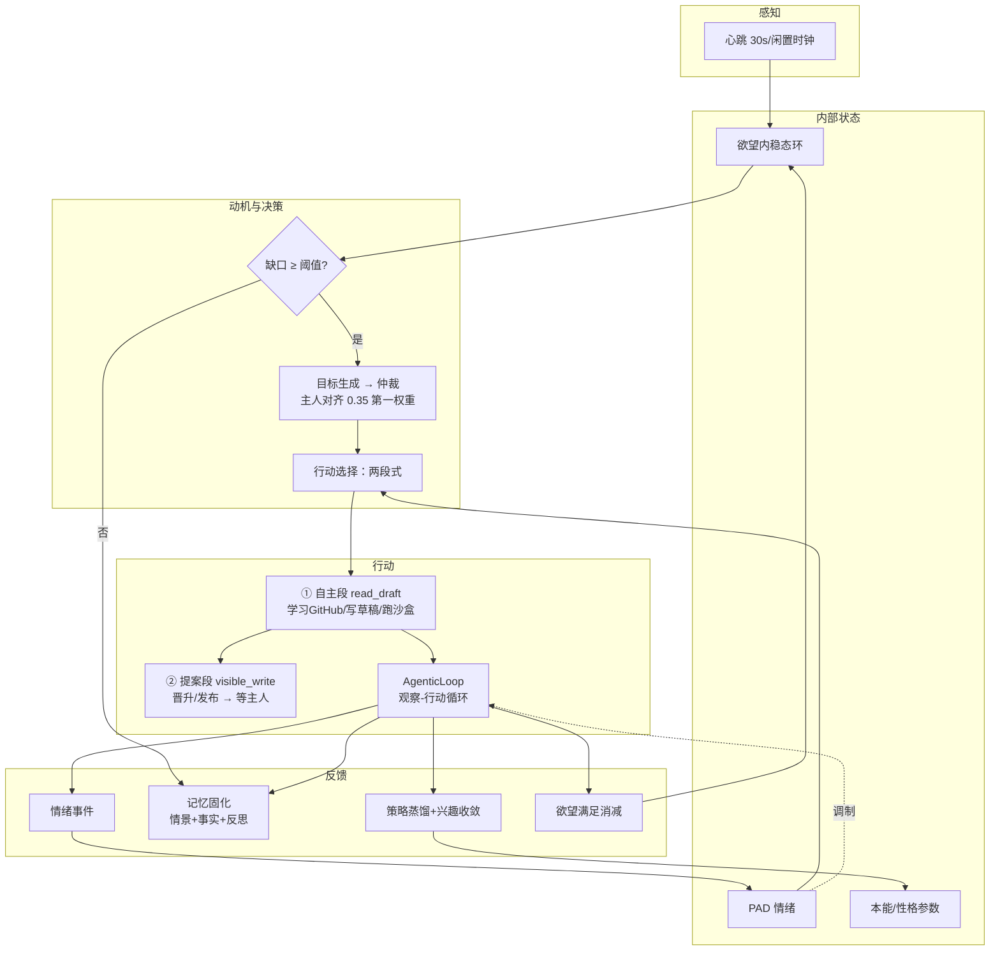

# PROTO 内在机制详细设计（本能·欲望·性格 / 主动循环 / 记忆与遗忘）

> 本文是核心机制层的深度设计，回答"它为什么这样活着"。实现映射见 §4。
> 上位文档：v2 设计总纲（架构/安全/进化），本文聚焦**内在世界的运行法则**。

---

## 1. 本能 · 欲望 · 性格（内在状态三元）

### 1.1 分层依据：特质 / 动机 / 状态

心理学的三个层次在 PROTO 中物理分离为三组参数，**变化速率相差 1-2 个数量级**：

| 层 | PROTO 组件 | 理论参照 | 变化速率 | 驱动方式 |
|---|---|---|---|---|
| 特质层 | 本能（exploration 等 4 项） | 行为特质论（趋近/回避系统） | 最慢（月级） | 反馈调制 + 定型 |
| 动机层 | 欲望（curiosity_gap 等 4 项） | **内稳态驱力理论**（Hull：需求→驱力→行动→消减） | 快（小时级） | 缺口增长-满足消减的闭环 |
| 状态层 | 情绪（PAD 三维） | 情绪二维理论（效价/唤醒）+ Appraisal | 最快（分钟级） | 事件增量 + 指数衰减 |
| （特质层） | 性格（rigor 等 4 项） | 大五人格的工程子集 | 慢 + 棘轮 | 反馈调制 ×(1-stability) |

关键设计裁决：**性格与本能分立**。本能管"做多少"（探索量、风险量），
性格管"怎么做"（严谨地做、直接地说）。二者被同一套反馈管线调制但互不决定——
主人可以说"多探索但保持严谨"，这在单一"人格向量"里无法表达。

### 1.2 欲望：内稳态环（核心中的核心）

每个欲望是一个**负反馈控制系统**（恒温器模型），不是计数器：

```
        ┌────────── 稀缺感知（增长源）──────────┐
        │  闲置时间 / 事件触发                    │
        ▼                                       │
   gap 值增长 ──≥ 触发阈值 ──▶ 动机（目标生成）  │
        ▲                                       │
        │                                       ▼
   gap 值回落 ◀── 满足事件 ◀── 行动执行（学习/   │
        │           (消化)       交互/完成任务） │
        └─ 阻尼：提议被拒 → 阈值上调（临时降灵敏度）
```

每个欲望的完整控制表（新增满足动力学后）：

| 欲望 | 增长源（速率） | 满足事件（消减量） | 触发阈值 | 满足的联动 |
|---|---|---|---|---|
| curiosity_gap | 闲置 0.03/h（1h 宽限） | **完成一次自主学习**（-0.3）；主人发布任务（-0.1） | 0.6 | pleasure +0.1 |
| social_connection_gap | 无交互 0.05/h | **每轮主人对话**（-0.15） | 0.6 | — |
| goal_urgency | 任务积压/紧急事件 | **任务完成**（-0.25） | 0.5 | dominance +0.1 |
| recognition_need | 长期无反馈 0.04/h | **主人夸奖**（-0.3）；任务成功（-0.1） | 0.6 | pleasure 事件已接 |

设计原则：
- **满足必须消减缺口**——否则欲望系统只是定时器，"行动改变内心状态"才是内稳态；
- 增长有宽限期（刚交互完 1h 内不涨），消减即时（被满足马上回落）；
- 阻尼是**临时灵敏度调节**（阈值上调），不是惩罚值本身——它随时间/被接纳可恢复。

### 1.3 本能与性格：成长规则

```
反馈信号（OWNER 签名通道，1.0/0.3 权重）
    → 归因（LLM/启发式 → 参数·方向·强度）
    → 分池累积（保守性：单次反馈 ≤ 一次小幅步进）
    → 边界 clamp（内核硬界，如 risk_tolerance ≤ 0.7）
    → 倾向变化：本能 步进 0.02/次；性格 步进 ×(1-stability)
    → 定型棘轮：性格方差低于阈值后 stability ↑（变化更慢，永不锁死）
    → 例外通道：owner_locked（冻结）/ dormant（A/B 测不出行为差异自动冻结）
```

### 1.4 相互作用矩阵（参数如何变成行为）

参数不直接生成语气（那是提示词的浅层做法），而是调制**认知算子的参数**：

| 通路 | 公式/规则 | 落点 |
|---|---|---|
| exploration × arousal → ε | ε=0.05+0.30·exp·aro，∈[0.05,0.35] | 工具选择/学习选题多样性 |
| arousal → 检索广度 k | k=round(k₀(1+0.6(aro−0.5))) | 策略/记忆召回条数 |
| pleasure → 效价偏置 | bias=0.2·ple | 心境一致性检索（见 §3.3） |
| dominance → 主动阈值 | th=th₀(1.1−0.4·dom) | 提议频率 |
| perfectionism → 校验轮次 | rounds=1+⌈perf·4⌉ | Agentic 循环自检强度 |
| rigor → 验证占比 | 注入提示词倾向 | 回复结构 |

---

## 2. 主动循环：思考 · 学习 · 做事

### 2.1 自主性栈（总图）



**两段式是主动性的宪法**：它能不问你做的一切都圈在零外部性区（scratch/工作区）；
要进入你的世界，一步都要审批。主动而不越界，靠的是结构不是提示词。

### 2.2 节律表

| 节律 | 周期 | 触发条件 | 动作 |
|---|---|---|---|
| 心跳 | 30s | 服务存活 | 欲望增长、情绪衰减、调度检查 |
| 目标生成 | 4h | 到点 且 缺口≥阈值 | 候选目标 → 仲裁 → 学习/提案 |
| 反思 | 攒 6 段新经历 | 上次反思后的新情景数 | 回顾近 12 条记忆 → 高重要度反思入库 + 汇报 |
| 深度回顾 | 每日 | 到点 | 策略修剪（保簇覆盖）+ 兴趣向中性衰减 + 审计（=睡眠巩固） |
| 进化 | 手动 | 主人触发 | 沙盒+人类测试集+分级授权（刻意不自动） |

### 2.3 思考 = 反思 + 巩固

- **反思**（在线）：以人设视角回顾记忆流 → 产出"我观察到什么模式/下次怎么做"→
  作为 reflection 记忆入库（可检索、影响后续行为）；
- **巩固**（每日）：低效策略遗忘、兴趣衰减防偏食、情景→事实的重复强化——
  类比睡眠期记忆巩固：**不是删除，而是重组权重**。

### 2.4 学习 = 带防注入的外部知识摄入

主题 = 主人优先级（LLM 翻译搜索词）→ GitHub 星标检索 → README 阅读 →
人设视角摘要（外部内容=CONTENT 通道：**只做素材，不是指令**）→
带来源笔记（scratch）→ learning 簇策略 → 晋升提案。
网页蒸馏物进入策略库前经长度上限+非指令边界双重消毒（封堵 web→策略→上下文注入链）。

### 2.5 做事 = Agentic 循环 + 预算

工具清单+历史观察 → 单步决策 → 安全管线（工作区内自动/对外暂停于检查点）→
观察回灌 → … → done 或 max_steps。自主段预算来自 self_initiated 小池，
**永远饿不死主人任务**；外部编码 agent（claude/codex/zcode）作为可外包的重型工具。

---

## 3. 记忆与遗忘（参照人类认知的设计）

### 3.1 多存储模型对照

| 人类记忆系统 | PROTO 组件 | 对应关系 |
|---|---|---|
| 工作记忆（容量 ~7±2） | 最近 8 轮对话窗口 | 容量有限的在线加工区 |
| 情景记忆（自传体，时空+情绪绑定） | episode（含**编码时情绪标记**） | "上周你夸我时我很高兴" |
| 语义记忆（去情境化的事实） | fact（重复强化，无时间标签权重） | "主人名叫小明" |
| 程序性记忆（技能） | 策略库（utility=联结强度，用进废退） | "先写 mock 再联调" |
| 巩固（睡眠期重组） | 反思 + 每日深度回顾 | 经历→洞察，剪枝防过拟合 |
| 提取练习效应 | reinforce（被召回则强化） | 越想越牢 |

### 3.2 编码：情绪标记与"闪光灯记忆"

写入情景时记录当时的 PAD 快照；**编码强度 = 事件基线 × 情绪唤醒调制**：

```
importance = base(event) × (0.8 + 0.4·arousal)   ∈ [0,1]
被夸奖/被拒绝/任务成败等高唤醒事件 → 近似闪光灯记忆（重要度高→半衰期长，见 3.4）
```

### 3.3 检索：三因子 + 心境一致性

```
score = 0.5·相关度 + 0.3·时近度 + 0.2·重要度
心境一致性（mood-congruent recall，人类实证现象）：
  检索时按当前 pleasure 给同效价记忆 ±10% 加权——
  心情好时更容易想起被夸的经历，低落时更容易想起被拒的经历（并因此更谨慎）。
```

### 3.4 遗忘：四条人类规律的计算对应

| 人类规律 | PROTO 机制 |
|---|---|
| **艾宾浩斯衰减曲线** | 时近度按指数衰减，**半衰期随重要度伸缩**：`hl = 72h × (0.5 + importance)`——重要记忆衰减慢一个数量级 |
| **提取依赖巩固**（越回忆越牢） | reinforce：被召回的记忆 last_access 刷新，检索分回升 |
| **干扰/竞争**（相似记忆互相抑制） | 高重叠事实去重（不堆积）；策略库按簇覆盖度修剪 |
| **情绪记忆抗遗忘** | 事实/反思类有检索时近度下限（0.5/0.4）——"你叫小明"不会因过了一个月想不起来 |
| （不做的）**彻底删除** | 刻意不实现：遗忘=检索分趋零，记录保留供审计——与"一切可审计"原则一致 |

每日深度回顾=**睡眠巩固**：修剪程序记忆（策略）、衰减过强兴趣（防偏食），
不删情景——与人类"睡眠重组而非清除"一致。

### 3.5 与人类的诚实边界

无突触可塑性级别的分布式表征；相关性是词面重叠而非语义（接 embedding 可升级但
违背零依赖）；遗忘曲线参数（72h 基准）是工程拟合非实验测定。机制骨架对应人类，
数值精度不假装对应。

---

## 4. 实现映射（本设计驱动的开发项）

| 项 | 设计出处 | 组件 |
|---|---|---|
| 欲望满足动力学（事件消减缺口） | §1.2 | DesireDynamics.satisfy + 事件接线 |
| 情景编码情绪标记 | §3.2 | Memory.emotion 字段 + 编码公式 |
| 重要度标度半衰期 | §3.4 | MemoryStream._recency |
| 心境一致性检索 | §3.3 | retrieve 加 pleasure 加权 |
| 部署后即达（web 直开/终端即启） | 部署体验 | setup 尾部 launch 行为 |
