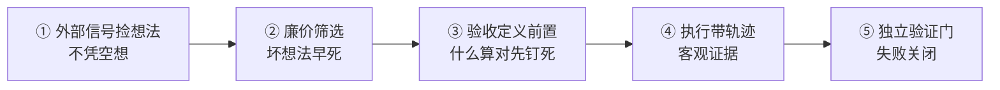

# 想法生成与目标质量保障（M33）

> **历史专项设计。** 当前五层流水线和 LLM 验收边界统一见 [总设计第 9 节](../DESIGN.md#quality)；下文研究数字不是本项目实测质量保证，不据此推断当前实现已具备所有目标能力。

> 回答一个核心问题：**好想法和高质量完成，靠什么机制保证？**
> PROTO 的答案是一套五层流水线——从想法的诞生到最终验收，每层都有明确的淘汰机制。

## 核心原则

**想法的好坏不由产生它的 Agent 自己判断**（提出者≠评判者），质量不靠"更聪明"，靠**漏斗式的淘汰**：坏想法死得早、死得便宜；好想法过五关才被承认完成。

## 五层流水线



### 第 1 层：外部信号驱动想法（不从零想）

好想法不是"想"出来的，是从**可观测的外部数据**中"捡"的。PROTO 的三个想法来源全是外部信号：

| 来源 | 机制 | 淘汰什么 |
|---|---|---|
| **预测误差** | 世界模型到期复核，预测落空→自动生成"调查"目标 | 平庸的"随便学学"——只有异常才值得追 |
| **目标分解** | 长期愿景→LLM 分解→中期目标（附最小可检验定义） | 空泛愿景不落到可验证的子目标 |
| **晨间趋势扫描** | 每日 GitHub trending 对齐主人优先级 | 与主人所关心无关的热点 |

淘汰发生在源头：**没有异常、没有对齐、没有可验证定义的想法根本不产生。**

### 第 2 层：目标选优（廉价筛选）

目标树选优 = `0.4×主人对齐(沿父链继承) + 0.4×深度 + 0.2×进度`。
不排队、不投票——评分淘汰，同一时刻只有一个目标被执行。
**坏想法在这一步的成本是零**（一次内存计算）。

### 第 3 层：验收定义前置（什么算"对"在执行前钉死）

执行前必须生成**最小可检验定义**（`generate_acceptance`）：
- 什么场景、做什么操作、观察到什么结果才算做对
- 写不出定义的任务：验证门视为"不适用"并显式标注**未验证**——绝不冒充通过
- 验收定义一经生成不可被 Agent 自己修改（防"灵活调整标准"）

### 第 4 层：执行轨迹（客观证据，不是自述）

Agentic 循环每步记录 `{tool, args, category, result}` 结构化轨迹；
产物原文（write_file 内容）作为外部证据。Agent 的"我觉得搞定了"是叙述——**轨迹才是证据**。

### 第 5 层：独立失败关闭验证门

| 设计约束 | 实现 |
|---|---|
| 验证器看不到执行者的叙事 | 输入=验收定义+轨迹+产物原文，**绝不含执行 summary** |
| 干净上下文 | 全新 LLM 调用，零共享历史 |
| 失败关闭 | 证据不齐默认 fail；解析失败即 fail |
| 补证据不改标准 | fail→带"缺少什么"反馈重试一轮→仍 fail 则目标不完成 |
| 状态分离 | `completed`（自称做完）≠ `verified`（验证通过）；里程碑只在 verified 时触发 |

## 研究对齐

| 机制 | 出处 |
|---|---|
| 验证器看原始请求 vs 执行者自述 | 错误接受率 18-22% → 2%（多 Agent 验证研究） |
| 自主循环自评不可靠 | 56% 声称改进的周期实测为零或负（预注册研究） |
| 想法漏斗 | ScholarLoop：N 个想法→冒烟测试→幸存者进入全量验证 |
| 失败蒸馏 | Reflexion：失败变成下轮的注入条件 |
| 新颖性去重 | 已研读仓库 30 天内不重复——避免原地打转 |

## 端到端示例

```
预测"库月增千星" → 到期复核发现星标未涨（第1层：异常）
→ 生成"调查为何落空"目标（第2层：对齐主人优先级，入树）
→ 验收定义 = "找到 3 个可验证的原因，附来源链接"（第3层）
→ 执行：GitHub 检索 + README 阅读 + 笔记，全程轨迹（第4层）
→ 独立验证：3 个原因各自有来源链接？有→verified，目标完成
  缺一个→fail + 反馈"缺少第 3 个原因的证据" → 重试补齐
```
